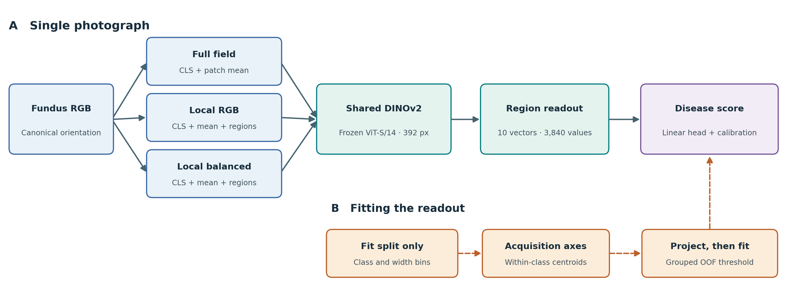
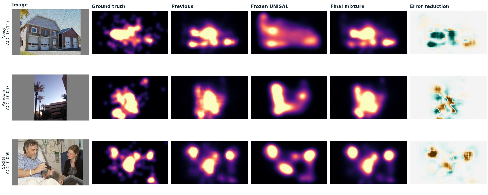
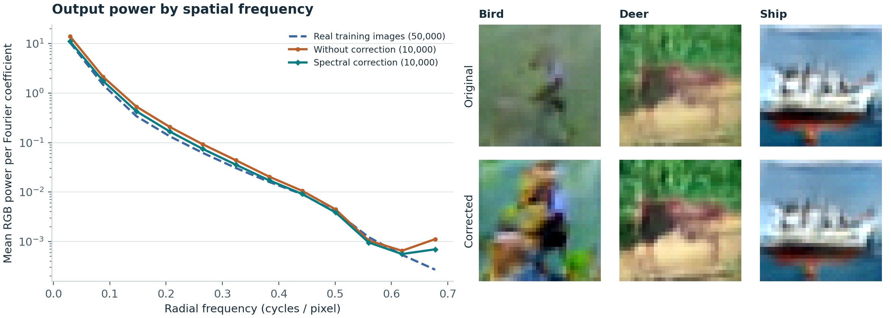

# 实验 2–4 的创新模块、论文来源与消融结果

| 任务与测试规模 | 上一轮 → 本轮选定模型 | 变化体现在哪里 |
|---|---|---|
| 眼底二分类，250 张图 | AUROC 0.8528 → **0.9296**，准确率 72.4% → **86.4%** | 两个模型都检出 92/100 张患病图，150 张正常图中的误报从 61 张降到 **26 张** |
| 人眼注视密度，400 张原图 | 相关系数 CC 0.8910 → **0.9021**，KL 散度 0.2641 → **0.2455**，密度重叠度 SIM 0.7504 → **0.7606** | 280 张图的 CC 提高，20 个场景类别的平均 CC 均提高 |
| CIFAR-10 条件生成，10,000 张生成图对 10,000 张真实图 | FID 62.06 → **48.40**，每图网络分支求值 24 次 → **8 次** | 四步即可生成一张图，换一批独立噪声复测，FID 为 **48.51** |

各轮沿用课程划分，早期测试中观察到的错误用于提出后续问题。下文用同一轮、固定其他设置的消融判断模块贡献。论文日期均为 arXiv 首稿日期，正式发表的会议或期刊另列。

## 实验二　怎样减少正常眼底图的误报？

仅凭原图宽高就能得到 0.9664 的测试 AUROC，说明图像尺寸与疾病标签高度相关。模型因此需要回答两个问题：亮区周围的局部外观有多少判别力？其中又有多少信息随采集条件而改变？

| 模块与来源 | 本实验的做法与选择依据 |
|---|---|
| 冻结 DINOv2 与寄存器 token。DINOv2，2023-04-14，TMLR 2024。*Vision Transformers Need Registers*，2023-09-28，ICLR 2024。[DINOv2](https://arxiv.org/abs/2304.07193) · [Registers](https://arxiv.org/abs/2309.16588) | 1,393 张拟合图只有整图标签，因此共享冻结编码器，训练轻量分类头。**亮区定位、三视图和中心／环带池化**由本实验设计。固定其他设置，在三视图上分别读取亮区中心与外围，AUROC 从 0.9219 升到 **0.9296**。亮区来自像素亮度估计，数据中没有病灶边界标注。 |
| 类别内子空间投影。George 等，*From Measurement to Mitigation*，2026-04-07，CVPR 2026。[论文](https://arxiv.org/abs/2604.05296) | 原文用线性投影移除身份信息。这里将图像分为患病和正常两类，分别估计特征随图宽变化的方向，再从分类输入中投影掉这些方向。固定区域特征、岭系数和样本权重后，开启投影使 AUROC 从 **0.8591 升至 0.9296**。按图宽留组验证和同宽度段内比较均在训练侧完成，新图预测只需要 RGB。 |

两项备选解释了最终取舍。同样使用三视图和投影，眼底预训练的 RETFound-Green 得到 0.8801 AUROC，低于通用 DINOv2。借鉴 DINOv3 加入局部 patch 的 Gram 关系后，训练侧选型分也从 0.9036 降至 0.8835。最终保留区域外观和位置。RETFound-Green 首稿为 2024-04-30，期刊版于 2025-07-25 上线；DINOv3 首稿为 2025-08-13。[RETFound-Green](https://www.nature.com/articles/s41467-025-62123-z) · [DINOv3](https://arxiv.org/abs/2508.10104) · [逐项消融](../experiment2/outputs/spatial/matched_controls.csv) · [实验二报告](../experiment2/report.md)

## 实验三　看全场景和找准小目标，能否兼得？

即使给每张图都预测同一幅平均注视图，CC 也有 0.7834。要超过这个中心偏好基线，模型必须找出哪些画面内容会让人移开目光。单一尺度下，相邻的小目标容易合成一个热点。

| 模块与来源 | 本实验的做法与选择依据 |
|---|---|
| 多尺度密度建模。Kümmerer 等，*Modeling Saliency Dataset Bias*，2025-05-15，ICCV 2025。[论文](https://arxiv.org/abs/2505.10169) | 让同一 DINOv2 分别读取宽 224、448、672 像素的场景，再对齐特征网格。这样既能保留场景布局，也能区分距离很近的注视点。固定读出结构后，单尺度换成三尺度使 CC 从 **0.8937 升至 0.8989**。 |
| 双编码器与局部重采样。Bolya 等，*Perception Encoder*，2025-04-17，NeurIPS 2025。Wimmer 等，*AnyUp*，2025-10-14，ICLR 2026。[PE](https://arxiv.org/abs/2504.13181) · [AnyUp](https://arxiv.org/abs/2510.12764) | 实际加载 PE-Spatial 的官方权重，用其中间层补充 DINO 的中、细尺度特征。另借鉴 AnyUp，让浅层纹理决定如何在 3×3 邻域重新分配语义特征。纯三尺度分支单加重采样，CC 从 0.8989 升至 **0.9005**。纯三尺度与含 PE、重采样和扩散的分支等权融合，CC 为 **0.90206**。 |
| 外部模型融合。Droste 等，*Unified Image and Video Saliency Modeling*，2020-03-11，ECCV 2020。[UNISAL](https://arxiv.org/abs/2003.05477) | 在同一批图上复跑公开权重，再按验证 CC 选定 **45% 三尺度 DINO + 45% 双编码器 + 10% UNISAL**。加入 UNISAL 只将测试 CC 从 0.90206 推到 **0.90210**，配对区间跨零。仅用前两支时，KL 为 0.24435、SIM 为 0.76352，两项均优于最终混合。 |

从第二轮到最终模型，平均 CC 增加 0.01109，按同图配对估计的 95% 区间为 0.00895～0.01325。三个尺度和互补编码器已获得几乎全部提升，单看最终混合权重会高估外部模型的作用。[逐图指标](../experiment3/outputs/multiscale/native_images.csv) · [配对区间](../experiment3/outputs/multiscale/paired_intervals.csv) · [实验三报告](../experiment3/report.md)

## 实验四　怎样用四步生成类别清楚、纹理自然的图？

旧模型生成的鸟、马、狗经常难以辨认。实验依次检验训练目标能否强化类别信息、采样器能否利用已算过的速度，以及频谱校正能否改善生成图的纹理分布。FID 越低，表示生成图与真实图的 Inception 特征分布越接近。

| 模块与来源 | 本实验的做法与选择依据 |
|---|---|
| 训练时学习类别引导。Tang 等，*Diffusion Models without Classifier-free Guidance*，2025-02-17，微软研究院列为 NeurIPS 2026。[论文](https://arxiv.org/abs/2502.12154) · [微软研究院](https://www.microsoft.com/en-us/research/publication/diffusion-models-without-classifier-free-guidance/) | 教师网络对同一幅含噪图分别预测有类别、空类别的速度，把两者的差加入训练目标。固定八步、仅用条件分支时，普通续训与新目标的类别一致率分别为 **34.94% 和 69.28%**，FID 分别为 **61.71 和 49.81**。 |
| 历史速度外推。Liao 等，*Momentum Guidance*，2026-02-23，ECCV 2026。[论文](https://arxiv.org/abs/2602.20360) | 在四步时间网格上，用当前速度相对历史均值的变化修正前进方向。固定权重、引导强度和一万组噪声，开启外推使 FID 从 **78.25 降至 50.55**。两组都是四步，每步分别计算有类别、空类别速度，共八次分支求值。 |
| 径向频谱校正。Kim 与 Kim，*Correcting Guided Diffusion Trajectories with Spectral Alignment*，2026-10-02，arXiv 预印本。[论文](https://arxiv.org/abs/2610.02753) | 用五万张训练图估计 12 个频带的参考功率，每步调整振幅并保留相位。固定四步模型后，两批独立噪声上的 FID 分别从 **50.55 降至 48.40**、从 **50.21 降至 48.51**。换用 2,000 张 CIFAR-10.1 v6 真实图作参照，KID × 1,000 也从 **19.09 降至 17.35**。 |

少步蒸馏给出了另一种结果。在冻结的旧模型上，借鉴 S4S（2025-02-24，ICML 2025）和 GAS（2025-10-20，ICLR 2026）学习更新系数，以十二步欧拉为教师，四步学生的 FID 从 76.79 降到 65.17。另一组借鉴 SpanLift（2026-06-07）的空间残差能更准确地复现长轨迹教师的端点，FID 却从 84.25 升到 89.82。这解释了为什么最终四步方案按真实图像分布质量选型。[S4S](https://arxiv.org/abs/2502.17423) · [GAS](https://arxiv.org/abs/2510.17699) · [SpanLift](https://arxiv.org/abs/2606.08672) · [独立噪声复测](../experiment4/outputs/spectral_guidance/repeat/metrics.csv) · [实验四报告](../experiment4/report.md)

历轮基线、全部备选模块与训练设置可在[完整论文出处表](../method-origins.md)中查阅。三项实验的逐指标数值汇总在[复核数据表](../frontier-results.csv)。
