# 小幅几何增强能否改进已经达到 99.5% 的手写数字分类器？

**机器学习基础 · 实验一 | SY2631122 徐基恒**

**摘要** 原卷积网络在 10,000 张课程测试图像上只错了 50 张（种子 42），但对数字位置的变化仍然敏感。本实验固定网络结构和数据划分，比较了三种做法，分别是训练时对数字做小幅旋转、缩放和平移，对训练权重取指数移动平均（EMA），以及在推理时融合平移图像的预测。验证集选中了单独使用仿射增强的方案，每张图仍只需一次前向计算。三个种子的平均测试准确率从 99.52% 升至 99.60%。将验证图平移 3 像素后，种子 42 的原模型准确率为 92.20%，增强模型为 98.87%。

**关键词** 手写数字识别；卷积神经网络；仿射增强；位置鲁棒性；配对消融

## 1 问题描述

### 1.1 任务与数据

课程数据中的每张 BMP 图像都已裁成单个黑底白字的数字。给定图像 $x\in[0,255]^{28\times28}$，分类器输出十个得分 $f_\theta(x)\in\mathbb R^{10}$，得分最高的类别即预测值 $\hat y$。标签取自文件名开头，例如 `TrainingSet/3_24.bmp` 的标签为 3。讲义以 MNIST 为例介绍任务，本文的训练和评测使用教师提供的 ZIP 数据包。 [作业说明](../../Machine-Learning-Class-Assignment26/README.md) · [课程讲义](2025机器学习课实验1.pdf) · [数据来源](https://bhpan.buaa.edu.cn/link/AAB14093C4DF1F4085922390C07C87498F)

| 表 1 划分 | 张数 | 在实验中的用途 |
|---|---:|---|
| 教师训练集 | 60,000 | 划分为拟合集和验证集，训练结束后再计算完整训练集的准确率 |
| 拟合集 fit | 54,000 | 用 sklearn 按类别分层抽取，划分种子为 42。用于更新权重、估计像素均值和标准差 |
| 验证集 val | 6,000 | 选择训练轮次、训练方案和推理方式，也用于测量平移后的准确率 |
| 教师测试集 | 10,000 | 用选好的权重逐图预测，统计准确率并分析错例 |

先将像素值除以 255，再用拟合集的均值 0.130648 和标准差 0.308090 做标准化。此时黑色背景对应的数值约为 −0.424，图像变换后空出的位置也填这个值。按像素计算 SHA-256 后，拟合集和验证集之间、完整训练集和测试集之间均未发现完全相同的图像。数据中没有书写者编号，同一人是否出现在不同划分中仍未知。 [数据清单、类别数与压缩包校验值](outputs/main/data_manifest.json)

训练和验证都调用 `tensor_images`。一个由 128 张灰度图组成的批次，读入时形状为 `[128,28,28]`。`unsqueeze(1)` 在第二个位置补上单通道维度，卷积层因而能区分批次、通道和两个空间维度。像素为 0 与 255 的两端，经过这段代码后分别约为 −0.424 和 2.822。后面的仿射增强要用到前一个数。 [输入张量转换](run_experiment.py)

~~~python
def tensor_images(x, manifest, device):
    t = torch.from_numpy(x.astype(np.float32)).unsqueeze(1).to(device) / 255.0
    return (t - manifest["mean"]) / manifest["std"]
~~~

*图 1 每列展示同一数字的两种写法。即使都裁成 28×28 像素，笔画的长短、弯曲程度和倾角仍有差别。*

*图 2 拟合集中，数字 1 有 6,068 张，数字 5 有 4,879 张，前者约为后者的 1.24 倍。表 8 分别列出十个数字的召回率，并给出各类等权的宏平均 F1。*

### 1.2 指标与实验问题

课程以分类准确率 $\mathrm{Acc}=N^{-1}\sum_i\mathbf1[\hat y_i=y_i]$ 为主指标。Top-2 准确率也计入真类排在第二位的图像。对数字 $k$，精确率 $P_k=TP_k/(TP_k+FP_k)$ 是预测为该数字的样本中判对的比例，召回率 $R_k=TP_k/(TP_k+FN_k)$ 是该数字的样本中被认出的比例。两者的调和平均为 $F1_k=2P_kR_k/(P_k+R_k)$，再对十个类别等权平均即得宏 F1。混淆矩阵 $C_{ij}$ 统计真值 $i$ 被判为 $j$ 的张数。负对数似然 $\mathrm{NLL}=-N^{-1}\sum_i\log p_i(y_i)$ 则衡量模型给真类的概率，值越小越好。 [指标实现](src/evaluation.py) · [指标定义](https://scikit-learn.org/stable/modules/model_evaluation.html#classification-metrics)

固定数据划分和训练种子 42 时，多层感知机（MLP）在测试集上错了 153 张，卷积神经网络（CNN）错了 50 张，准确率分别为 98.47% 和 99.50%。两者的参数量和训练轮数也有差别。后续对照固定 CNN 的结构和训练轮数，以便单独考察每项改动。

实验先比较训练时使用原图和随机仿射图的结果，再从同一次训练中分别取当前权重和 EMA 权重做预测。除了比较原图准确率，还把同一批验证图向四个方向平移，观察数字偏离原位置后，两种训练方式的差距会怎样变化。最后比较只看原图与融合多个平移视图的预测。

## 2 模型原理与方法来源

### 2.1 从像素到数字

MLP 将图像展平成 784 个像素，每个位置都有各自的全连接权重。CNN 用同一个卷积核在图像各处寻找局部笔画，ReLU 保留正响应，最大池化逐步缩小特征图。展平后，各位置仍分别连接到分类头。因此，同一笔画挪到另一处，即使卷积核仍有响应，最终的类别得分也可能改变。所有模型都从随机权重开始训练，目标函数均为交叉熵。设 $z=f_\theta(x)$，类别概率为 $p_k=\exp z_k/\sum_j\exp z_j$，单张图像的损失为 $-z_y+\log\sum_j\exp z_j$。训练代码把原始得分（logits）直接传给 `cross_entropy`，导出预测概率时才计算 softmax。

~~~text
教师 BMP ── 标签/尺寸校验 ── 用 fit 统计量标准化 ── [B,1,28,28]
                                   │
               训练：原图或逐图随机仿射；验证与正式预测：原图
                                   ↓
            两层卷积 + 池化 [B,32,14,14] → 两层卷积 + 池化 [B,64,7,7]
                                   ↓
                    展平 3136 → 全连接 128 → 十类 logits
                                   ↓
          训练：交叉熵 → Adam → 可选 EMA 副本，逐轮验证保存最佳权重
          推理：固定权重 → 可选平移 logits 融合 → 预测/混淆矩阵/同图比较
~~~

*图 3 随机增强改变训练图像，EMA 在每次参数更新后取平均，多视图融合则在预测时合并类别得分。最终模型只采用了训练增强。*

### 2.2 从顶会思路到可检验的改动

| 表 2 借鉴的论文思路 | 本实验的改动 | 对照方法 |
|---|---|---|
| Cubuk 等的 AutoAugment（CVPR 2019）从数据中搜索增强策略。Shen 等（ICML 2022）分析数据增强怎样改变模型对不同特征的利用 | 针对数字字形手工限定旋转、平移和缩放幅度。数字每次参加训练时都重新采样，避开可能改变数字含义的翻转和大角度旋转 | 固定初始化、批次顺序、训练轮数和网络结构，分别用原图和增强图训练，再将验证图平移 0～3 像素 |
| Ajroldi 等（ICML 2025）比较训练过程中多种权重平均方法的泛化效果与成本 | 在 Adam 的每次更新后计算 $\bar\theta_t=0.995\bar\theta_{t-1}+0.005\theta_t$。EMA 副本从模型初始权重起步 | 从同一次训练中保留当前权重和 EMA 权重，分别按同一验证标准选择最佳轮次 |
| Rahman 等（CVPR 2026）通过软等变层调节网络对变换的敏感程度 | 借用“对位移保留多少敏感性”这个问题，在输出端融合原图和四张平移图的得分。令 $T_j$ 表示四个方向的整数平移，融合得分为 $(1-\lambda)z(x)+\lambda\sum_j z(T_jx)/4$ | 在验证集上改变平移半径和融合比例，测量黑色补边下各组视图的预测效果。论文的理论保证针对其投影层 |

这四项研究发表于 CCF 人工智能类 A 类会议 CVPR 和 ICML。本实验根据数字的写法手工选定增强幅度（图 4），再把两个模型的预测按图配对，检查哪些数字改判，以及平移后准确率下降了多少（图 7、图 8）。 [CCF 目录](https://www.ccf.org.cn/Academic_Evaluation/AI/) · [AutoAugment](https://openaccess.thecvf.com/content_CVPR_2019/html/Cubuk_AutoAugment_Learning_Augmentation_Strategies_From_Data_CVPR_2019_paper.html) · [增强与特征](https://proceedings.mlr.press/v162/shen22a.html) · [ICML 2025 权重平均](https://proceedings.mlr.press/v267/ajroldi25a.html) · [CVPR 2026 软等变性](https://openaccess.thecvf.com/content/CVPR2026/papers/Rahman_Tunable_Soft_Equivariance_with_Guarantees_CVPR_2026_paper.pdf)

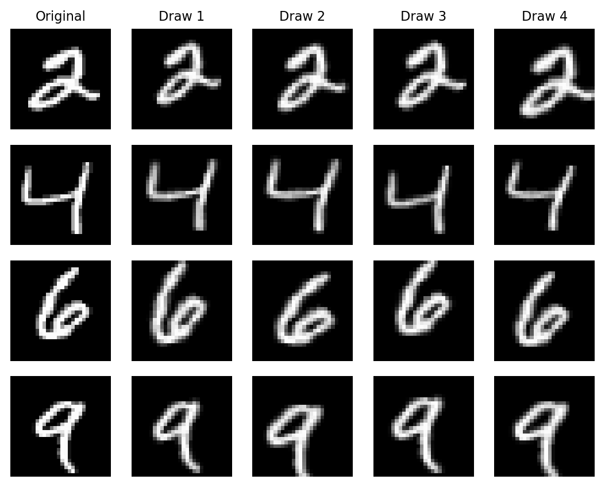

*图 4 每行左侧是拟合集原图，右侧是对同一张图独立做四次增强的结果。对比 2、4、6、9 可以看到，数字的位置和倾角有所改变，主要笔形仍然可辨。*

图中同一行的四张变形图来自 `affine_batch`。传入一批图像后，函数会为每张图生成自己的采样网格。 [训练时的仿射变换](train_ablation.py)

~~~python
def affine_batch(x, generator, black):
    """逐图在原图坐标系抽取采样网格，越界位置填黑色。"""
    n, _, h, w = x.shape
    r = 2 * torch.rand((n, 4), generator=generator, device=x.device) - 1
    angle = r[:, 0] * math.radians(12)
    scale = 1 + 0.1 * r[:, 1]
    c, s = scale * angle.cos(), scale * angle.sin()
    theta = torch.stack((c, -s, 4 * r[:, 2] / w, s, c, 4 * r[:, 3] / h), 1)
    return sample_affine(x, theta.reshape(n, 2, 3), black)
~~~

训练增强和固定扰动验证都调用 `sample_affine`，越过边界的像素按相同规则填黑。 [仿射采样实现](src/views.py)

~~~python
def sample_affine(x, theta, black):
    grid = F.affine_grid(theta, x.shape, align_corners=False)
    return F.grid_sample(x - black, grid, align_corners=False) + black
~~~

`r` 的每一行对应一张图，四列分别控制角度、缩放、水平和竖直平移。每张图对应一个 2×3 的 `theta` 矩阵，前两列控制旋转和缩放，最后一列控制采样网格的偏移。在 `align_corners=False` 的坐标系中，一个像素的水平间距是 `2/w`，所以 `4 * r[:, 2] / w` 对应最多两个像素的水平采样偏移。函数为每个输出位置查找原图坐标，在相邻像素之间作双线性插值。

最后一行先减去 `black`，原图黑色像素就变成了 0，恰好与 `grid_sample` 默认的图外填充值一致。插值结束后加回 `black`，新露出的区域仍与原背景同色。若直接在标准化图像上补 0，那些区域会呈现拟合集的平均灰度，在画布边缘留下原图没有的亮边。

## 3 实验结构与训练设置

### 3.1 网络结构和计算量

| 表 3 CNN 层，单张输入 | 输出尺寸（C×H×W 或向量） | 可训练参数（含偏置） | FLOPs |
|---|---:|---:|---:|
| Conv1，3×3，1→32；ReLU | 32×28×28 | 320 | 451,584 |
| Conv2，3×3，32→32；ReLU | 32×28×28 | 9,248 | 14,450,688 |
| MaxPool 2×2，步长 2 | 32×14×14 | 0 | — |
| Conv3，3×3，32→64；ReLU | 64×14×14 | 18,496 | 7,225,344 |
| Conv4，3×3，64→64；ReLU | 64×14×14 | 36,928 | 14,450,688 |
| MaxPool 2×2；Flatten | 64×7×7 → 3,136 | 0 | — |
| Linear；ReLU；Dropout(0.5) | 128 | 401,536 | 802,816 |
| Linear | 10 | 1,290 | 2,560 |
| **合计** | **10** | **467,818** | **37,383,680** |

每个卷积层的步长为 1（stride=1），填充宽度为 1（padding=1）。表 3 只统计卷积和全连接层，一次乘加（MAC）计两次浮点运算，`—` 表示该层不计入 FLOPs。一次前向计算共需 18,691,840 次乘加。参数最集中的地方是展平后的第一层全连接，占总数约 86%。作为对照，MLP 的层宽为 784→256→128→10，两个隐藏层各接 ReLU 和丢弃率为 0.2 的 dropout，共有 235,146 个参数。 [网络定义](src/models.py)

`build_model` 的 CNN 分支按前向传播顺序列出所有层。`channels`、`height` 和 `width` 取自输入形状，`num_classes` 在数字任务中为 10。 [CNN 分支](src/models.py)

~~~python
return nn.Sequential(
    nn.Conv2d(channels, 32, 3, padding=1), nn.ReLU(),
    nn.Conv2d(32, 32, 3, padding=1), nn.ReLU(), nn.MaxPool2d(2),
    nn.Conv2d(32, 64, 3, padding=1), nn.ReLU(),
    nn.Conv2d(64, 64, 3, padding=1), nn.ReLU(), nn.MaxPool2d(2),
    nn.Flatten(), nn.Linear(64 * (height // 4) * (width // 4), 128), nn.ReLU(), nn.Dropout(0.5),
    nn.Linear(128, num_classes),
)
~~~

例如，第一层只需保存 `32 × (1 × 3 × 3 + 1) = 320` 个参数，便能在整幅图上寻找 32 种局部模式，括号里的 1 是每个卷积核的偏置。两次池化把边长从 28 减到 14，再减到 7，最后还剩 `64 × 7 × 7 = 3,136` 个特征。把它们连到 128 个隐藏单元要用 `3,136 × 128 + 128 = 401,536` 个参数，正好对应表 3 中占比最大的一层。最后的 `Linear` 为每个数字输出一个得分。四组消融共用这段代码，因此表 5 的差别可以沿着训练输入和权重更新去找。

### 3.2 哪些设置固定，哪些由验证集决定

| 表 4 设置 | 数值或规则 |
|---|---|
| 优化与目标 | Adam（学习率 0.001，weight_decay=$10^{-4}$，PyTorch 默认 betas 0.9/0.999），十类交叉熵 |
| 学习率与训练轮数 | CosineAnnealingLR，每轮结束后调整学习率，终点为 $10^{-5}$。MLP 训练 15 轮，CNN 训练 20 轮。批量大小为 128，每轮更新 422 次 |
| 随机种子 | 数据划分固定用 42。CNN 初始化、批次打乱和 dropout 分别随训练种子 42、43、44 改变。增强另用 seed+10000，使同一种子的两次训练具有相同的批次顺序 |
| 仿射增强 | 每张图独立均匀采样。旋转范围为 ±12°，采样网格的缩放系数为 0.90～1.10，水平和竖直平移各在 ±2 像素内。采用双线性插值，越界处填黑。网格从输出位置映射到输入位置，因此图像的缩放倍数是网格系数的倒数 |
| EMA | 衰减率固定为 0.995，对应的有效窗口约为 $1/(1-0.995)=200$ 步。EMA 权重单独保存，梯度更新仍使用当前权重 |
| 模型选择 | 对每个种子的每组权重，先取验证准确率最高的轮次，同分时取验证损失较低者。再按三个种子的平均验证准确率选择方案，同分时取平均 NLL 较低者 |
| 推理选择 | 固定选好的训练方案，比较原图和六种融合设置（平移半径 1 或 2 像素，四邻域总权重 0.5、0.8 或 1.0）。作图和单图演示预先选定列表中的第一个种子 42 |
| 环境与耗时 | Python 3.11.18，PyTorch 2.6.0+cu124，RTX 3070 Ti Laptop GPU，启用确定性算法。三个种子分别计时，用原图训练每次耗时 39.3～40.7 秒，增强训练用时 41.4～44.4 秒。原实验计时包含两组权重在原图上的验证。第 4.2 节新增的逐轮扰动验证另计 |

每个种子训练两次，一次用原图，一次用增强图。每次分别保存当前权重和 EMA 权重，三个种子共得到 6 条训练轨迹和 12 份用于评估的权重。两组共用学习率和训练轮数，增强幅度和 EMA 衰减率均取表 4 的固定值。设计消融实验时，原 CNN 的课程测试成绩已经知道。本轮训练方案先由验证集选定，再在测试集上分析错例。多视图实验在这之后提出，七种推理设置都在验证集上比较。 [训练配置](outputs/ablation/config.json) · [第一阶段选择](outputs/ablation/selection.json) · [第二阶段选择](outputs/ablation/views/selection.json)

### 3.3 一个批次怎样训练，哪一轮权重会留下

`train_pair` 用 `plain` 表示原图训练，用 `affine` 表示训练时开启随机仿射变换。下面摘的是一个批次内真正发生更新的几行。`xb` 和 `yb` 分别是一批图像及其标签，`live_params` 属于正在训练的 CNN，`ema_params` 属于从同一初值复制出来的模型。 [训练循环与权重保存](train_ablation.py)

~~~python
xb, yb = x[ids], y[ids]
if augmented:
    xb = affine_batch(xb, rng, black)
optimizer.zero_grad(set_to_none=True)
logits = model(xb)
loss = F.cross_entropy(logits, yb)
loss.backward()
optimizer.step()
with torch.no_grad():
    torch._foreach_lerp_(ema_params, live_params, 1 - args.decay)
~~~

只有 `xb` 经过变换，手写数字的标签 `yb` 沿用原值。`zero_grad` 清掉上一批留下的梯度，`backward` 根据这一批的交叉熵求梯度，Adam 随后更新 CNN。最后一行才更新 EMA。衰减率取 0.995 时，每个参数保留副本旧值的 99.5%，加入刚更新的参数值的 0.5%。这个副本不参与反向传播。每轮让两组权重预测同一批验证图，就能直接比较平滑前后的效果。

每轮结束时，`validate` 在原始验证图上分别计算两个模型的准确率和损失。程序用 `(acc, -loss) > best[name]` 决定是否覆盖该分支的权重文件。以种子 42 的 `affine` 为例，第 13 轮认对 5,966/6,000 张，第 17 轮认对 5,965 张。虽然后者的验证损失从 0.02378 降到了 0.02298，按准确率优先的规则仍保留第 13 轮。两轮对应的准确率在终端分别显示为 99.4333% 和 99.4167%，差距就是一张验证图。 [种子 42 的逐轮记录](outputs/ablation/seed42/affine_history.csv)

选定各自的轮次后，程序再比较四种训练方案。这里读的是每份权重随训练保存的验证指标。 [跨种子选模代码](train_ablation.py)

~~~python
scores = {}
for name in ["plain", "plain_ema", "affine", "affine_ema"]:
    ckpts = [torch.load(args.output / f"seed{s}/{name}.pt", map_location="cpu", weights_only=True)
             for s in args.seeds]
    scores[name] = dict(accuracy=float(np.mean([c["validation_accuracy"] for c in ckpts])),
                        loss=float(np.mean([c["validation_loss"] for c in ckpts])))
winner = max(scores, key=lambda n: (scores[n]["accuracy"], -scores[n]["loss"]))
~~~

`scores` 中的每个准确率都是三个种子的平均值。`max` 先看准确率，只有同分才比较负损失。`plain` 和 `plain_ema` 恰好同分，平均验证 NLL 分别为 0.03479 和 0.03319，EMA 在这一对中排在前面。四组一起比较时，`affine` 的平均验证准确率最高。表 5 的测试成绩使用各自保存的那一轮权重计算。 [四组验证得分](outputs/ablation/selection.json)

## 4 结果与分析

### 4.1 总体效果与统计口径

| 表 5 三个种子的单模型结果（准确率、F1、Top-2 均为 %） | 验证准确率 | 测试准确率（均值 ± 样本标准差） | 测试错误数（42 / 43 / 44） | 宏 F1 | Top-2 | NLL |
|---|---:|---:|---:|---:|---:|---:|
| 原 CNN | 99.439 | 99.520 ± 0.035 | 50 / 50 / 44 | 99.515 | 99.920 | 0.0183 |
| CNN + EMA | 99.439 | 99.550 ± 0.000 | 45 / 45 / 45 | 99.546 | 99.930 | 0.0169 |
| **CNN + 仿射增强（验证选定）** | **99.500** | **99.600 ± 0.052** | **46 / 37 / 37** | 99.599 | 99.950 | 0.0111 |
| CNN + 仿射增强 + EMA | 99.478 | 99.630 ± 0.056 | 43 / 32 / 36 | 99.630 | 99.953 | 0.0109 |

表 5 中，每个模型独立预测同一批测试图像，再对三个种子的指标取平均。原 CNN 平均每 10,000 张错 48 张，训练时加入仿射增强后错 40 张，错误率从 0.48% 降到 0.40%，相对减少约 16.7%。叠加 EMA 的测试准确率最高（99.630%）。选模时看的是验证准确率，单独增强为 99.500%，略高于增强加 EMA 的 99.478%，因此后续分析采用单独增强的模型。表中的标准差反映三个训练种子在同一划分上的波动。比较范围限于采用同一课程数据包、54,000/6,000 划分和种子设置的本地实验。 [12 行逐次结果](outputs/ablation/analysis/runs.csv)

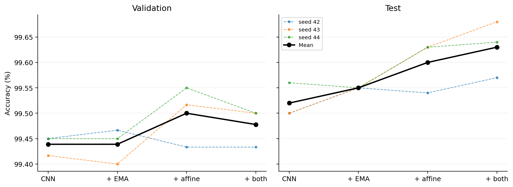

*图 5 左图为验证集，右图为测试集。每条虚线对应一个种子，黑线为三者均值。在测试集上，三个种子的增强模型都超过各自的原 CNN。单独加 EMA 时，种子 42 和 43 的准确率上升，种子 44 略降。*

### 4.2 loss 和准确率如何变化？

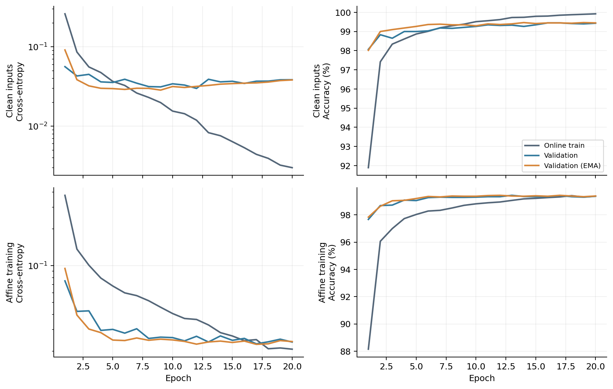

*图 6 种子 42 的逐轮记录。左列为交叉熵（对数轴），右列为准确率。上排用原图训练，下排用仿射增强图训练。训练曲线按开启 dropout 时的批次结果统计。两条验证曲线分别使用轮末的当前权重和 EMA 权重，评估时关闭 dropout。*

增强模型第一轮的训练损失为 0.3753，准确率为 88.15%。这一轮结束时，验证损失为 0.0751，准确率已达 97.67%。训练指标计入了刚开始训练时的预测，而且每批图都经过随机变形，模型也开着 dropout。验证则使用轮末权重，在原图上关闭 dropout 做预测。到第 6 轮，验证准确率已达到 99.27%。

第 13 轮，增强模型的训练和验证损失分别为 0.0328 和 0.0238，准确率分别为 99.06% 和 99.43%。到第 20 轮，训练损失降至 0.0208，训练准确率升至 99.37%，验证损失仍约为 0.0238，验证准确率为 99.37%。按表 4 的规则，保留第 13 轮权重。

原 CNN 后期的过拟合更明显。第 20 轮训练损失已降至 0.0030，验证损失却从第 12 轮的 0.0299 升到 0.0385。准确率只记录得分最高的类别是否正确，交叉熵还取决于模型给真类多少概率。例如，一张图始终判错，模型给真类的概率越低，这张图的损失就越大，准确率却不会再变。 [增强逐轮记录](outputs/ablation/seed42/affine_history.csv) · [无增强逐轮记录](outputs/ablation/seed42/plain_history.csv)

图 6 中的每个训练点覆盖整轮 54,000 张拟合图。由于每批最多 128 张，第 422 批只有 112 张。训练循环先以 `loss.detach() * len(ids)` 累加每批损失，再除以 54,000，因此最后一小批按它实际包含的图数计入。终端逐轮摘要和图 6 使用这个口径。训练时若要看一轮之内的变化，可以打开启动时给出的 TensorBoard 地址，选 `batch/loss`、`batch/accuracy_pct` 或 `batch/learning_rate`。这些点对应被记录的单个批次。比较 `plain` 与 `affine` 的收敛趋势时，切到 `epoch/loss` 和 `epoch/accuracy_pct`，就能把训练、验证和 EMA 验证曲线叠在一起看。 [实时指标的记录方式](src/training_monitor.py)

同一轮的两条训练曲线还有一个差别。`plain` 看的是原图，`affine` 每次看到的笔画位置、角度和大小都会变化。种子 42 的第 20 轮，两者训练准确率分别为 99.92% 和 99.37%。在相同的原始验证图上，两者已经非常接近，为 99.43% 和 99.37%。把这 6,000 张验证图向上、下、左、右各移动 3 像素，原 CNN 的平均准确率降到 92.29%，增强 CNN 仍有 99.03%。从各自的原图成绩算起，前者掉了 7.14 个百分点，后者只掉了 0.33 个百分点。这个差别从第 1 轮就能看见，当时两者的平移准确率分别为 76.31% 和 94.00%。 [原图训练的逐轮记录](outputs/robustness_seed42/seed42/plain_history.csv) · [增强训练的逐轮记录](outputs/robustness_seed42/seed42/affine_history.csv)

在 TensorBoard 的 Scalars 中同时选 `seed42/plain/val` 和 `seed42/affine/val`，搜索 `robustness/shift_3px/accuracy_pct` 可以对照完整的 20 轮曲线，搜索 `drop_pp` 可看相对原图掉了多少个百分点。同一轮还单独测了旋转和缩放。第 20 轮将原图绕中心旋转 ±12°，两模型的平均准确率分别为 98.63% 和 99.33%。将采样网格分别缩放至 0.9 和 1.1 倍时，两者分别为 99.29% 和 99.41%。在这个种子和这三种扰动中，平移最能拉开差距。这里取同一轮的当前权重。图 8 使用各自按原图验证准确率选出的权重，对应 `plain` 的第 16 轮和 `affine` 的第 13 轮，可在看板上分别定位这两个点。 [打开曲线的指令](README.md)

### 4.3 训练集、验证集与测试集并列

| 表 6 固定种子 42，最佳轮次，统一 eval 模式 | 最佳轮 | fit | val | 教师完整训练集 | 教师测试集 | fit−test（百分点） |
|---|---:|---:|---:|---:|---:|---:|
| MLP | 12 | 99.87% | 98.37% | 99.72% | 98.47% | 1.40 |
| 原 CNN | 16 | 99.97% | 99.45% | 99.92% | 99.50% | 0.47 |
| 增强 CNN | 13 | 99.75% | 99.43% | 99.715% | 99.54% | 0.21 |

种子 42 的增强模型在完整训练集上答对 59,829/60,000 张，在测试集上答对 9,954/10,000 张。若计入第二候选，测试集命中 9,997/10,000 张。增强后，拟合集与测试集之间的准确率差从 0.47 个百分点缩小到 0.21 个百分点。单看这个种子，原 CNN 的验证准确率（99.45%）略高于增强模型（99.43%），三个种子取平均后才是增强模型领先。重新加载保存的权重评估测试集，仍得到 46 个错误。 [旧模型记录](outputs/main/summary.json) · [新权重独立复核](outputs/ablation/verification.json)

### 4.4 这 0.08 个百分点来自哪里？

| 表 7 同一测试图，增强 CNN 相对同种子原 CNN | 纠正旧错 | 新增错判 | 两者都错 | 准确率差（百分点） | 同图 95% 区间 | McNemar 双侧 p |
|---|---:|---:|---:|---:|---:|---:|
| seed 42 | 25 | 21 | 25 | +0.04 | [−0.09, +0.17] | 0.659 |
| seed 43 | 25 | 12 | 25 | +0.13 | [+0.01, +0.25] | 0.047 |
| seed 44 | 23 | 16 | 21 | +0.07 | [−0.05, +0.19] | 0.337 |

加入增强后，三个种子在 10,000 张测试图上分别多认对了 4、13 和 7 张。计算表 7 的区间时，固定同一种子的两组权重，以图像为单位做 20,000 轮有放回抽样。每轮计算两模型在同一批重抽图像上的准确率差，再取差值的 2.5% 和 97.5% 分位数。双侧精确 McNemar 检验只用“纠正旧错”和“新增错判”两列。三个种子共用测试图，区间分别计算。种子 42 和 44 的区间跨零，只有种子 43 的区间完全在零以上，其 p 值为 0.047，未经多重比较校正。 [完整配对统计](outputs/ablation/analysis/paired.csv)

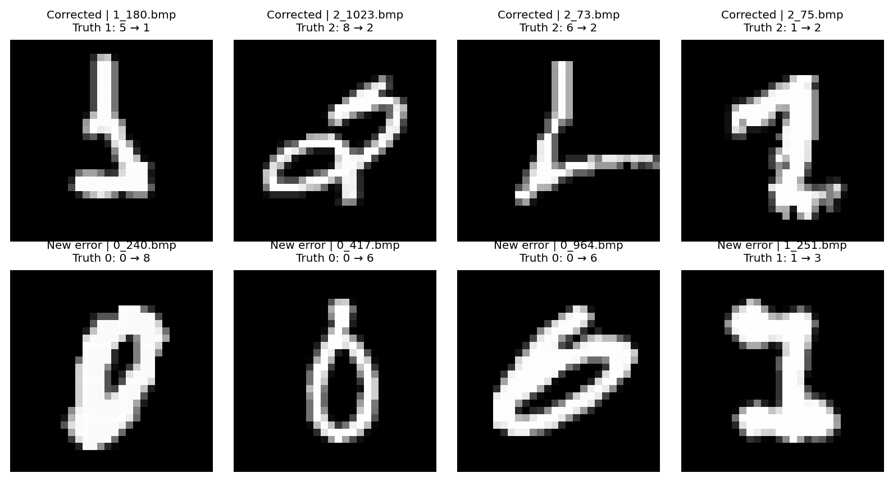

*图 7 种子 42。上排为原 CNN 判错、增强后判对的图，例如 `1_180.bmp` 从 5 改判为 1。下排显示相反的情况，例如 `0_240.bmp` 从 0 改判为 8。每排按文件顺序取前四例。共纠正 25 张，又新错 21 张，因此净增 4 张。* [全部改变正误的文件](outputs/ablation/analysis/changed_decisions.csv)

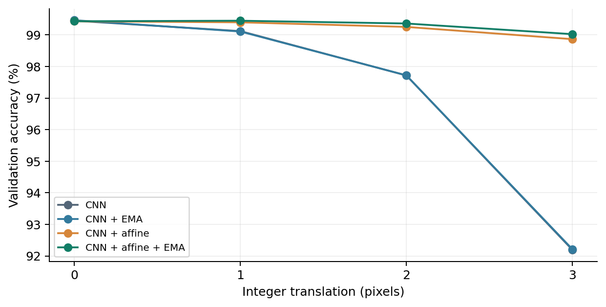

*图 8 将种子 42 的两组权重固定，对同一批 6,000 张验证图做整数平移，空出的位置填黑。位移为 0 时用原图，其他各点取上、下、左、右四个方向的平均准确率。*

原图上，原 CNN 和增强 CNN 的验证准确率分别为 99.45% 和 99.43%。平移 1、2、3 像素后，原 CNN 依次降到 99.12%、97.72%、92.20%，增强 CNN 则为 99.40%、99.25%、98.87%。两条曲线在 2 像素处开始明显分开。3 像素已经超出了训练时 ±2 像素的平移范围，此时两者相差 **6.67 个百分点**。验证图的画布大小固定，平移时靠近边缘的笔画也可能被裁掉。 [各方向原始结果](outputs/ablation/analysis/shift_validation.csv)

分方向看，向上移 3 像素对原 CNN 影响最大，6,000 张验证图中有 644 张判错，增强后降为 85 张。同样向左移 3 像素，原 CNN 错 284 张，增强后错 60 张。其余两个方向也有改善。图 8 的均值概括了总体差距，这些计数还说明，同样的移动距离，方向也会影响判断。 [逐方向记录](outputs/ablation/analysis/shift_validation.csv)

*图 9 两条线分别对应平移半径 1 和 2 像素，纵轴为三个种子的平均验证准确率。邻域权重为 0 时，两条线都从原图的 99.500% 出发。半径 1、权重 0.5 时为 99.483%，半径 2、权重 1 时为 99.456%。*

训练阶段加入仿射增强后，再在推理时融合平移图像，没有进一步提高验证准确率。以半径 1 像素、邻域权重 1 为例，平均验证 NLL 从 0.02201 降到 0.02114，准确率却从 99.500% 降到 99.456%。七种设置中，原图单视图的验证准确率最高，因此最终模型每张图只计算一次。 [七组参数 × 三种子验证明细](outputs/ablation/views/validation_grid.csv)

图 8 对每个方向单独预测。图 9 考察将同一张图在几个位置上的预测合并后，原图的分类能否更准。`ShiftAverage.forward` 实现了这种融合。 [多视图推理](src/views.py)

~~~python
def forward(self, x):
    center = self.backbone(x)
    if self.mix == 0:
        return center
    neighbors = [self.backbone(v) for v in translated_views(x, self.radius, self.black)]
    return torch.lerp(center, torch.stack(neighbors).mean(0), self.mix)
~~~

`center` 是原图的十个类别得分。`mean(0)` 对齐相同类别，分别平均左、右、上、下四张图的得分，再用 `torch.lerp` 与原图得分作线性加权。例如 `mix=0.5` 时，原图占一半，四个方向各占八分之一。验证搜索对同一半径缓存这些得分，改变权重时直接重算融合结果。最终保存的 `view_mix` 为 0，加载权重时直接恢复原 CNN，单图预测只需算原图。 [验证视图搜索](compare_views.py) · [最终推理设置](outputs/ablation/views/selection.json)

### 4.5 逐类结果与特征图

| 表 8 代表增强 CNN，在教师测试集上 | 样本数 | 精确率 % | 召回率 % | F1 % | 漏判数 |
|---|---:|---:|---:|---:|---:|
| 0 | 980 | 99.90 | 99.59 | 99.74 | 4 |
| 1 | 1,135 | 99.47 | 99.65 | 99.56 | 4 |
| 2 | 1,032 | 99.71 | 99.71 | 99.71 | 3 |
| 3 | 1,010 | 99.41 | 99.70 | 99.56 | 3 |
| 4 | 982 | 99.59 | 99.69 | 99.64 | 3 |
| 5 | 892 | 99.22 | 99.33 | 99.27 | 6 |
| 6 | 958 | 99.48 | 99.16 | 99.32 | 8 |
| 7 | 1,028 | 99.42 | 99.61 | 99.51 | 4 |
| 8 | 974 | 99.59 | 99.59 | 99.59 | 4 |
| 9 | 1,009 | 99.60 | 99.31 | 99.45 | 7 |
| **宏平均** | **10,000** | **99.54** | **99.53** | **99.54** | **46（合计）** |

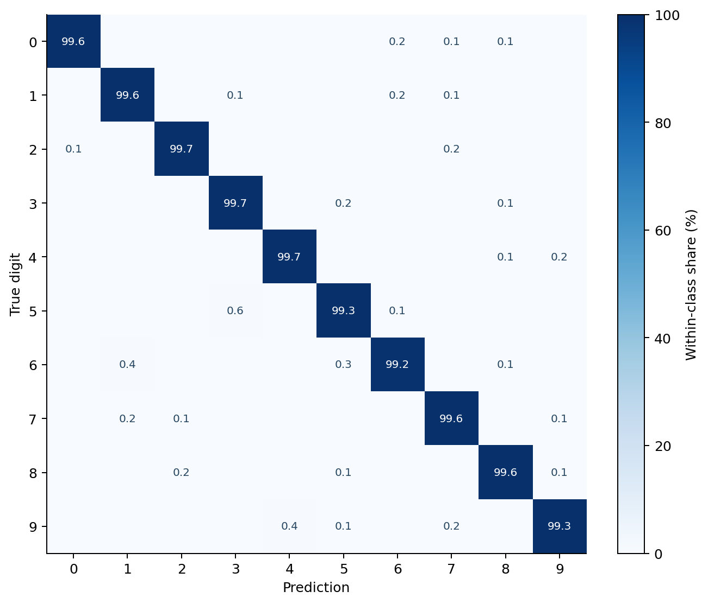

*图 10 每行对应一个真实类别，每列对应一个预测类别。格内数字为该行样本的百分比，空白表示零次。6 的召回率最低，958 张中漏判 8 张，其中 4 张被判成 1。5 的精确率最低，共有 7 张其他数字被误判为 5。从第 5 类所在行还可以看到，5 张真正的 5 被判成了 3。* [原始计数矩阵和逐类指标](outputs/ablation/analysis/metrics.json)

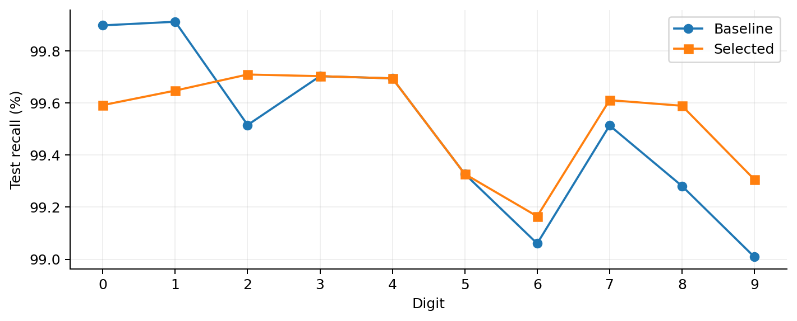

*图 11 两组模型在相同测试图上的逐类召回率。训练增强后，数字 9 的漏判从 10 张减到 7 张，数字 0 的漏判却从 1 张增到 4 张。*

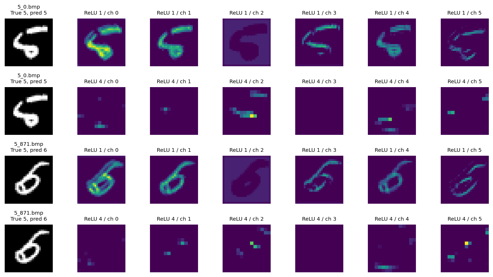

*图 12 左列为输入图像，右侧依次显示通道 0～5。每个样本各取第一次 ReLU（32×28×28）和第四次 ReLU（64×14×14）的响应，同一行的六张特征图共用色标，越亮表示响应越强。*

`5_0.bmp` 和 `5_871.bmp` 都是 5，模型把前一张判对，后一张判成了 6。在浅层，两张图的笔画轮廓都还看得出来。到第四次 ReLU，亮区集中在局部。正确样本的第 2 通道在字形下部有一段横向亮区，错例的第 5 通道则出现一个较集中的亮点。要判断某处响应是否影响了 5 和 6 的取舍，还需要遮挡对应笔画，观察两类得分如何变化。 [全通道数值](outputs/ablation/analysis/feature_maps.npz)

图 12 的激活取自表 3 中的同一个网络。`plot_features` 把一个正确样本与一个同类错例逐层向前传递。`enumerate(model)` 从 0 编号，索引 1 和 8 恰好是第一和第四个 ReLU。 [特征提取和绘图](analyze_ablation.py)

~~~python
for i, idx in enumerate([right, wrong]):
    z = x[idx:idx+1]
    for layer, op in enumerate(model):
        z = op(z)
        if layer not in (1, 8):
            continue
        stage = 0 if layer == 1 else 1
        row = axes[i * 2 + stage]
        f = z[0].cpu().numpy()
        values[f"sample{idx}_relu{layer}"] = f
~~~

`x[idx:idx+1]` 保留大小为 1 的批次维度，`z[0]` 再取出这张图的全部通道。对保存的特征张量统计大于零的元素，正确样本从第一层的 51.98% 降到第四层的 5.74%，错例则从 51.53% 降到 5.43%。深层中有响应的元素明显变少，这一点在正确样本和错例上很接近。两层看见的范围也不同。按表 3 的卷积与池化步长计算，第一层 ReLU 的一个位置只覆盖输入的 3×3 邻域，第四层的一个位置已经覆盖 14×14，足以容纳几段相邻笔画。同一行的通道共用色标，跨行比较宜看亮区的位置和形状。 [两张图的全通道激活](outputs/ablation/analysis/feature_maps.npz)

### 4.6 六个失败案例与剩余误差

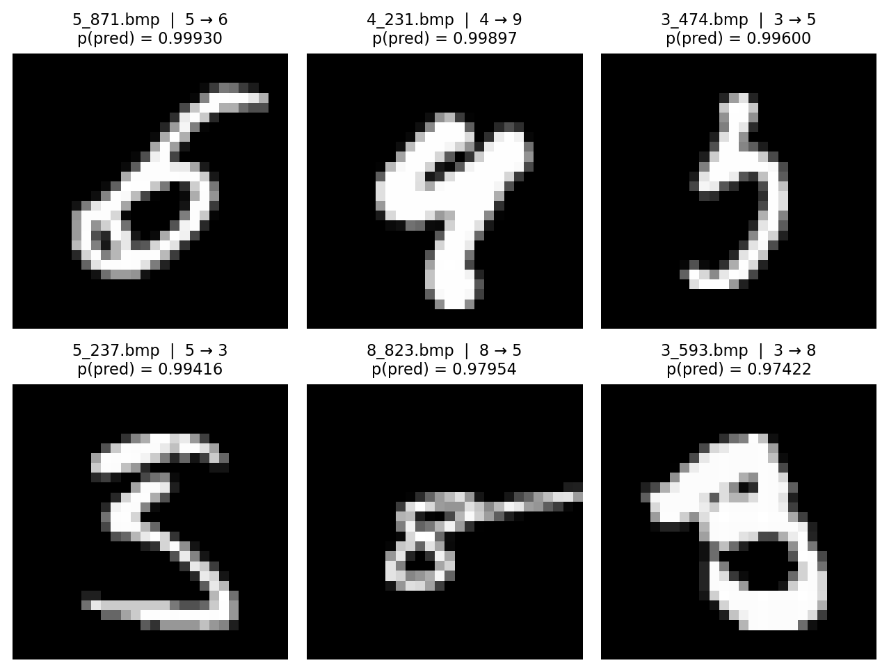

*图 13 将种子 42 的错例按预测类别的概率降序排列，每个混淆方向最多取一张。箭头左边是文件标签，右边是模型预测。以下按笔形讨论六个高置信错例，并给出检验这些解释的办法。*

- **`5_871.bmp`，5→6，0.99930。** 下半部绕成了一个近乎闭合的环，上面伸出一长笔。若模型容易把这个环认作 6 的特征，训练图中下半部闭合的 5 应该比开口的 5 更常被误判为 6。
- **`4_231.bmp`，4→9，0.99897。** 上半部两笔挨得很近，只留一条窄缝，下方的竖笔很粗。将训练侧相近写法的 4 细化一个像素，再比较 4 和 9 的得分差，可以检验窄缝的影响。
- **`3_474.bmp`，3→5，0.99600。** 起笔向左折出一个角，下半段弯回左侧。可以在验证集里各取一组折角起笔和圆弧起笔的 3，对齐后比较模型给 5 的得分。
- **`5_237.bmp`，5→3，0.99416。** 这张恰好错向相反的方向。两条较长的横笔被一段折线连在一起，很像带棱角的 3。分别遮住中间折线和同样大小的边缘区域，可以比较哪一处更影响 5 与 3 的分差。
- **`8_823.bmp`，8→5，0.97954。** 两个小环挤在左边，右上方却拖出一条很长的细横笔。将这条横笔从末端开始逐段遮住，再与原图比较，可以看出模型对这段笔画有多敏感。
- **`3_593.bmp`，3→8，0.97422。** 上半部墨迹较重，下半部的弧也几乎闭合。对笔画做轻微腐蚀，观察缝隙变宽后 8 的得分是否下降，可以检验粗笔画和近闭合形状的作用。

图 13 中置信度最高的错判是 5→6。按全部 46 张错例计，最常见的方向却是 5→3，共 5 张，其次是 6→1 和 9→4，各有 4 张。

| 表 9 按混淆方向归纳全体错例（互斥） | 张数 | 占 46 张错误 | 代表文件 |
|---|---:|---:|---|
| 5→3 | 5 | 10.87% | 5_237.bmp |
| 6→1 | 4 | 8.70% | 6_236.bmp |
| 9→4 | 4 | 8.70% | 9_186.bmp |
| 6→5 | 3 | 6.52% | 6_102.bmp |
| 其他 22 个方向 | 30 | 65.22% | 8_823.bmp 等 |
| 合计 | 46 | 100% | 逐图记录含真值、预测、最大概率、真类概率 |

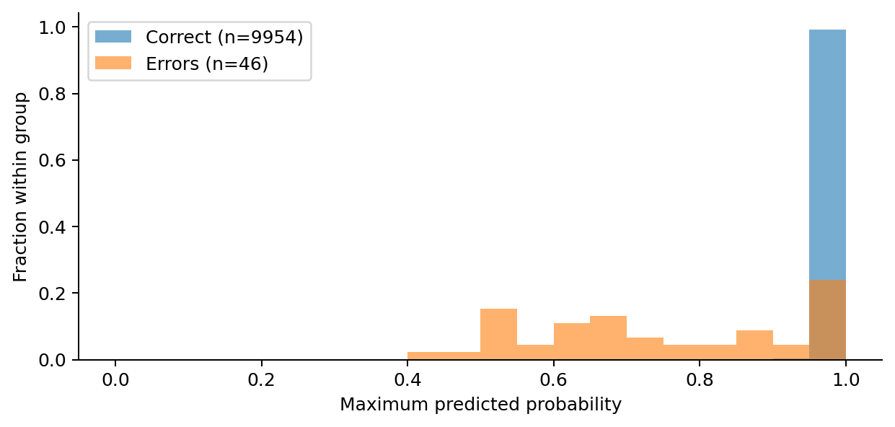

*图 14 判对和判错的样本分别归一化。46 张错例中，13 张的最高预测概率达到 0.90，其中 4 张达到 0.99。如果将低于 0.90 的预测交给人工复核，这 13 张仍会漏过。* [全部测试预测](outputs/ablation/analysis/test_predictions.csv)

以图 13 中的 `5_871.bmp` 为例，模型给 6 的概率为 99.93%，给真类 5 的概率只有 0.0694%，但 5 仍排在第二位。这张图在 Top-2 统计里算命中，在交叉熵里却贡献了 `−ln(0.000694) ≈ 7.27` 的损失。种子 42 的增强模型在 10,000 张测试图上的损失总和约为 123.75，仅这一张就占约 5.9%。这样的错例可以明显拉高平均损失，但计算 Top-1 准确率时，它与其他任何一张判错的图都只算一次。 [种子 42 的逐类概率](outputs/ablation/analysis/seed42_test.npz)

## 5 总结

在这批手写数字上，小幅几何增强最明显的收益出现在数字偏离原位置时。验证图平移 3 像素后，种子 42 的增强模型比原 CNN 高出 6.67 个百分点。对未经平移的测试图，三个种子的平均准确率从 **99.52% 升到 99.60%**，相当于每 10,000 张少错 8 张。两种模型都有 467,818 个参数，每张图只需一次前向计算。

种子 42 的 46 张错例中，有 43 张把真类排在第二位，Top-2 准确率达到 99.97%。在训练图中按笔画是否闭合、粗细或倾角分组，可以检验图 13 中几种写法是否更容易被混淆。本实验的三个种子共用同一划分，增强幅度也固定。换一批人写数字后，增强能否带来同样的改善，还需要在独立采集、按书写者划分的图像上检验。若系统允许拒识，还需在独立验证集上同时测量各置信度阈值下的覆盖率和错误率。

## 参考文献

1. Y. LeCun et al., “Gradient-Based Learning Applied to Document Recognition,” *Proceedings of the IEEE*, 1998. [原文与 DOI](https://doi.org/10.1109/5.726791)
2. N. Srivastava et al., “Dropout: A Simple Way to Prevent Neural Networks from Overfitting,” *JMLR*, 2014. [期刊原文](https://jmlr.org/papers/v15/srivastava14a.html)
3. D. P. Kingma and J. Ba, “Adam: A Method for Stochastic Optimization,” *ICLR*, 2015. [作者论文](https://arxiv.org/abs/1412.698)
4. I. Loshchilov and F. Hutter, “SGDR: Stochastic Gradient Descent with Warm Restarts,” *ICLR*, 2017. 本文仅采用无重启的单段余弦衰减。[论文](https://openreview.net/forum?id=Skq89Scxx)
5. E. D. Cubuk et al., “AutoAugment: Learning Augmentation Strategies From Data,” *CVPR*, 2019. [会议论文](https://openaccess.thecvf.com/content_CVPR_2019/html/Cubuk_AutoAugment_Learning_Augmentation_Strategies_From_Data_CVPR_2019_paper.html)
6. R. Shen et al., “Data Augmentation as Feature Manipulation,” *ICML*, 2022. [会议论文](https://proceedings.mlr.press/v162/shen22a.html)
7. N. Ajroldi et al., “When, Where and Why to Average Weights?”, *ICML*, 2025. [会议论文](https://proceedings.mlr.press/v267/ajroldi25a.html)
8. M. A. Rahman et al., “Tunable Soft Equivariance with Guarantees,” *CVPR*, 2026. [会议论文](https://openaccess.thecvf.com/content/CVPR2026/papers/Rahman_Tunable_Soft_Equivariance_with_Guarantees_CVPR_2026_paper.pdf)
9.  Scikit-learn developers, “Metrics and scoring: quantifying the quality of predictions.” [分类指标定义](https://scikit-learn.org/stable/modules/model_evaluation.html#classification-metrics)
10. Q. McNemar, “Note on the sampling error of the difference between correlated proportions or percentages,” *Psychometrika*, 1947. [DOI](https://doi.org/10.1007/BF02295996)

## 附录 A 代码导读与复现

训练入口按职责分成两部分。`read_archive` 和 `prepare_data` 负责解码 BMP、核对文件名并生成划分，`run_experiment.py` 用这份划分训练最初的 MLP 和 CNN。复核表 5 时则从 `train_ablation.py` 开始，对应第 3.3 节的训练循环。 [数据读取与划分](src/data.py) · [原始基线训练](run_experiment.py) · [网络定义](src/models.py) · [消融训练](train_ablation.py)

预测时，`evaluate.py` 会核对数据包的 SHA-256，再读取权重中保存的均值和标准差处理测试图。`predict.py` 也用这组统计量处理单张图片。两个入口都通过 `inference_model` 加载同一份权重和视图设置，因此可以先在一张图上试用，再评估整个测试集。 [验证视图搜索](compare_views.py) · [模型加载](src/views.py) · [结果分析](analyze_ablation.py) · [整集评价](evaluate.py) · [单图识别](predict.py)

**1．准备环境和数据。** 在实验一目录运行以下命令。本机已有 `ml-course` 环境。新机器可先进入该目录，运行 `conda env create -f environment.yml` 创建环境，再激活。锁定清单记录了实验所用依赖的具体版本。 [完整环境](environment.yml) · [实测版本锁](requirements-lock.txt)

~~~bash
cd /home/ubuntu/Documents/ml-course/experiment1
conda activate ml-course
# 仅在缺少教师 ZIP 时下载；也可手动将两个同名文件放到 data/raw/
test -f data/raw/1-Digit-TrainSet.zip && test -f data/raw/1-Digit-TestSet.zip || python download_data.py
~~~

**2．用现有权重核对结果。** 第一条命令评估全部测试图像，输出应含 `"correct": 9954` 和 `"errors": 46`。第二条识别示例图 `7_0.bmp`。换成自己裁好的白底黑字图像时，可加 `--invert` 反转颜色。第三条运行项目测试。

~~~bash
python evaluate.py --checkpoint outputs/ablation/views/selected.pt
python predict.py examples/7_0.bmp --checkpoint outputs/ablation/views/selected.pt
python -m pytest -q
~~~

**3．从头训练并重建图表。** `--output` 指定空目录。如果示例中的目录已有结果，请换一个目录名，并同步修改后续命令的路径。没有 GPU 时，可给训练、视图比较和分析脚本加 `--device cpu`。需要逐位核对数值时，应使用锁定的软件版本和同型 GPU。

~~~bash
python run_experiment.py --output outputs/reproduce_original
python train_ablation.py --output outputs/reproduce_ablation --seeds 42 43 44 --epochs 20
python compare_views.py --run outputs/reproduce_ablation
python analyze_ablation.py --run outputs/reproduce_ablation
python evaluate.py --checkpoint outputs/reproduce_ablation/views/selected.pt --output outputs/reproduce_ablation/verification.json
~~~

第一条命令训练原 MLP 和 CNN 并生成数据图。第二条命令记录 6 次训练，保存 12 份最佳权重。第三条在验证集上选择推理方式，第四条绘制消融图表并导出每张图的预测，第五条重新加载选中的权重核对测试结果。本次选中的是 `affine` 的原图单视图。报告链接指向 `outputs/main` 和 `outputs/ablation`，可与新目录中的复跑结果逐项对照。

**4．从逐图预测复算表 7。** 在实验一目录运行下面的命令即可核对种子 42。NPZ 中两组预测共享同一列文件名和真值，`argmax(axis=1)` 沿十个类别找出每张图得分最高的数字。 [两组预测及真值](outputs/ablation/analysis/seed42_test.npz)

~~~bash
python - <<'PYTHON'
import numpy as np

with np.load("outputs/ablation/analysis/seed42_test.npz") as data:
    labels = data["labels"]
    plain_ok = data["plain"].argmax(axis=1) == labels
    affine_ok = data["affine"].argmax(axis=1) == labels

fixed = np.count_nonzero(~plain_ok & affine_ok)
broken = np.count_nonzero(plain_ok & ~affine_ok)
gain_pp = 100 * (fixed - broken) / len(labels)
print(f"纠正 {fixed} 张，新增错判 {broken} 张，准确率差 {gain_pp:+.2f} 个百分点")
PYTHON
~~~

输出为“纠正 25 张，新增错判 21 张，准确率差 +0.04 个百分点”。将文件名中的 `seed42` 换成 `seed43` 或 `seed44`，即可算出表 7 的另外两行。复跑自己的实验时，把路径换成对应输出目录中的 `analysis` 子目录。

## 附录 B 如何迁移到另一种分类任务

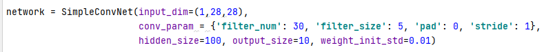

*图 15 讲义中的 SimpleConvNet 接收 1×28×28 的输入，使用 30 个 5×5 卷积核、100 个隐藏单元和 10 个输出。实际实验使用表 3 的四层卷积网络。两者迁移到新任务时，都要先确定输入的通道数、尺寸和输出类别数。*

以 32×32 的 RGB 图像五分类为例。讲义中的 `input_dim` 应从 `(1,28,28)` 改为 `(3,32,32)`，`output_size` 改为 5。`filter_num` 控制卷积通道数，`filter_size/pad/stride` 中的三个参数控制卷积核大小、填充和步长，`hidden_size` 控制分类头宽度。这些设置可以独立于类别数调整。`weight_init_std` 控制初始权重的尺度，本实验使用 PyTorch 卷积层和线性层的默认初始化。如果全连接层写死了输入维度，改分辨率后也要重算。dilation=1 时，卷积后的单边尺寸为 $\lfloor(H+2p-k)/s\rfloor+1$，继续算过池化层，就能得到展平后的长度。仓库中的 `build_model` 会根据输入尺寸计算这一维度，可用下面的前向计算检查。

~~~python
import torch
from src.models import build_model

model = build_model("cnn", input_dim=(3, 32, 32), num_classes=5)
images = torch.zeros(4, 3, 32, 32)
logits = model(images)
assert logits.shape == (4, 5)
# 两次池化后每图 64×8×8，分类头输入为 4096。
~~~

上例验证了新输入能得到五个类别得分。从这一步到用新数据训练，还要改以下几处。

1. **读取与划分。** 在 `src/data.py` 中读取新格式，用显式标签映射（如 `{"cat": 0, ...}`）替代数字文件名规则，并按新数据修改数量和尺寸检查。RGB 图使用 `convert("RGB")`。若同一对象有多张照片，让同一对象只出现在训练、验证或测试中的一个划分。
2. **张量与增强。** 用 `permute(0,3,1,2)` 将 RGB 批量数组从 `[N,H,W,3]` 转为 `[N,3,H,W]`，去掉灰度图专用的 `unsqueeze(1)`。在新拟合集上分别估计三个通道的均值和标准差，按 `[1,3,1,1]` 广播。要沿用黑色补边，也要逐通道计算标准化后的黑色像素值。旋转或平移可能改变新类别的含义，需要结合任务重新选择增强范围。
3. **训练与保存。** 用示例中的参数构建模型，标签编码成 `0…4` 的 `torch.long` 张量，仍可使用多类交叉熵。三通道输入改变了第一层的形状，图像尺寸改变了展平长度，五类输出也需要新的分类头。训练后，将 `input_dim`、`num_classes`、类别映射和预处理统计量随权重保存，加载时用相同参数调用 `build_model`。
4. **评估与单图预测。** 将 `src/evaluation.py` 中的 `range(10)`、混淆矩阵坐标和图表布局改成新类别列表。在 `predict.py` 和 `evaluate.py` 中同步调整颜色模式、图像尺寸、各通道的均值和标准差，以及类别名称。保留多视图推理时，`src/views.py` 也要支持逐通道补边。先用一个批次检查 logits、标签范围和损失，再评估各划分。这里的 RGB 五分类示例只验证了网络前向计算，报告中的准确率均来自手写数字任务。

## 附录 C 数据、权重与补充结果索引

- **数据与配置** [原始训练包](data/raw/1-Digit-TrainSet.zip) · [原始测试包](data/raw/1-Digit-TestSet.zip) · [缓存图像、文件名和 fit/val 索引](data/processed/digits.npz) · [原始 ZIP 校验值](data/raw/download_manifest.json) · [新训练配置](outputs/ablation/config.json)
- **旧基线** [原始实验总表与历程](outputs/main/summary.json) · [MLP 曲线](outputs/main/mlp/learning_curves.png) · [CNN 曲线](outputs/main/cnn/learning_curves.png) · [MLP 错例](outputs/main/mlp/failure_examples.png) · [CNN 错例](outputs/main/cnn/failure_examples.png) · [MLP 混淆计数图](outputs/main/mlp/confusion_matrix.png) · [CNN 混淆计数图](outputs/main/cnn/confusion_matrix.png)
- **新训练记录** 每个种子目录含 `plain_history.csv`、`affine_history.csv` 和四份最佳权重。 [种子 42](outputs/ablation/seed42/) · [种子 43](outputs/ablation/seed43/) · [种子 44](outputs/ablation/seed44/) · [最终单模型权重与推理参数](outputs/ablation/views/selected.pt)
- **原始预测** NPZ 按文件顺序保存真值、文件名及四种方案的十类概率。读入后取 `argmax(axis=1)` 即为预测标签。[种子 42](outputs/ablation/analysis/seed42_test.npz) · [种子 43](outputs/ablation/analysis/seed43_test.npz) · [种子 44](outputs/ablation/analysis/seed44_test.npz) · [代表模型六万张训练预测](outputs/ablation/analysis/train_predictions.csv) · [一万张测试预测](outputs/ablation/analysis/test_predictions.csv)
- **分析复算** [各模型各划分指标](outputs/ablation/analysis/runs.csv) · [同图统计](outputs/ablation/analysis/paired.csv) · [原始激活张量](outputs/ablation/analysis/feature_maps.npz) · [平移测量](outputs/ablation/analysis/shift_validation.csv) · [推理配置网格](outputs/ablation/views/validation_grid.csv) · [独立复核 JSON](outputs/ablation/verification.json)
