# 基于图宽留组验证与亮区空间读出的眼底图像分类

**机器学习基础 · 实验二 | SY2631122 徐基恒**

**摘要** 同一份眼底数据中，原始图宽与疾病标签高度相关。普通验证集上的高分因此容易掩盖正常图在测试时的大量误报。本文从整图、亮区原色和亮区对比度校正三个视图提取冻结 DINOv2 特征，用中心和环带保留局部结构，并在疾病类别内部估计、移除随图宽变化的特征方向。在 250 张课程测试图上，模型获得 86.4% 准确率和 0.9296 AUROC。与上一轮全图模型相比，两者均检出 92 张患病图，正常图误报从 61 张减至 26 张。固定其他设置，关闭采集方向投影使 AUROC 降至 0.8591。

**关键词** 眼底分类、采集偏差、分组验证、区域池化、线性子空间投影

## 1 问题描述

给定一张眼底彩照，预测患病概率 $p$，在训练侧选定阈值后输出二分类结果。正类为 disease。教师提供的 JPEG 只有整图标签，没有医生勾画的病灶或视盘边界。表 1 的拟合与验证集来自对原训练包的分层划分，测试沿用教师提供的独立文件包。[逐图清单](data/images.csv)

| 表 1 数据划分 | 患病 | 正常 | 合计 | 用途 |
|---|---:|---:|---:|---|
| 拟合 | 549 | 844 | 1,393 | 学习投影、线性头，做四折图宽留组验证 |
| 随机验证 | 97 | 149 | 246 | 衡量同来源表现 |
| 教师测试 | 100 | 150 | 250 | 锁定配置后评价 |

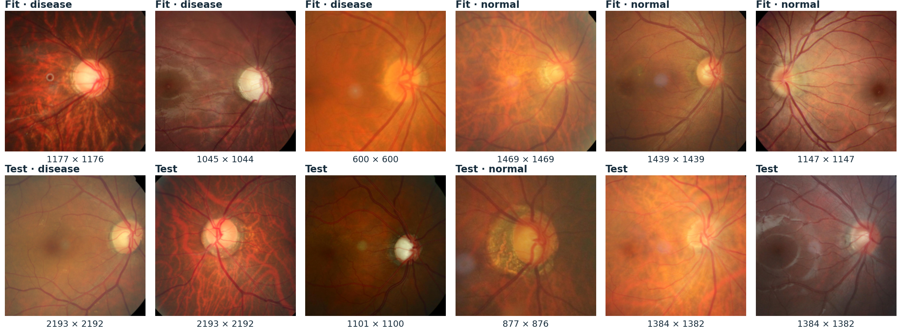

图 1 同为方形眼底照片，亮区位置、背景亮度与视野大小均有差异。值得关注的是，这些差异可能同时反映组织外观和拍摄条件。

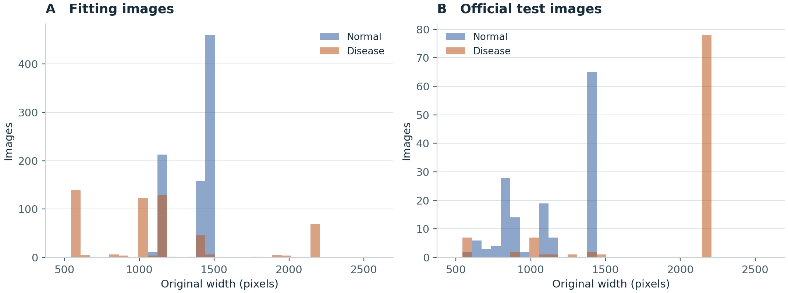

图 2 测试集中 78/100 张患病图宽 2,192 或 2,193 像素。只用宽高查训练集的患病比例就能取得 0.9664 的测试 AUROC，但沿用验证阈值时准确率只有 42.8%。这个对照促使我们在**相近采集条件内**检查模型能否区分患病与正常。

## 2 模型原理与创新设计

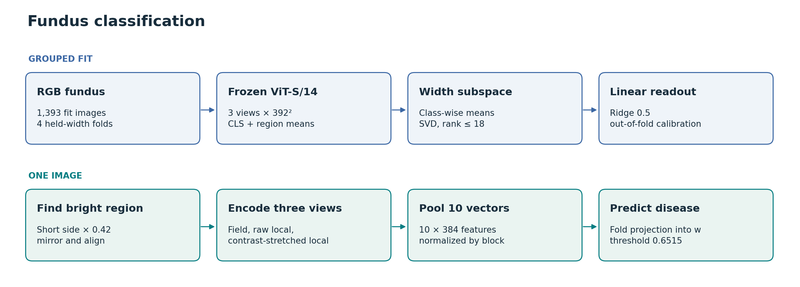

图 3 上排说明如何利用宽度分组训练分类器，下排是部署时的 RGB 输入路径。宽度组只参与拟合和评价，部署时投影已经合入分类器系数。[可编辑 SVG](figures/report_pipeline.svg)

**创新一：同时读取亮区外观和局部几何。** 在 96×96 缩略图上，以绿通道两个尺度的平滑差结合红通道亮度定位候选亮区；在原图截取短边 42% 的局部方块，越界镜像补齐。保留原色局部，再生成按通道 2%～98% 分位拉伸的局部。使三个视图左右方向一致后送入冻结 ViT。在两张局部图上分别读出中心和外围，避免全局平均把相对位置抹掉。亮区定位、三视图和中心／环带组合均是针对本数据设计的。[区域实现](spatial_features.py)

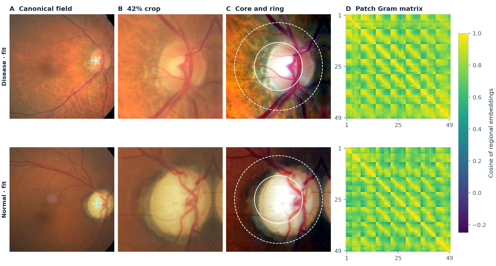

图 4 中心取归一化半径 $r<0.23$，环带取 $0.23\le r<0.42$。两者随裁图位置平移；当最亮处落到背景时，这套坐标也会一起偏离。

**创新二：在每个疾病类别内估计采集方向。** 借鉴 George 等的线性子空间移除方法，把原文中的身份差异换成类内图宽差异。设 $\mu_y$ 是类别均值，$\mu_{yg}$ 是该类第 $g$ 个宽度组的均值。收集 $d_{yg}=\sqrt{n/(n+15)}(\mu_{yg}-\mu_y)$；至少有三张照片才估计一个组均值。对差向量做 SVD，以前 $r$ 个右奇异向量组成 $V$，将特征投影为 $z=x-V^{\top}Vx$。在 $z$ 上拟合类别平衡的岭回归，再用折外分数校准概率。按疾病类别分别估计均值，能使投影针对同类图像内部的变化。[CVPR 2026 方法来源](https://arxiv.org/abs/2604.05296) · [分类实现](spatial.py)

**创新三：把同图宽段内的判别力写进选型准则。** 图宽除以 32 后取整分组，同组不会同时出现在一折的训练和留出部分。选型分等权平均四折 AUROC 均值和同宽段内的折外 AUROC。后者按两类样本数的调和均值加权，减少单一类别占绝大多数的组对排序的影响。[四折与 330 项选择记录](outputs/spatial/cv_grid.csv)

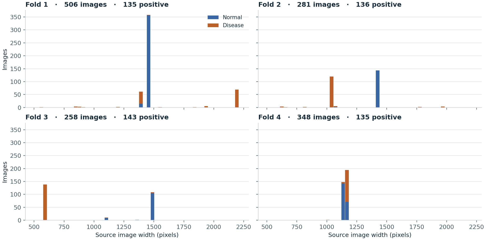

图 5 各折覆盖的宽度和类别比例不同。单看随机验证容易高估这种数据上的泛化能力，留组分数和最终测试分数因此都予以保留。

## 3 模型结构、参数与实现

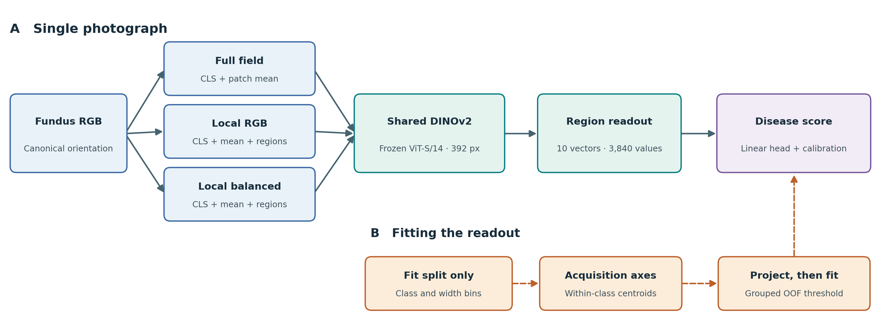

图 6 三种视图共用一套官方 DINOv2-S/14-reg4 权重，池化时排除寄存器 token。十个 384 维向量组成 3,840 维线性输入。[可编辑架构图](figures/spatial_architecture.svg)

| 表 2 阶段 | 形状或规模 | 参数和运算 |
|---|---|---|
| 原图与亮区处理 | 3 × RGB × 392 × 392 | 几何定位、镜像补边、通道分位拉伸 |
| 冻结 ViT-S/14 | 每视图 28×28 个图像 token，宽 384 | 21,832,704 个参数，三视图共享；单视图计数 33.86 GFLOPs |
| 区域聚合 | 3 组 CLS + 3 组 patch 均值 + 4 组区域均值 | 块内归一化、按组等权拼接 |
| 最终读出 | 3,840 → 1 | 3,840 个线性系数、1 个偏置，另有概率校准的斜率与截距 |

| 表 3 训练设定 | 取值 | 如何确定 |
|---|---|---|
| 特征设计、投影秩上限 | 11 个设计；0、4、12、18、24 | 四折训练侧选择全部区域、秩上限 18 |
| 岭系数、训练权重 | 0.05、0.5、5；两类权重方案 | 选中 0.5 和类别平衡 |
| 阈值 | 0.651516 | 折外加权 Youden 指数最大处 |
| 分类头拟合 | 加权岭回归闭式解 | 每折单独拟合投影与回归；迭代训练曲线对应下文神经网络基线 |

本次在 **RTX 3070 Ti Laptop GPU（8 GB）** 上重新从 1,889 个原始 JPEG 提取 5,667 个视图特征；四折、概率校准和最终岭回归按原实现用 CPU 双精度求解。含两档投影对照的完整调用耗时 54.5 秒。软件为 PyTorch 2.6.0+cu124。FLOPs 按一次乘加计两次，只计框架识别的算子。[硬件及权重摘要](outputs/report_replay/run.json) · [运算量实测](outputs/report_replay/complexity.csv)

## 4 实验结果分析

### 4.1 主结果与分类阈值

表 4 和图 7 来自本次重拟合。准确率为 $(TP+TN)/N$，精确率为 $TP/(TP+FP)$，灵敏度为 $TP/(TP+FN)$，特异度为 $TN/(TN+FP)$。AUROC 衡量正例排在负例之前的概率，AP 按召回增量加权精确率；两者越高越好。在患病比例 40% 的测试集上，恒定分数的 AP 为 0.40。

| 表 4 配置与划分 | 准确率 | AUROC | AP | 精确率 | 灵敏度 | 特异度 | F1 |
|---|---:|---:|---:|---:|---:|---:|---:|
| 主模型，拟合 1,393 张 | 95.84% | 0.9948 | 0.9917 | 98.81% | 90.53% | 99.29% | 0.9449 |
| 主模型，随机验证 246 张 | 91.87% | 0.9893 | 0.9813 | 98.73% | 80.41% | 99.33% | 0.8864 |
| 关闭投影，测试 250 张 | 76.40% | 0.8591 | 0.7406 | 63.76% | 95.00% | 64.00% | 0.7631 |
| **主模型，测试 250 张** | **86.40%** | **0.9296** | **0.8745** | **77.97%** | **92.00%** | **82.67%** | **0.8440** |

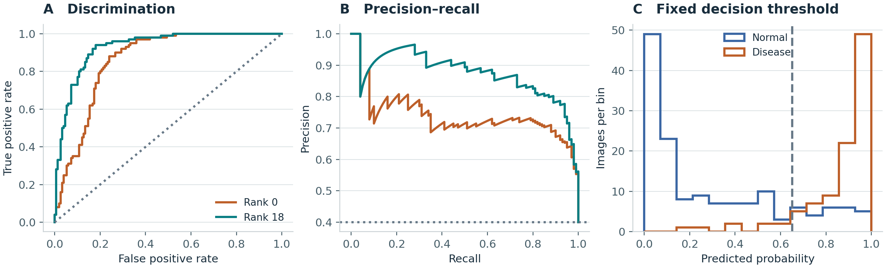

图 7 正常图仍有高分长尾。在 118 张判为患病的图里有 26 张正常图，另有 8 张患病图被漏检。换到训练侧选出的等成本操作点，检出患病图增到 96 张，正常误报也升到 39 张。[本次逐图概率](outputs/report_replay/predictions.csv) · [本次原始指标](outputs/report_replay/metrics.csv) · [操作点规则](outputs/spatial/operating_points.json)

### 4.2 哪部分改动真正有用？

| 表 5 相同教师测试集，前期对照与选定配置 | AUROC | 准确率 | 读数 |
|---|---:|---:|---|
| 眼底预训练 RETFound-Green 三视图 | 0.7519 | 68.4% | 上一轮分组验证选中 |
| DINOv2 全图 | 0.8528 | 72.4% | 检出 92 张、误报 61 张 |
| 全三视图，无中心／环带，固定其余读出设置 | 0.9219 | 82.4% | 检查局部位置能否补足外观 |
| 全区域、同样投影和岭系数，换 RETFound-Green | 0.8801 | 76.8% | 检查眼底专用预训练 |
| **DINOv2 全区域与类内投影** | **0.9296** | **86.4%** | 检出 92 张、误报 26 张 |

表 5 的旧模型和区域消融取自归档，本次重新测量了主模型和无投影对照。相比上一轮 DINO 全图，主模型的 AUROC 增量为 0.0768（按标签分层、同图重抽 2,000 次，95% 区间 0.0383～0.1201），准确率增量为 14.0 个百分点（8.8～19.6）。这个差值包含区域和投影两项改动。单独改变投影时，应比较表 4 的最后两行。[同读出消融](outputs/spatial/matched_controls.csv) · [配对差与区间](outputs/spatial/paired.csv)

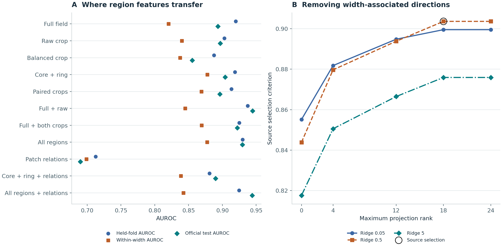

图 8 固定岭系数与权重时，图宽段内 AUROC 随秩上限从 0、4、12 增至 18，依次为 0.7791、0.8360、0.8604、0.8775。再升到 24，折内有效秩达到上限，训练侧分数持平。借鉴 DINOv3 的 Gram 位置关系作为备选特征，加入全部区域后训练侧选型分从 0.9036 降至 0.8835，因此主模型保留区域特征。全图加原色局部的另一候选在教师测试上达到 0.9445，但它在训练侧的排名低于主模型。[DINOv3](https://arxiv.org/abs/2508.10104) · [选择记录](outputs/spatial/ablation_selection.csv)

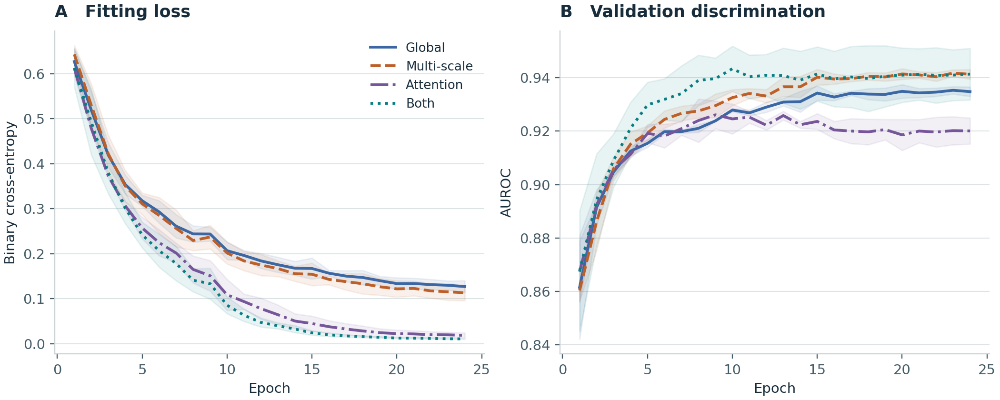

图 9 首轮 ResNet 对照按 epoch 记录训练损失和验证 AUROC。双模块头可以在随机划分上收敛，但其三种子集成在测试上的 AUROC 为 0.6368；后续读出因而改用图宽留组选择。

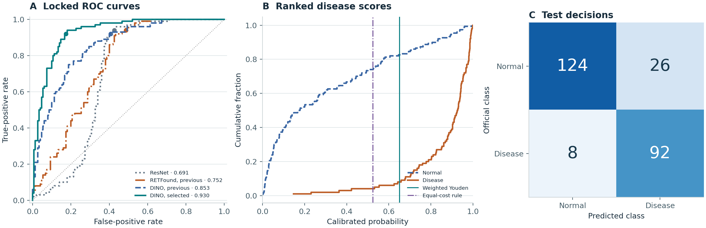

图 10 对同一批图片，46 张从判错变为判对，11 张从判对变为判错。净减少 35 个错误并不意味着两种模型检出的是完全相同的 92 张患病图。

### 4.3 失败案例与图像质量

| 本次误差类型 | 样本编号 | 真值 | 无投影患病分数 | 主模型患病分数 |
| --- | --- | --- | --- | --- |
| 误报 | normal_095695 | 正常 | 0.9585 | 0.9928 |
| 误报 | normal_094700 | 正常 | 0.9338 | 0.9596 |
| 漏报 | disease_002786 | 患病 | 0.2854 | 0.1481 |
| 漏报 | disease_002468 | 患病 | 0.2178 | 0.2315 |

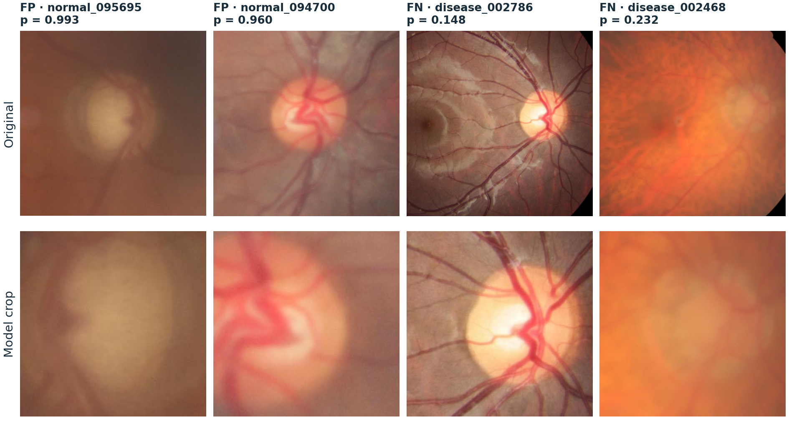

图 10b 上排为四张原始图片，下排为分类器实际使用的对齐局部。两组均由固定规则选取，分数及文件编号见表 6。[图版源数据](outputs/report_replay/cases.csv)

表 6 取本次主模型分数最高的两张误报和最低的两张漏报。另按新旧模型判决变化挑选的图版见图 11：normal_095276 的新分数为 0.168，纠正了误报；disease_002468 降至 0.232，造成新增漏报。normal_092106 在两种模型中都被误判，新分数为 0.769。[案例文件名和两模型分数](outputs/spatial/cases.csv)

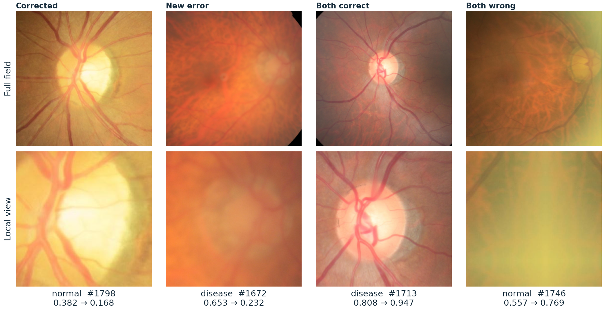

图 11 一起看原图与实际裁图，可以区分亮区确实落在组织结构上、以及裁图主要落到背景的情况。这里的图像对应关系只支持分析模型的取景，不能据此作出病灶定位结论。

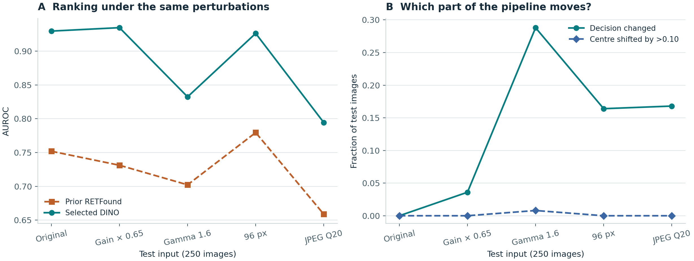

图 12 固定阈值后，将亮度乘 0.65 仍有 85.2% 准确率，施加 gamma 1.6 后降到 63.2%。后者改变 72 张图的判决，但亮区坐标移动超过图宽 10% 的只有两张。大多数翻转发生在相近取景下，说明读出对局部对比度的反应值得进一步检查。[扰动数据](outputs/spatial/stress_metrics.csv)

## 5 总结

三视图保留了全图背景、局部中心与外围的关系，类内投影则减少了同一疾病类别内部随图宽而变化的线索。相对历史全图模型，主模型在保持 92% 灵敏度的同时，将特异度从 59.33% 提至 82.67%。下一步最有价值的检验是按患者和拍摄设备分层的独立测试，其次是在亮区偏离或对比度异常时评估拒判策略。课程数据提供图宽，未提供患者或设备标识，因此目前的分组结果只回答图宽迁移的问题。

## 参考文献

1. Oquab 等，DINOv2，首稿 2023-04-14，TMLR 2024。用于冻结图像表征。[论文](https://arxiv.org/abs/2304.07193)
2. Darcet 等，Vision Transformers Need Registers，首稿 2023-09-28，ICLR 2024。四个寄存器来自官方权重。[论文](https://arxiv.org/abs/2309.16588)
3. George 等，From Measurement to Mitigation，首稿 2026-04-07，CVPR 2026。将身份子空间移除改用于类内采集方向。[论文](https://arxiv.org/abs/2604.05296)
4. Engelmann、Bernabeu，RETFound-Green，首稿 2024-04-30，Nature Communications 于 2025-07-25 上线。用作眼底预训练对照。[期刊原文](https://www.nature.com/articles/s41467-025-62123-z)
5. Siméoni 等，DINOv3，首稿 2025-08-13。借鉴 Gram 空间关系作消融，编码器沿用 DINOv2。[论文](https://arxiv.org/abs/2508.10104)
6. He 等，Deep Residual Learning for Image Recognition，CVPR 2016。Ilse 等，Attention-based Deep Multiple Instance Learning，ICML 2018。用于早期空间池化对照。[ResNet](https://arxiv.org/abs/1512.03385) · [MIL](https://proceedings.mlr.press/v80/ilse18a.html)

## 附录 运行与数据

在项目根目录激活 ml-course 后运行以下命令。第一条读取原始图片，重新提取全部特征并重拟合两个秩设置，第二条从其逐图结果重画图 7。

~~~bash
python -m course.report_replay 2
python -m course.report_figures 2
python -m experiment2.spatial predict --image /path/to/fundus.jpg
~~~

[复跑脚本](../course/report_replay.py) · [完整环境](../environment-234.lock.txt) · [历轮训练、消融与全部插图](report.md)
