# 实验二 眼底图像二分类：跨尺寸验证选出了怎样的表征？

[按课程大纲编排的正式报告（含 RTX 3070 Ti 复跑）](SY2631122徐基恒.md)

**徐基恒 · SY2631122**

在 250 张教师测试图上，第三轮选定的空间读出达到 **86.4% 准确率、0.9296 AUROC**。相对上一轮测试表现最好的 DINOv2 全图对照，两者都检出 92/100 张患病图，新的正常图误报从 61 张降到 26 张。改动集中在两处：让模型比较全图与局部亮区的中心和外围，并在训练时移除与采集尺寸有关的特征方向。

前两轮先比较局部判别证据、微调和眼底预训练，找出随机验证与教师测试落差的来源。第三轮在相同划分上检验来自这些发现的改动。[第三轮的空间读出与配对消融](#第三轮在相近采集条件下寻找可迁移的空间特征)

## 图像、标签与划分

教师数据以文件名前缀区分 disease 与 normal，患病为正类。按标签分层，从原训练集中留出 15% 作验证，划分种子为 42。下文的“完整训练集”包含拟合与验证两部分。ResNet 实验输入 224 × 224 RGB 图像，以 ImageNet 均值和标准差归一化。后续 ViT 直接从原始 JPEG 构造 392 × 392 输入。原文件、原始宽高和拆分关系均有记录。拟合与测试之间按 JPEG 文件 SHA256 比对，未发现相同文件。[逐图清单](data/images.csv) · [原始包校验值](data/raw/download_manifest.json)

| 数据 | 患病 | 正常 | 合计 |
|---|---:|---:|---:|
| 拟合 | 549 | 844 | 1,393 |
| 验证 | 97 | 149 | 246 |
| 完整训练集 | 646 | 993 | 1,639 |
| 教师测试集 | 100 | 150 | 250 |

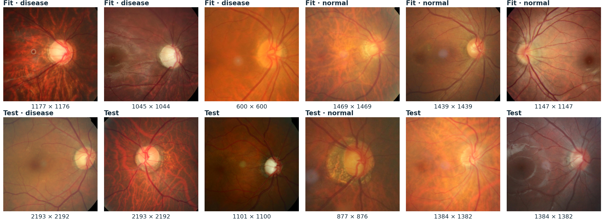

图 1 同为方形眼底图，视盘所占面积、光照和色调已有明显差别。样本取自各组按文件名排序约 20%、50%、80% 的位置。

## 空间证据怎样汇成一个分数

冻结 ImageNet 预训练的 ResNet-18，分别开关两个模块。第一个模块把第 3 阶段的 256 通道特征池化到 7 × 7，与第 4 阶段的 512 通道特征拼接，再用 1 × 1 卷积压到 64 通道。第二个模块对 49 个位置分别打分，经 softmax 求加权均值，再与普通均值等权相加。最后用 dropout 和线性层输出患病 logit。这种聚合借鉴了基于注意力的多实例学习，训练只用整图标签。[ResNet](https://openaccess.thecvf.com/content_cvpr_2016/html/He_Deep_Residual_Learning_CVPR_2016_paper.html) · [Attention-based Deep Multiple Instance Learning](https://proceedings.mlr.press/v80/ilse18a.html)

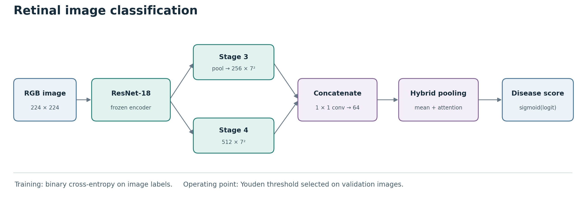

图 2 两个模块同时开启时的网络。单模型有 51,522 个可训练参数，三个种子的模型可以共享一次冻结编码器的前向计算。[可编辑 SVG](figures/architecture.svg)

四个配置各训练 24 轮，使用二元交叉熵、AdamW、批量 64，学习率从 0.001 余弦衰减至 0.00008，权重衰减 0.01。种子 17、42、73 共享同一数据划分。每次训练保留验证 AUROC 最高的权重，再以验证集 Youden 指数（灵敏度 + 特异度 − 1）最大处设阈值。表中为三个独立训练的均值；AUROC 后附种子间样本标准差。

| 冻结编码器上的读出方式 | 可训练参数 | 验证 AUROC | 测试 AUROC | 测试准确率 | 平衡准确率 | F1 |
|---|---:|---:|---:|---:|---:|---:|
| 末层 + 均值 | 33,025 | 0.9360 | 0.6010 ± 0.0041 | 62.27% | 0.6617 | 0.6449 |
| 多尺度 + 均值 | 49,409 | 0.9420 | 0.5995 ± 0.0008 | 62.53% | 0.6622 | 0.6439 |
| 末层 + 注意力 | 35,138 | 0.9283 | 0.6132 ± 0.0158 | 59.33% | 0.6344 | 0.6224 |
| 多尺度 + 注意力 | 51,522 | **0.9439** | **0.6333 ± 0.0228** | **64.40%** | **0.6822** | **0.6628** |

多尺度在均值池化下几乎没有改变测试排序。在注意力读出下，加入中间层使平均测试 AUROC 从 0.6132 升到 0.6333。按平均验证 AUROC 选中这一组合，平均三个种子的概率后，冻结模型的测试准确率为 66.4%，AUROC 为 0.6368。[各次训练与评测结果](outputs/metrics.csv)

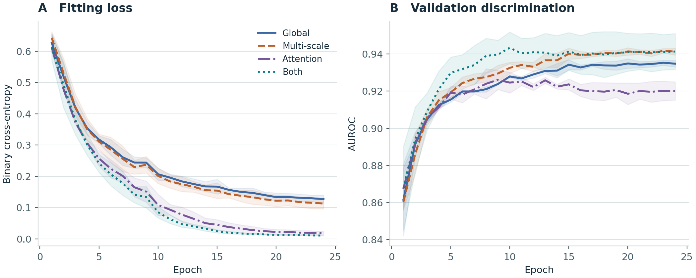

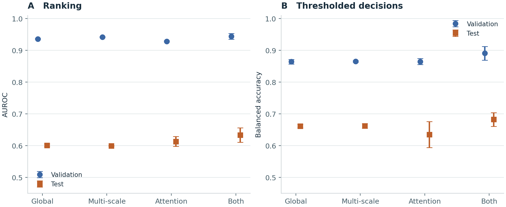

## 图像尺寸揭示了什么

冻结模型在验证集和测试集上的 AUROC 相差 0.311。回查图像后，发现原始尺寸本身就能预测标签。一个简单对照对每个宽高组合统计拟合集患病比例，以两份全局先验作平滑，没见过的尺寸回退到拟合集患病率 549/1,393。它完全不读取像素。

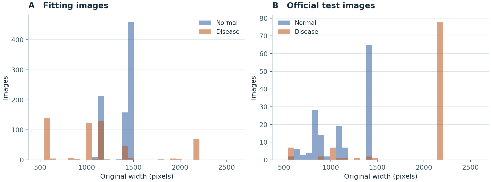

图 5 测试集的 100 张患病图里，有 78 张宽度为 2,192 或 2,193 像素。拟合集中对应的是 69/549 张。测试集中还有 142/150 张正常图的宽高组合从未在拟合集中出现，患病图为 7/100 张。

尺寸对照的验证 AUROC 为 0.9961、测试 AUROC 为 0.9664。沿用验证阈值 0.2980 后，149 张未见尺寸都因回退分数约 0.394 而被判为患病，最终准确率只有 42.8%。这既解释了高 AUROC 和低准确率为何可以并存，也揭示了此数据集的一个捷径。网络输入已统一尺寸，像素模型究竟利用了哪些随采集条件变化的线索，单凭尺寸统计无法分辨。[尺寸对照及微调结果](outputs/followup/metrics.csv)

## 微调能否改善测试表现

看到上述落差后，追加一次配对比较。两组都更新 ResNet-18 的第 3、4 阶段和线性头，共 10,493,953 个可训练参数，全网 11,177,025 个参数。一组直接用 RGB，另一组先做局部光照校正，令输出像素为 clip(128 + 3 × (原图 − 高斯模糊图), 0, 255)，模糊半径为 8 像素。两组均采用随机水平翻转、0.85～1.15 倍亮度扰动、批量 32 和 AdamW，学习率从 0.00018 余弦衰减至 0.00002，训练 10 轮。保留原划分、三个种子和验证选择规则。这个追加实验使用同一测试集，属于探索性比较。

| 图像输入 | 平均验证 AUROC | 平均测试 AUROC | 平均测试准确率 | 灵敏度 | 特异度 |
|---|---:|---:|---:|---:|---:|
| 原始 RGB | 0.9979 | 0.6918 ± 0.0187 | 69.73% | 95.0% | 52.9% |
| 局部光照校正 | 0.9953 | 0.6714 ± 0.0131 | 62.40% | 99.0% | 38.0% |

光照校正增加了检出率，也增加了误报。按平均验证 AUROC 选择原始 RGB，三个权重分别取第 8、10、9 轮。下表是等权概率集成在固定阈值 **0.5937** 下的结果。

| 数据 | 准确率 | AUROC | AP | 精确率 | 灵敏度 | 特异度 | F1 | Brier ↓ |
|---|---:|---:|---:|---:|---:|---:|---:|---:|
| 拟合 | 100.00% | 1.0000 | 1.0000 | 1.0000 | 1.0000 | 1.0000 | 1.0000 | <0.0001 |
| 验证 | 99.19% | 0.9983 | 0.9977 | 1.0000 | 0.9794 | 1.0000 | 0.9896 | 0.0151 |
| 完整训练集 | 99.88% | 1.0000 | 0.9999 | 1.0000 | 0.9969 | 1.0000 | 0.9984 | 0.0023 |
| 测试 | **72.00%** | **0.6909** | 0.4933 | 0.5949 | **0.9400** | 0.5733 | 0.7287 | 0.2682 |

对 250 张测试图按真实类别分层重采样 1,500 次，准确率的 95% 百分位区间为 66.8%～77.2%，AUROC 为 0.622～0.759。与冻结集成在同一批图上配对比较，AUROC 增量为 0.0541，区间为 0.017～0.093。区间以图像为单位，固定了训练出的模型和阈值。[重采样结果](outputs/bootstrap.json)

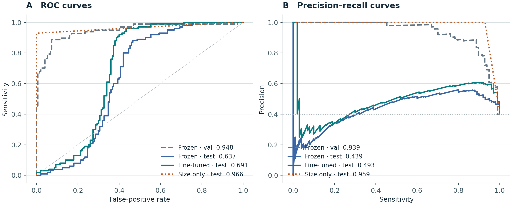

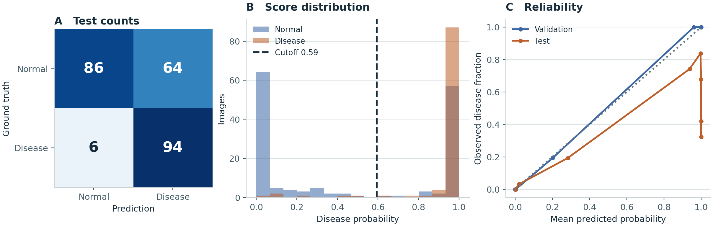

图 7 测试患病率为 40%，AP 为 0.4933。许多正常图也取得了接近 1 的分数。右图按预测概率排序后分成八组，每点比较该组的平均预测概率与实际患病比例。

## 错在哪里

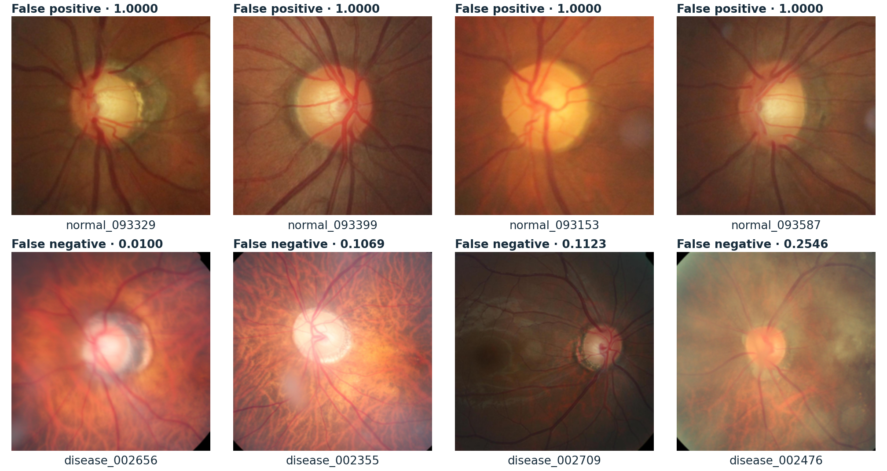

图 8 四张误报的原始宽度在 793～896 像素之间，均有醒目的亮视盘，模型给出的患病概率都超过 0.99999。四张漏报中有三张尺寸为 2,193 × 2,192；其中 disease_002656 的分数低至 0.0100。图中既有偏暗样本，也有局部偏亮、纹理不清的样本。标签只精确到整张图，无法据此确认模型依据的病灶。[失败样本及原始分数](outputs/error_gallery.csv)

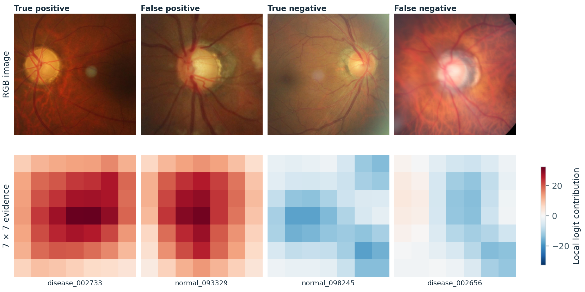

图 9 从真阳、假阳、真阴、假阴四组各取一张模型判断最坚决的图。将种子 42 的线性分类权重乘到最后的 7 × 7 特征图上，空间均值加偏置恰好等于整图 logit。各图用同一尺度，红色推高患病分数，蓝色压低分数。正常图 normal_093329 的正向贡献均值达到 15.85，而患病图 disease_002656 为 −5.03。这张图展示单模型的打分来源，颜色范围并非病灶标注。[逐例分解](outputs/followup/spatial_evidence.csv)

后两级残差块参与训练后，测试 AUROC 比冻结特征上的最优集成高 0.0541，随机验证 AUROC 却比相应测试值高出 0.3074。下一组实验专门检验按图宽留组验证后，预训练模型的排序能否更接近真实测试结果。

## 跨尺寸验证与基础模型

RETFound-Green 在约 75,000 张公开眼底图上用 token 重建目标训练，作者提供了可直接提取表征的 ViT-S/14 权重。这里用其官方分辨率 392 × 392 和通道均值、标准差 0.5，移除分类头后冻结全部 21,832,704 个参数。自然图像对照选同构的 DINOv2 ViT-S/14-reg4，用其 ImageNet 标准化。两者均有 12 个 Transformer 块、6 个注意力头和 4 个寄存器 token；取最后 28 × 28 个图像 token 的平均值，得到 384 维向量。[RETFound-Green 论文，Nature Communications 2025](https://www.nature.com/articles/s41467-025-62123-z) · [作者实现与权重](https://github.com/justinengelmann/RETFound_Green) · [DINOv2 官方实现](https://github.com/facebookresearch/dinov2)

**三个视图回答不同问题。** 全图保留整体形态。第二个视图从原 JPEG 放大明亮局部：先将图像缩至 64 × 64，在绿色通道做半径 3 的高斯平滑，于中央 60% 范围内寻找亮度最高且靠近图心的位置。以该点为中心裁出边长等于原短边 55% 的正方形，靠边时平移裁框，再缩放至 392 × 392。第三个视图对相同局部的 RGB 通道分别做 2%～98% 分位数拉伸，以减弱整体色调。三路共享同一编码器，拼接成 1,152 维向量。亮度定位是启发式方法，数据集没有提供视盘或病灶边界。

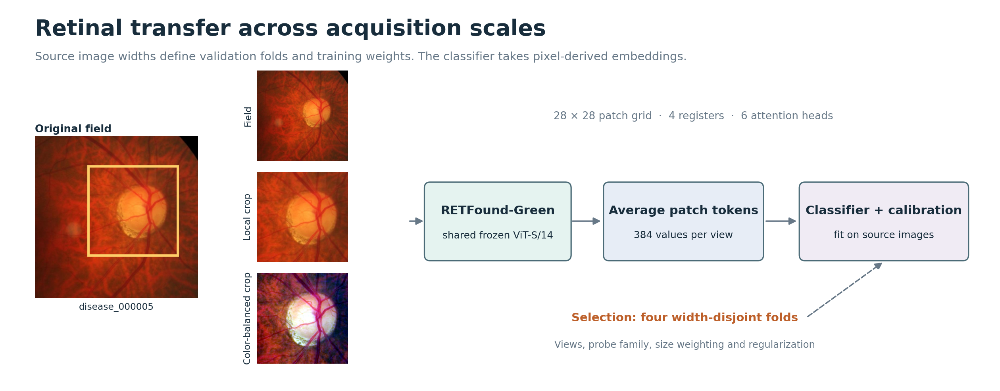

图 10 金框表示实际裁剪位置。新模型不接收图宽或文件名作为输入特征。三视图线性头有 1,153 个系数（含截距），另有两个概率校准系数。[可编辑架构图](figures/foundation_architecture.svg) · [特征代码](retinal_features.py) · [眼底权重校验](data/foundation/retina.json) · [自然图像权重校验](data/foundation/natural.json)

**选型与阈值在测试前锁定。** 与早期 ResNet 使用相同的 1,393 张拟合图，定义图宽组为 ⌊宽度 / 32⌋。每组的图像完整放入同一折，分层分组四折均含两类。每次仅用其余三折估计特征均值和尺度，再将样本向量归一到单位长度。宽度组是采集差异的可观测代理，课程包未提供相机或患者编号。这一轮是在原测试结果已知后设计的追加研究；没有新的独立测试集。

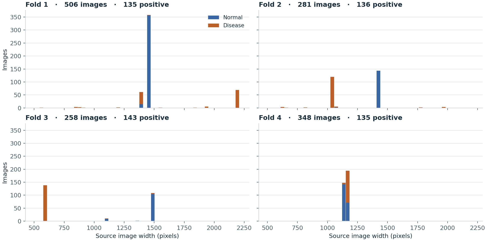

图 11 四折分别留出 506、281、258、348 张图。三视图的逐折 AUROC 为 0.8674、0.9745、0.9950 和 0.8057。最后一折包含拟合集中不少 1,100～1,200 像素的图，该折和其余三折的难度差异在汇总均值中并不明显。[逐图折分](outputs/foundation/folds.csv)

每种表征比较逻辑回归与 RBF-SVM（γ = 1）、三个 C 值（0.1、1、10），以及普通权重和尺寸平衡权重。后者对“类别 × 宽度组”的样本数取平方根倒数，再在各类别内恢复原权重总和。每个候选计算四个留出折 AUROC 的等权平均，7 种表征共 84 个配置、336 次折内拟合。各表征按该均值选读出头，全局最高者是三视图配线性读出、C = 10 和尺寸平衡权重。使用其折外分数拟合一维 logistic 校准并以 Youden 指数设阈值，最后在全部 1,393 张拟合图上重训读出头。246 张随机验证图可用来比较两种验证方案的难度。[全量网格](outputs/foundation/cv_grid.csv) · [折外概率](outputs/foundation/oof_predictions.csv) · [锁定配置](outputs/foundation/selection.json)

| 配置（每行在训练侧选读出头） | 四折平均 AUROC | 最低折 AUROC | 随机验证 AUROC | 教师测试 AUROC | 测试准确率 | 测试 AP |
|---|---:|---:|---:|---:|---:|---:|
| 冻结 ResNet 全图 | 0.8897 | 0.7780 | 0.9507 | 0.6540 | 58.8% | 0.4574 |
| 自然图像 DINOv2 全图 | 0.8707 | 0.6781 | 0.9836 | **0.8528** | **72.4%** | **0.7798** |
| RETFound-Green 全图 | 0.8843 | 0.7769 | 0.9817 | 0.7141 | 70.4% | 0.5330 |
| 仅原色局部 | 0.8762 | 0.7570 | 0.9605 | 0.7498 | 68.0% | 0.6011 |
| 仅标准化局部 | 0.9097 | **0.8128** | 0.9871 | 0.7833 | 68.0% | 0.6732 |
| 全图 + 原色局部 | 0.8908 | 0.7650 | 0.9859 | 0.7269 | 69.6% | 0.5652 |
| 全图 + 两种局部 | **0.9106** | 0.8057 | **0.9940** | **0.7519** | 68.4% | 0.6060 |

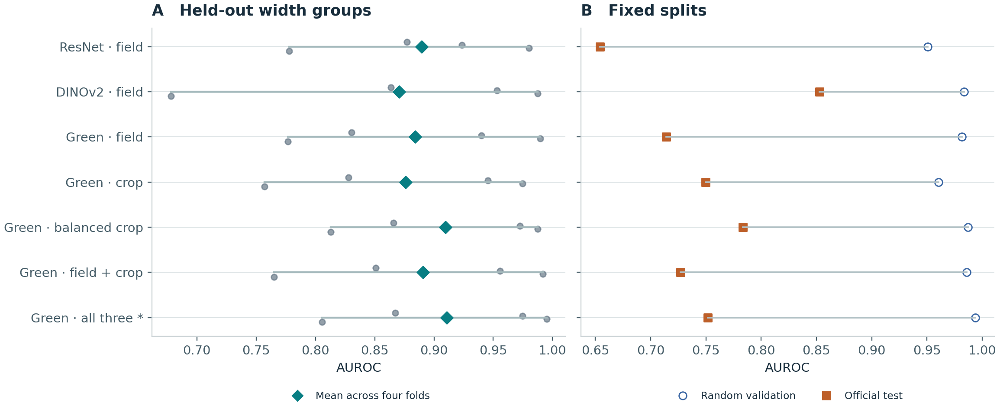

图 12 左图每个灰点是一折，菱形为四折均值；右图方点为官方测试。DINOv2 的分组验证分数最低，却在教师测试上排第一。两个全图 ViT 使用同一空间网格、相同的线性读出、C 和样本权重。两者仍沿用各自的预训练归一化方式。该逆序说明，留出图宽覆盖了部分采集变化，无法重建这份测试集的全部差异。

为分清输入视图和分类器的作用，又让七种表征统一使用已选定的线性头、C = 10 和尺寸平衡权重。RETFound-Green 的全图、原色局部、标准化局部、双视图和三视图测试 AUROC 分别为 0.7141、0.7498、0.7484、0.7269、0.7519。标准化局部在前表达到 0.7833，包含了 RBF 读出与样本权重共同改变的效果。双视图上新增标准化局部，在固定读出条件下使 AUROC 增加 0.0250。[固定读出的完整对照](outputs/foundation/matched_readout.csv)

### 同一阈值应用到不同数据

三视图锁定阈值为 0.3362。它在训练侧表现平稳，应用到教师测试集后明显增加了误报。

| 数据 | 准确率 | AUROC | AP | 灵敏度 | 特异度 | F1 | Brier ↓ |
|---|---:|---:|---:|---:|---:|---:|---:|
| 拟合 | 97.99% | 0.9985 | 0.9980 | 0.9891 | 0.9739 | 0.9749 | 0.0288 |
| 随机验证 | 96.75% | 0.9940 | 0.9921 | 0.9381 | 0.9866 | 0.9579 | 0.0434 |
| 完整训练集 | 97.80% | 0.9979 | 0.9971 | 0.9814 | 0.9758 | 0.9724 | 0.0310 |
| 教师测试 | 68.40% | 0.7519 | 0.6060 | 0.9400 | 0.5133 | 0.7041 | 0.2174 |

将同一个三视图模型的权重和分数固定，改用旧 ResNet 的做法，在原有的 246 张随机验证图上最大化 Youden 指数。验证阈值从 0.3362 移至 0.3092。在教师测试集上，这一变化多检出 1 张患病图，也多误报 2 张正常图。两种阈值的准确率仅差 0.4 个百分点，均低于旧集成的 72.0%。[两种阈值在验证、测试上的完整结果](outputs/foundation/threshold_comparison.csv)

| 模型与阈值来源 | 固定阈值 | 测试 TP | FN | TN | FP | 测试准确率 |
|---|---:|---:|---:|---:|---:|---:|
| 旧 ResNet 微调集成，随机验证 | 0.5937 | 94 | 6 | 86 | 64 | 72.0% |
| 三视图，按图宽分组的折外分数 | 0.3362 | 94 | 6 | 77 | 73 | 68.4% |
| 三视图，随机验证 | 0.3092 | 95 | 5 | 75 | 75 | 68.0% |

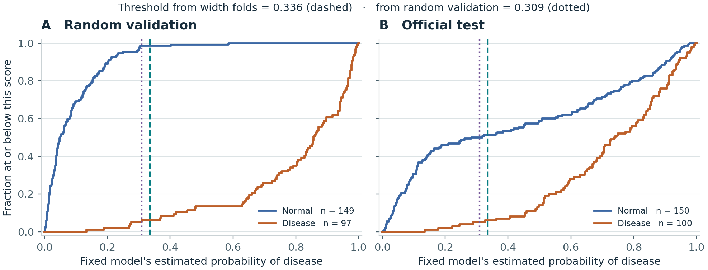

图 13 虚线与正常类累积曲线的交点给出特异度。两条阈值线靠得很近，但在同一个 0.3362 阈值处，验证集有 98.7% 的正常图落在线的左侧，测试集只有 51.3%。正常图分数的右移解释了误报增加的幅度。

同批比较，旧微调集成和三视图分别判对 180、171 张，二者各检出 94 张患病图，后者多报 9 张正常图。三视图的 AUROC 增量为 **0.0610**，按真实类别配对重采样 2,000 次，95% 百分位区间为 **0.0190～0.1041**。准确率变化为 −3.6 个百分点，区间为 −7.2～0.0 个百分点。两模型纠错的方向不对称：三视图纠正了旧模型的 6 张，又把原来正确的 15 张判错，精确 McNemar 双侧检验 p = 0.0784。区间以图像为抽样单位。[指标](outputs/foundation/metrics.csv) · [配对区间](outputs/foundation/paired.json) · [逐图分数](outputs/foundation/predictions.csv)

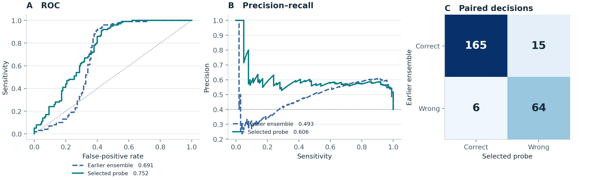

图 14 在“拟合时未见过精确宽高”的 149 张测试图内，AUROC 从 0.7545 升至 0.8994，其中患病样本只有 7 张。在精确尺寸已见的 101 张图内，AUROC 从 0.8925 变为 0.8575，其中正常样本只有 8 张。这样的分组能定位变化来源，分组内的单个样本也足以显著改变指标。[分组统计](outputs/foundation/subgroups.csv)

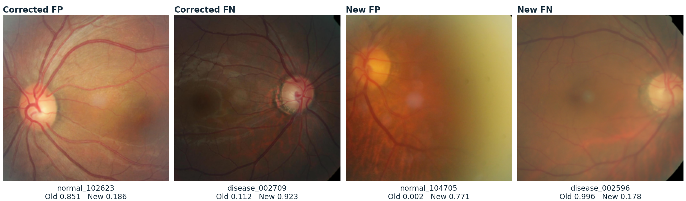

图 15 disease_002709 原来得分 0.112，换用三视图后为 0.923，纠正了漏报；normal_104705 从 0.002 升至 0.771，带来新误报。每组取两个模型相对于各自阈值的分数距离变化绝对值最大者，原分辨率和文件名均可回查。[案例清单](outputs/foundation/paired_cases.csv)

### 压暗、降采样与 JPEG 压缩

固定主模型和旧集成的权重、阈值，在相同的 250 张图上分别施加四种单一扰动。亮度缩放和 gamma 在 RGB 像素上逐通道执行；降采样先缩到 96 × 96，再恢复原尺寸；JPEG 在原图上以质量 20 重新编码。表中“翻转”统计同一模型相对无扰动输入改变判决的图像数。

| 输入条件 | 旧集成 AUROC | 三视图 AUROC | 三视图准确率 | 三视图翻转数 |
|---|---:|---:|---:|---:|
| 原图（重载） | 0.6908 | 0.7519 | 68.4% | 0 |
| 亮度乘 0.65 | 0.6829 | 0.7311 | 67.6% | 10 |
| gamma 1.6 | 0.6519 | 0.7022 | 61.6% | 27 |
| 先缩至 96 像素 | 0.7034 | 0.7795 | 67.2% | 19 |
| JPEG 质量 20 | 0.6632 | 0.6587 | 56.8% | 31 |

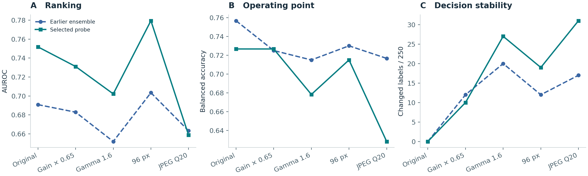

图 16 三视图对简单压暗较稳定，却对强 JPEG 压缩敏感。强压缩后，正常图误报由 73 张增至 101 张。低分辨率输入的 AUROC 反而更高，阈值准确率略低；消除部分高频线索对排序和对固定阈值的作用并不相同。重载的旧模型使用 BF16 和不同批大小，AUROC 与原表相差约 0.0001。[扰动结果](outputs/foundation/stress_metrics.csv) · [逐图扰动数据](outputs/foundation/stress_predictions.csv)

在同一线性读出下，加入两个局部视图后，RETFound-Green 的测试 AUROC 从 0.7141 升至 0.7519。对这批测试图，区分两类最好的表征仍是自然图像 DINOv2 的全图特征，而训练侧四折均值最高的三视图配置比旧微调集成多报了 9 张正常图。若能获得采集来源或患者编号，下一次验证值得检验这种模型排序的逆转能否重现。

## 第三轮：在相近采集条件下寻找可迁移的空间特征

上一轮 DINOv2 全图在教师测试上达到 0.8528 AUROC，但在训练侧四折排在末位。分组能隔开相同图宽，同一折内的患病图和正常图却仍可能来自不同的宽度段。第三轮保留 1,393 张拟合图和原有四折，将同一宽度段内的跨类比较加入选型准则，同时让读出头主动舍弃与图宽相关的特征方向。

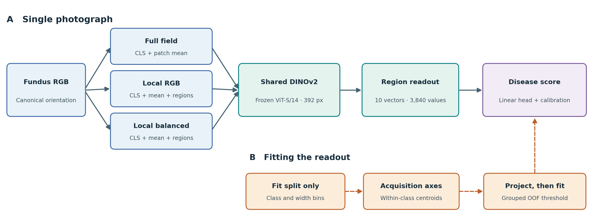

图 17a 实线是单张图像的推理路径，虚线是只在拟合阶段使用的步骤。中心与环带来自共享编码器的 patch，十组 384 维向量组成最终特征。下方的投影在部署前已经合入线性系数。[可编辑架构图](figures/spatial_architecture.svg)

### 亮区周围值得保留多少空间信息？

先在 96 × 96 缩略图上定位一个相对周围背景偏亮的区域。定位分数融合绿色通道两种尺度的平滑差和少量红色通道亮度，横向搜索范围扩展到第 3～92 列。第二轮只搜索中央 60%，容易错过靠近左右边缘的目标。按此位置裁出原图短边 42% 的正方形，超出图像的部分镜像补齐。亮区在左侧时将三个视图同步水平翻转，使局部几何方向一致。全图、原色局部、2%～98% 分位拉伸后的局部均缩放到 392 × 392。这里看到的是候选亮区，数据没有专家画出的视盘或病灶边界。[定位和特征提取代码](spatial_features.py)

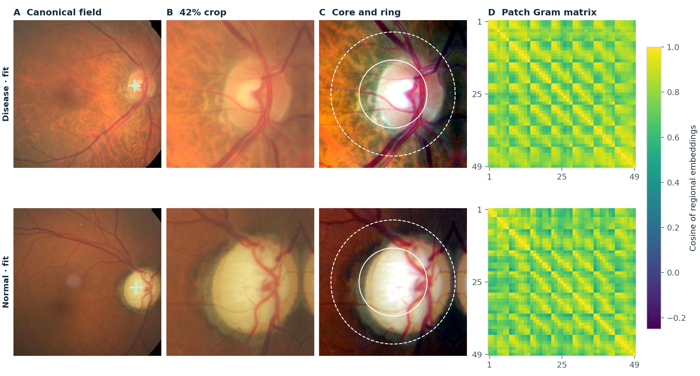

图 17b 青色十字标出候选中心。每个视图使用冻结 DINOv2-S/14-reg4 的 CLS 和 28 × 28 patch 网格的均值。两个局部视图还分别读出中心和环带，半径按裁图宽度归一化，中心取 r < 0.23，环带取 0.23 ≤ r < 0.42。四组向量各先归一化再等权拼接，共 3,840 维，最终仅学习线性读出。推理输入为单张 RGB 图，宽度段标签只在训练中使用。[两张原图的身份与坐标](outputs/spatial/localization_examples.csv) · [可编辑 SVG](figures/spatial_regions.svg)

另做了一种空间关系描述。Siméoni 等人的 DINOv3 在预训练中用 Gram anchoring 保持 patch 间的空间关系。我们复用这个思路，把两个局部视图的 DINOv2 网格各池化为 7 × 7，计算所有 1,176 对不同位置间的余弦相似度，直接作为可选的分类特征。图 17b 的 D 栏给出原色分支。编码器仍然使用第二轮的 DINOv2 权重。[DINOv3，arXiv 首稿 2025-08-13，TMLR 2026](https://arxiv.org/abs/2508.10104) · [Gram 特征实现](spatial_shapes.py)

### 怎样压低图宽对读出的影响？

George 等人用线性投影从冻结表征中移除与身份相关的方向。我们将这一方法改用于眼底图的采集差异。在每个训练折内，对患病和正常两类分别求均值，再计算该类各图宽段的特征均值与类均值之差。只在至少有 3 张样本的“类别 × 图宽段”中估计均值，以 √[n/(n+15)] 收缩小组的贡献。对这些差向量做 SVD，移除前 r 个方向，在余下特征上拟合带截距的加权岭回归。投影和读出可以合并为一个权重向量。新图像不需要先确定属于哪个尺寸组。[From Measurement to Mitigation，arXiv 首稿 2026-04-07](https://arxiv.org/abs/2604.05296) · [CVPR 2026 会议论文](https://openaccess.thecvf.com/content/CVPR2026/papers/George_From_Measurement_to_Mitigation_Quantifying_and_Reducing_Identity_Leakage_in_CVPR_2026_paper.pdf) · [四折训练和单图推理](spatial.py)

选型分数是两个 AUROC 的等权平均。一项对四个留出折取平均，另一项在同一宽度段内比较折外分数。只有各含至少 2 张患病图和正常图的段进入第二项，权重为两类数量的调和均值。六个符合条件的宽度段中，36 号段有 123 张患病、71 张正常，45 号段虽有 356 张正常，却只有 2 张患病。后者因此不会仅凭样本多就主导结果。

先比较 8 组特征和 0、4、12 三档投影秩，源侧最优分数为 0.8966，出现在当时的秩上界。在查看本轮教师测试结果前，再加入 18、24 两档和三种含 Gram 的特征组合。最终比较 11 组特征 × 5 档秩 × 3 个岭系数 × 2 种样本权重，共 **330 个配置**。第一种权重使两类总权重相等，第二种还给同一宽度中存在异类图像的样本分配一半训练权重。主模型在训练侧确定为全图、双局部及其中心和环带，采用类别平衡、岭系数 0.5 和投影秩上限 18。源侧分数升到 **0.9036**，在固定读出下将秩上限增至 24 已不改变四折分数。[第一轮源侧记录](outputs/spatial/initial/cv_grid.csv) · [完整网格](outputs/spatial/cv_grid.csv) · [锁定配置](outputs/spatial/selection.json)

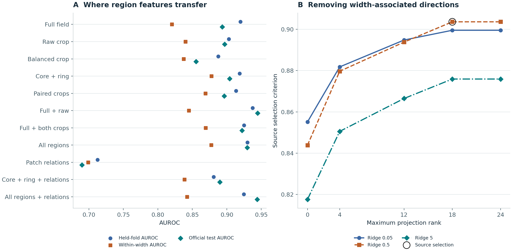

图 18 四组区域合用时，固定其余设置，投影秩上限 0、4、12、18、24 的宽度内 AUROC 依次为 0.7791、0.8360、0.8604、0.8775、0.8775。只用原色和标准化局部的中心及环带，也可达到 0.8776 的宽度内 AUROC。单用 Gram 缺少绝对外观信息，在测试集上只有 0.6900 AUROC。把 Gram 加入全部区域后，源侧分数 0.8835，低于所选方案。这里的训练有闭式解，曲线横轴是投影秩，各点都是实际拟合结果。[逐区域选择](outputs/spatial/ablation_selection.csv) · [同读出控制](outputs/spatial/matched_controls.csv) · [可编辑 SVG](figures/spatial_selection.svg)

### 同一批 250 张图，错误减少在哪里？

所有阈值先用训练侧折外分数设定，测试阶段固定权重和阈值。主操作点采用普通类别平衡和尺寸组内类别重叠各占一半的加权 Youden 指数，阈值为 0.6515。等成本操作点则最大化拟合集总体准确率与四折准确率均值的平均值，阈值为 0.5248。[阈值规则与数值](outputs/spatial/operating_points.json) · [源侧阈值数据](outputs/spatial/source_operating.csv)

| 数据 | 张数 | 准确率 | AUROC | AP | 灵敏度 | 特异度 |
|---|---:|---:|---:|---:|---:|---:|
| 拟合 | 1,393 | 95.84% | 0.9948 | 0.9917 | 90.53% | 99.29% |
| 随机验证 | 246 | 91.87% | 0.9893 | 0.9813 | 80.41% | 99.33% |
| 完整训练集 | 1,639 | 95.24% | 0.9939 | 0.9871 | 89.01% | 99.30% |
| 教师测试 | 250 | **86.40%** | **0.9296** | **0.8745** | **92.00%** | **82.67%** |

| 同一教师测试集 | AUROC | 准确率 | 检出患病 / 100 | 误报正常 / 150 |
|---|---:|---:|---:|---:|
| 上一轮源侧选中的 RETFound 三视图 | 0.7519 | 68.4% | 94 | 73 |
| 上一轮测试表现最好的 DINOv2 全图对照 | 0.8528 | 72.4% | 92 | 61 |
| 第三轮源侧选定的 DINOv2 空间读出 | **0.9296** | **86.4%** | **92** | **26** |
| 同一权重切换为等成本操作点 | 0.9296 | 82.8% | 96 | 39 |
| 同一特征结构和读出设置，更换为 RETFound 权重 | 0.8801 | 76.8% | 94 | 52 |
| 全图 + 原色局部，读出按各自源侧验证选定 | 0.9445 | 88.4% | 92 | 21 |

相对历史 DINOv2 全图对照，主模型 AUROC 增量为 **0.0768**，按正负类分层、在相同图像上做 2,000 次配对重采样，95% 区间为 **0.0383～0.1201**。准确率增加 **14.0 个百分点**，95% 区间为 **8.8～19.6 个百分点**。两种模型都检出 92 张患病图，新模型把正常图误报从 61 张降到 26 张。全图加原色局部在教师测试达到 0.9445，是这批消融中最高的排序分数；源侧选择准则仍保留完整空间读出。[逐图预测](outputs/spatial/predictions.csv) · [测试与训练指标](outputs/spatial/metrics.csv) · [配对区间](outputs/spatial/paired.csv)

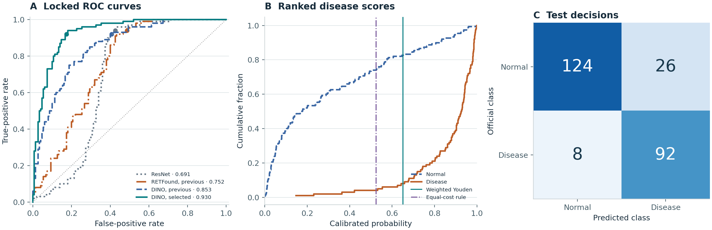

图 19 ROC 曲线上的圆点分别对应各模型锁定的操作点。0.6515 的主阈值下共有 216 张图分类正确。把阈值切换到 0.5248 后，额外检出 4 张患病图，也额外误报 13 张正常图。[可编辑 SVG](figures/spatial_outcomes.svg)

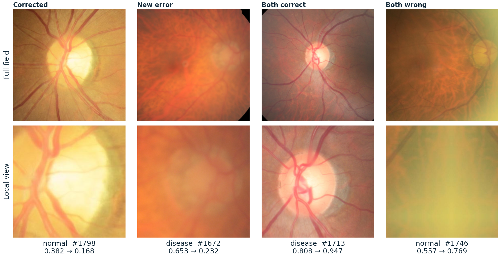

图 20 与历史全图模型逐例对照，新模型纠正 46 张、引入 11 个新错误，两者同对 170 张、同错 23 张。每组选择两模型分数差绝对值最接近组内中位数的图。左列 normal_095276 有醒目的亮区，空间模型把旧模型的 0.382 降到 0.168，纠正了误报。第二列 disease_002468 全图光照不均，局部裁图几乎只剩橙色纹理，分数从 0.653 降到 0.232，形成一次漏报。它点出了亮区定位的代价，定位不到有信息的区域时，放大倍数再高也补不回缺失的结构。[四例与组内图数](outputs/spatial/cases.csv) · [可编辑 SVG](figures/spatial_cases.svg)

### 锁定同一个读出，拆开区域、投影和输入质量的影响

各行自行选头时，区域组合与超参数会一起变化。再固定主模型的岭系数 0.5、类别平衡策略和阈值选择规则，只改变一个因素。使用全部区域时，关闭采集方向投影，测试 AUROC 从 0.9296 降到 **0.8591**，准确率从 86.4% 降到 **76.4%**。保留投影、仅用原色局部，AUROC 为 0.8968；加入全图后为 0.9220。原色和标准化视图再加入中心与环带，AUROC 从 0.9219 升到 0.9296，固定规则的测试准确率从 82.4% 升到 86.4%。

秩曲线的平顶有具体成因。各折可估计的有效采集方向只有 **13、15、16、16 个**，因而上限 18 与 24 在四折内给出相同解。用完整拟合集重训则能估出 20 个方向，两种上限的测试 AUROC 分别为 0.9296、0.9348。主模型沿用训练侧平局时取较小秩的规则。这里测得的是当前视图、当前数据和这组读出中的选择边界。[固定读出、各折有效秩及所有测试指标](outputs/spatial/matched_controls.csv) · [固定读出的逐图分数](outputs/spatial/matched_predictions.csv)

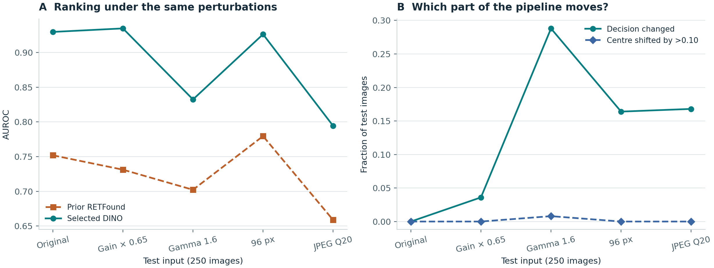

图 21 把同样的四种扰动施加到全部 250 张原图，保留原权重和阈值。亮度乘 0.65 后，AUROC 为 0.9347、准确率 85.2%；先缩至 96 像素后分别为 0.9262、82.0%。非线性 gamma 1.6 更棘手，准确率降至 **63.2%**，正常图误报从 26 张增加到 91 张，72 张图改变判决。归一化坐标中，亮区中心移动距离超过 0.10 的只有两张，说明大范围定位跳变解释不了多数判决变化。JPEG 质量 20 时仍有 71.2% 准确率，但 AUROC 降至 0.7943。[扰动汇总](outputs/spatial/stress_metrics.csv) · [各图的分数与中心坐标](outputs/spatial/stress_predictions.csv) · [可编辑 SVG](figures/spatial_perturbations.svg)

## 结论

先前的尺寸对照能取得很高的测试 AUROC，却在遇到未见宽高时把大量正常图误报为患病。第三轮将宽度信息留在训练侧，用它来估计哪些像素表征值得舍弃，再综合全图、亮区中心和外围形成判决。相对历史最强全图对照，新模型在同一灵敏度下少报 35 张正常图。最需要解决的余留问题是低对比度图像和非线性灰度变化，尤其是只裁到背景时的漏报。三轮均使用课程既有测试集，跨患者或跨设备的表现仍需带相应标识的独立队列验证。

## 复现与单图推理

第三轮沿用 `ml-course` 环境，从项目根目录运行。使用已保存权重时，可直接跳到 `predict`。六张原始 JPEG 已与特征缓存独立核对，概率最大绝对差低于 10⁻⁶，六个判决均相同。[逐例核验](outputs/spatial/verification.json) · [训练侧协议](outputs/spatial/protocol.json) · [最终读出权重](outputs/spatial/all_regions.npz)

```bash
python -m experiment2.spatial_features natural
python -m experiment2.spatial_features retina
python -m experiment2.spatial_shapes natural
python -m experiment2.spatial_shapes retina
OPENBLAS_NUM_THREADS=3 python -m experiment2.spatial select
python -m experiment2.spatial evaluate
python -m experiment2.spatial_controls
python -m experiment2.spatial_figures
python -m experiment2.spatial_stress
python -m experiment2.spatial verify
python -m experiment2.spatial predict --image /path/to/fundus.jpg
```

### 第一、二轮基线与读出

在项目根目录、已激活的 ml-course 环境执行下列命令。原始 ZIP、images.csv 与旧微调集成位于前述路径；分类器、校准系数、固定配置和划分均保留在 outputs/foundation。提取脚本会检查下游实验使用的官方权重 SHA256；所需额外包为 timm 0.9.12。

```bash
python -m pip install timm==0.9.12
python -m experiment2.retinal_features retina
python -m experiment2.retinal_features natural
python -m experiment2.foundation select
python -m experiment2.foundation test
python -m experiment2.foundation_matched
python -m experiment2.foundation_figures
python -m experiment2.foundation_stress
python -m experiment2.foundation verify
python -m experiment2.foundation predict --image /path/to/fundus.jpg
python -m experiment2.foundation predict --view-set dino_global --image /path/to/fundus.jpg
```

[锁定模型读出权重](outputs/foundation/retina_triple.joblib) · [原 JPEG 重载核验](outputs/foundation/verification.json) · [分组选择和推理源码](foundation.py) · [新增绘图源码](foundation_figures.py) · [扰动实现](foundation_stress.py)。早期 ResNet 实验和全项目运行说明见[项目首页](../README.md)。各图都保存了同名 SVG，可分别修改箭头、文字、坐标和线条。

[三个实验的论文出处、首稿日期与选择理由](../method-origins.md)
