# 多尺度视觉表征能否预测偏离画面中央的注视？

**机器学习基础 · 实验三 | SY2631122 徐基恒**

**摘要** 在课程注视数据上，把所有拟合图的注视分布取平均，已能得到 0.7834 的测试相关系数。模型需要进一步识别哪些图像内容会把人的目光引向中央以外。本文用三个输入尺度提取冻结 DINOv2 特征，再将三尺度读出与融合 PE-Spatial、局部纹理的读出组合。按验证集选定的密度模型在 400 张原尺寸图上的相关系数为 0.9021，KL 散度为 0.2455，分布重叠度为 0.7606。同一读出从单尺度换成三尺度，相关系数从 0.8937 升到 0.8989；加入外部显著性模型带来的额外变化远小于两条课程分支的贡献。

**关键词** 自由观看、注视密度、多尺度表征、内容引导重采样、场景先验

## 1 问题描述

输入为一幅场景 RGB 图像，输出与原图同宽高、非负且像素和为 1 的概率密度 $Q$。教师提供的灰度标注表示人群自由观看时的注视强度，归一化后得到目标分布 $P$。任务不提供观察者的眼睛或头部位置，也不提供逐人的离散注视坐标。预测和评价都针对整张密度图。

| 表 1 课程划分 | 场景数 | 每类图数 | 总图数 | 用途 |
|---|---:|---:|---:|---|
| 拟合 | 20 | 68 | 1,360 | 特征降维、空间先验、读出头训练 |
| 验证 | 20 | 12 | 240 | 按平均 CC 选轮次和概率融合权重 |
| 测试 | 20 | 20 | 400 | 原图推理，与同名 FIXATIONMAPS 配对 |

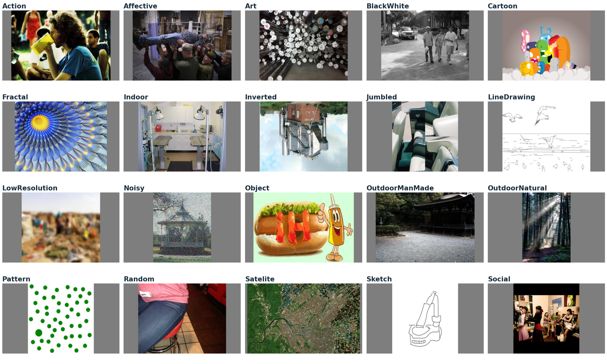

图 1 人像、线描、噪声和自然场景在纹理密度与物体大小上差异很大。保留 1,920×1,080 原图及其自带边框，以目录和文件名确保图像与标注一一对应。[数据清单](data/images.csv)

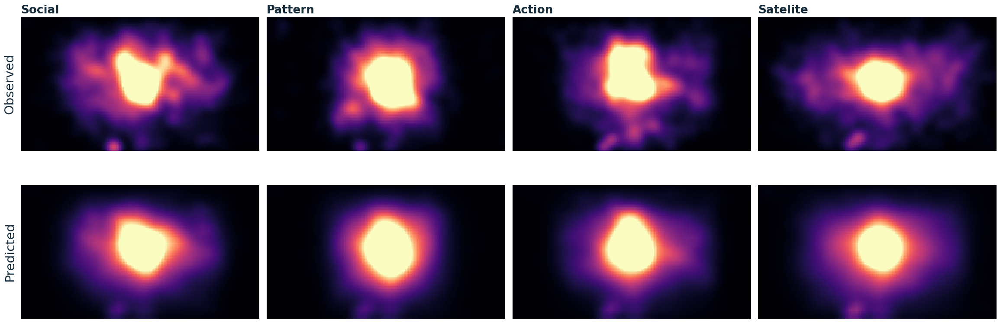

图 2 多个场景类别有共同的中央偏好。只靠类别均值无法分辨同类两幅图中物体位于左边还是右边，这为内容特征提供了可以检验的作用。

## 2 模型原理与创新设计

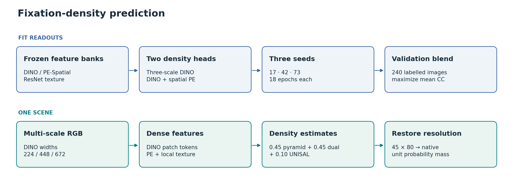

图 3 两条课程分支各训练三个种子。推理先将分支预测归一化为概率，按验证权重求和，再恢复标注分辨率。[可编辑 SVG](figures/report_pipeline.svg)

**创新一：在不同输入尺度真正重算特征。** 受 *Modeling Saliency Dataset Bias* 对视觉尺度的分析启发，将同一幅图缩放到宽 224、448、672 像素，送入共享的 DINOv2-S/14。取第 6、12 个块的空间特征，用拟合集学到的 PCA 压缩通道。粗尺度保留全场布局，细尺度能拆开原本落在同一格的热点。扩大的空间网格来自重新编码原图，而非对单张低分辨率特征做插值。[ICCV 2025 原文](https://arxiv.org/abs/2505.10169) · [多尺度实现](multiscale_features.py)

**创新二：让语义互补，让纹理决定局部位置。** 双编码器分支保留 DINO 中、细尺度，用 Meta PE-Spatial-T16 的中间特征替换粗尺度。受 AnyUp 启发，以浅层 ResNet 纹理预测局部查询权重，以语义邻域预测键，在 3×3 范围内重取样，再与原特征相加。场景向量还调节位置偏置、峰值温度及三个扩散宽度。PE 使用作者权重，局部重采样层和扩散头由课程密度监督训练。[Perception Encoder](https://arxiv.org/abs/2504.13181) · [AnyUp](https://arxiv.org/abs/2510.12764) · [本地读出](multiscale_train.py)

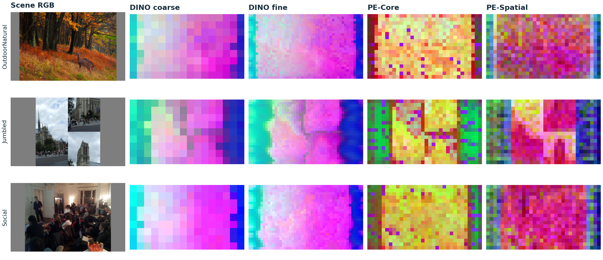

图 4 各列用各自拟合数据的固定色标显示三个主成分。细尺度和 PE 特征能显示粗网格中不易分开的局部区域；是否对应人的目光，仍需对照标注评测。

**创新三：用整幅概率分布做验证融合。** 读出头将内容分数与训练集平均注视图的对数先验相加，经空间 softmax 归一化。冻结的 UNISAL 使用 SALICON 静态分支，提供另一套外部预测。验证 CC 选出 45% 三尺度 DINO、45% DINO/PE、10% 原始 UNISAL。三项权重作用于概率密度，推理不需要场景标签。[融合选择记录](outputs/multiscale/fusion_validation.csv)

## 3 模型结构、训练与评价

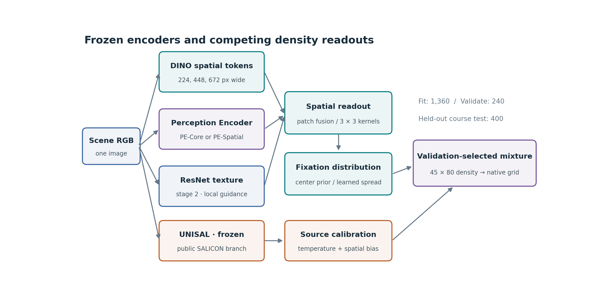

图 5 展开两路空间读出。冻结骨干的输出可以在同一组不同种子的读出头间共享。[可编辑架构图](figures/multiscale_architecture.svg)

| 表 2 模块 | 输入 → 输出 | 参数或计算量 |
|---|---|---|
| 冻结 DINOv2-S/14-reg4 | 224×126、448×252、672×378 → 16×9、32×18、48×27 网格 | 22,058,112 个参数共享；三档计入的算子分别为 6.39、24.93、55.84 GFLOPs |
| PE-Spatial-T16 | 512×288 → 32×18 网格 | 取第 6、11 块，各压缩到 64 维；另用 PE-Core 同结构对照 |
| 三尺度 DINO 头 | 语义与 128 通道浅层纹理 → 80×45 概率图 | 40,802 参数／头，约 0.109 GFLOPs |
| DINO/PE 双编码器头 | 语义、纹理及 48 维场景向量 → 80×45 | 47,079 参数／头，约 0.117 GFLOPs |
| 输出 | 六个课程头 + 冻结 UNISAL → 原尺寸密度 | 六个课程头合计 263,643 个可训练参数 |

计算量按一次乘加计两次，表 2 给出指定分支实测的可识别算子，PE、UNISAL、浅层纹理和插值开销另计。[结构计数](outputs/report_replay/complexity.csv) · [官方权重与 PCA 记录](outputs/multiscale/pe_spatial.json)

| 表 3 训练参数 | 设置 |
|---|---|
| 优化器 | AdamW，批量 20，权重衰减 0.012 |
| 学习率 | 0.0011，经 18 轮余弦衰减到 0.00006 |
| 正则与增强 | 读出卷积 dropout 0.10，梯度范数上限 4，同步水平翻转输入特征、先验和标注 |
| 目标 | $0.8D_{KL}(P\,\Vert\,Q)+0.8(1-CC)+0.25(1-SIM)$ |
| 选择 | 九种结构各三个初始化；按验证 CC 选轮次，先融合课程模型，再选择外部模型占比 |

CC 为 $P,Q$ 展平并去均值后的余弦相似度，越接近 1，热点的相对起伏越一致。$D_{KL}=∑_i P_i\log(P_i/Q_i)$ 衡量模型把概率分给真实注视区域的程度，越低越好。$SIM=∑_i\min(P_i,Q_i)$ 是两幅单位质量图的重合量，理想值为 1。各图等权，逐图计算后再求均值。[课程指标函数](../../Machine-Learning-Class-Assignment26/metric.py)

本次在 RTX 3070 Ti Laptop GPU（8 GB）上，复用冻结骨干的拟合特征，用 17、42、73 三个种子分别初始化三尺度和双编码器分支的读出头，共六个，每个重训 18 轮。测试时重新读取所有 400 张 RGB 原图，经冻结编码器和本次训练的权重预测。CC、KL 使用教师原函数直接在原图分辨率以双精度计算。整次调用用时 424.1 秒。表 4 和表 6 标出本次实测，其他结构及配对比较取自此前的同划分实验。[本次设备、权重与指标脚本摘要](outputs/report_replay/run.json) · [本次逐图结果](outputs/report_replay/predictions.csv)

## 4 实验结果分析

### 4.1 总体表现与训练过程

| 表 4 数据或模型 | 图数 | CC ↑ | KL ↓ | SIM ↑ |
|---|---:|---:|---:|---:|
| 最终配置，拟合（归档） | 1,360 | 0.9228 | 0.2162 | 0.7826 |
| 最终配置，验证原图（归档） | 240 | 0.9020 | 0.2412 | 0.7615 |
| 共享位置先验，测试 | 400 | 0.7834 | 0.5152 | 0.6413 |
| 第一轮 ResNet，测试 | 400 | 0.8609 | 0.3173 | 0.7238 |
| 第二轮 DINO + 浅层纹理，测试 | 400 | 0.8910 | 0.2641 | 0.7504 |
| 最终配置，归档批量推理 | 400 | 0.90210 | 0.24551 | 0.76056 |
| **本次重训、逐张原图推理** | **400** | **0.90210** | **0.24551** | **0.76056** |

归档主模型在 280 张图上的 CC、303 张图上的 KL、291 张图上的 SIM 优于第二轮。按类别分层的同图配对 95% 区间分别为 ΔCC [+0.00895, +0.01325]、ΔKL [−0.02146, −0.01574] 和 ΔSIM [+0.00834, +0.01190]。批量编码归档和逐图重算使用不同批大小，这里保留两个结果各自的精度。[归档原图全表](outputs/multiscale/native_metrics.csv) · [配对区间](outputs/multiscale/paired_intervals.csv)

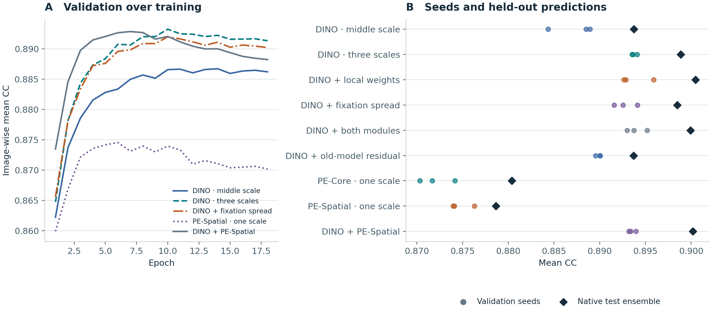

图 6 三条初始化的验证轨迹支持逐种子保留最佳轮次。增添读出组件有时提升测试空间重叠度，却未必提升验证 CC。九臂共 27 个头的比较与本次六个头的重训分开记录。[六头训练示例](outputs/report_replay/dual_42/history.csv)

| 表 4b 本次训练（最佳轮次／验证 CC） | 种子 17 | 种子 42 | 种子 73 |
| --- | --- | --- | --- |
| pyramid | 10 / 0.8941 | 11 / 0.8935 | 10 / 0.8936 |
| dual | 9 / 0.8932 | 8 / 0.8940 | 7 / 0.8934 |

表 4b 是每个单头在 160×90 网格上的验证相关系数；表 4 是融合后在原图上的读数。同一个 seed 的数值不能代替六头融合的原图结果。

### 4.2 特征尺度、密度扩散与外部模型的消融

| 表 5 归档测试，同一 400 张原图 | CC ↑ | KL ↓ | SIM ↑ |
|---|---:|---:|---:|
| DINO 中尺度 | 0.8937 | 0.2596 | 0.7542 |
| DINO 三尺度 | 0.8989 | 0.2511 | 0.7596 |
| 三尺度 + 局部重采样 | 0.9005 | 0.2474 | 0.7618 |
| 三尺度 + 扩散 | 0.8985 | 0.2512 | 0.7598 |
| PE-Core／PE-Spatial 单路 | 0.8804／0.8786 | 0.2828／0.2823 | 0.7409／0.7413 |
| DINO 中、细尺度 + PE-Spatial、取样及扩散 | 0.9002 | 0.2463 | 0.7624 |
| 两条课程分支等权 | 0.90206 | **0.24435** | **0.76352** |
| 加入 10% UNISAL，按验证 CC 选定 | **0.90210** | 0.24551 | 0.76056 |

三尺度比中尺度提高 0.0052 CC，局部重采样在三尺度上再提高约 0.0016。PE 单独使用时，两种权重都落后于同分辨率 DINO；与 DINO 配合后，两条课程分支才产生互补。双编码器配置同时包含重采样和扩散，因此整条分支的提升不能完全归给 PE。

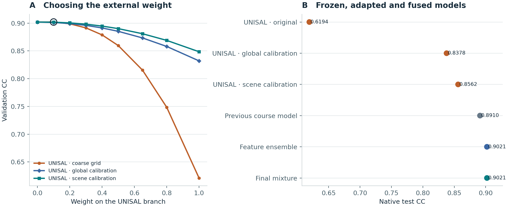

图 7 原始 UNISAL 在同批图上的 CC 为 0.6194，按课程场景校准后达到 0.8562。进入最终混合的是未经校准的少量预测。其测试 CC 边际变化为 +0.00004，配对区间 [−0.00050, +0.00060]；SIM 反而下降 0.00296。如果重点是预测概率与标注的重合，表 5 支持两条课程分支等权。[验证权重及配对测试](outputs/multiscale/anchor_paired.csv)

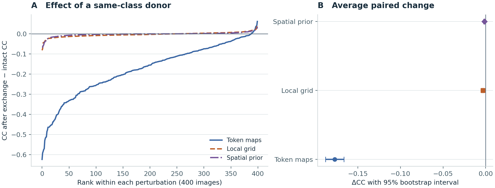

图 8 在历史三分支模型中，把 DINO patch 换成同类另一幅图的特征，CC 从 0.8897 跌到 0.7126，388/400 张图退步。交换浅层纹理仅下降 0.0033，交换场景先验下降 0.0016。保持类别而打乱个体画面能检验模型究竟利用了多细的空间信息。

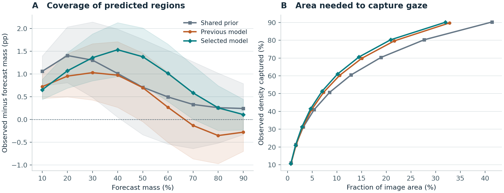

图 9 取覆盖半数预测质量的区域，第二轮模型用 7.02% 的画面面积捕获 51.38% 的真实注视量，全局先验则用 8.54% 面积捕获 50.71%。这项早期诊断补充了 CC 难以表达的热点集中度。

### 4.3 场景差异与失败案例

| 表 6 本次场景 | CC ↑ | KL ↓ | SIM ↑ | 场景 | CC ↑ | KL ↓ | SIM ↑ |
| --- | --- | --- | --- | --- | --- | --- | --- |
| Action | 0.8993 | 0.2496 | 0.7625 | LowResolution | 0.9261 | 0.2583 | 0.7573 |
| Affective | 0.9010 | 0.2636 | 0.7612 | Noisy | 0.9056 | 0.2587 | 0.7486 |
| Art | 0.8952 | 0.2386 | 0.7584 | Object | 0.9051 | 0.2451 | 0.7616 |
| BlackWhite | 0.9144 | 0.2399 | 0.7615 | OutdoorManMade | 0.8880 | 0.2644 | 0.7532 |
| Cartoon | 0.8898 | 0.2454 | 0.7501 | OutdoorNatural | 0.9041 | 0.2370 | 0.7598 |
| Fractal | 0.9184 | 0.2477 | 0.7593 | Pattern | 0.9242 | 0.2314 | 0.7780 |
| Indoor | 0.8992 | 0.2465 | 0.7597 | Random | 0.9064 | 0.2309 | 0.7695 |
| Inverted | 0.9000 | 0.2392 | 0.7662 | Satelite | 0.8818 | 0.2744 | 0.7418 |
| Jumbled | 0.8686 | 0.2333 | 0.7562 | Sketch | 0.9249 | 0.2174 | 0.7851 |
| LineDrawing | 0.9088 | 0.2399 | 0.7599 | Social | 0.8811 | 0.2487 | 0.7613 |

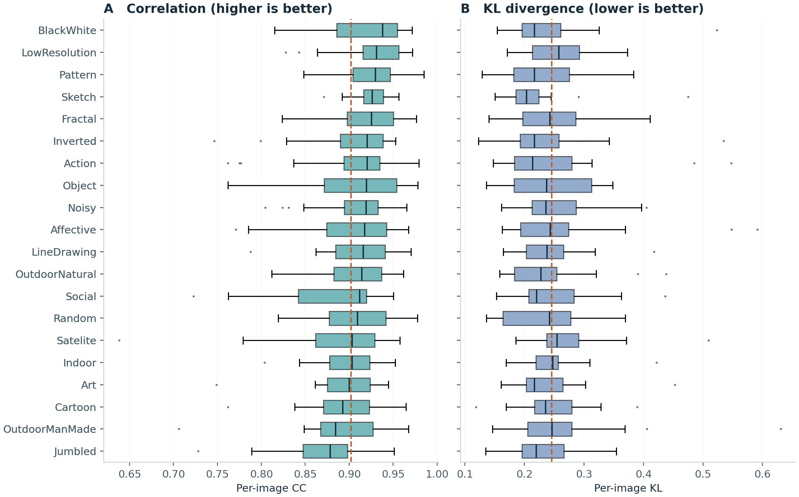

图 10 每个箱包含同类 20 张原图，虚线为全部图像的平均值。中位值反映这一类通常有多难，离群点说明同类图像也可能需要截然不同的热点布局。[本次分类别均值](outputs/report_replay/categories.csv)

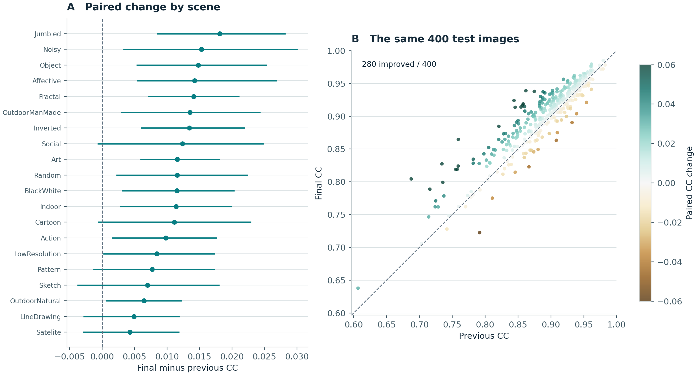

图 11 在归档配对中，20 个场景类别的平均 CC 均提高。Jumbled 增加 0.0181、Noisy 增加 0.0153，Satelite 增加 0.0043。每类样本数为 20，应结合图 10 的离散程度解释小幅差异。

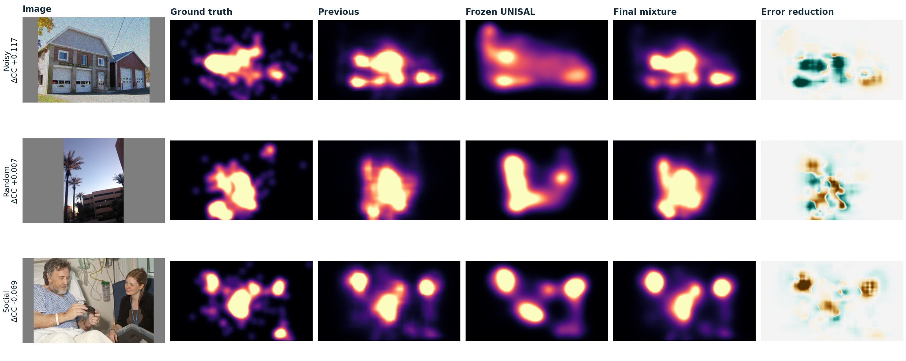

图 12 按 CC 变化取最大值、中位附近和最小值。Noisy/159 的房屋出现多个次级热点，CC 从 0.688 提到 0.805；Random/139 从 0.870 到 0.877。Social/029 上，模型过度集中于两张脸，漏掉脸部之间与下方的注视，CC 从 0.792 降至 0.723。[图版选择记录](outputs/multiscale/gallery.csv)

| 表 7 归档中退步最多的四张图 | 第二轮 CC | 最终 CC | 差值 |
|---|---:|---:|---:|
| Social/029 | 0.7917 | 0.7227 | −0.0691 |
| Cartoon/069 | 0.9083 | 0.8633 | −0.0450 |
| Social/199 | 0.8668 | 0.8230 | −0.0438 |
| LineDrawing/139 | 0.9322 | 0.8904 | −0.0418 |

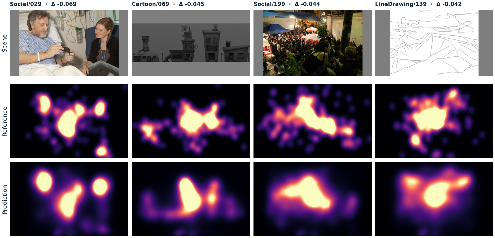

图 12b 展示本次复跑相对上一轮降幅最大的四张图。每列下两行使用相同的 0～4 倍图均值色标，便于辨认次级热点被压低的位置。[本次误差图版数据](outputs/report_replay/cases.csv)

这四张中有两张来自 Social。图 12 给出了 Social/029 中清晰可见的误差；其他三张的数值反映热点布局偏差，单个 CC 无法判断是主峰位置、次峰强度还是扩散宽度造成损失。[全部同图差值](outputs/multiscale/paired_images.csv)

## 5 总结

三种真实输入分辨率同时保留场景布局和目标位置，两路课程模型等权时已取得 0.90206 CC。外部模型对验证 CC 有很小的正贡献，概率重叠指标更偏好纯课程组合。后续可优先在多人脸和多个次级注视点的场景上检验峰间概率是否被低估，再用独立的公开隐藏标注检验跨数据集泛化。现有结果对应教师的 400 张显著图及其原尺寸评测协议。

## 参考文献

1. Kümmerer 等，DeepGaze II，首稿 2016-10-05。冻结视觉表征与注视读出。[论文](https://arxiv.org/abs/1610.01563)
2. Oquab 等，DINOv2，首稿 2023-04-14，TMLR 2024；Darcet 等，Vision Transformers Need Registers，首稿 2023-09-28，ICLR 2024。[DINOv2](https://arxiv.org/abs/2304.07193) · [Registers](https://arxiv.org/abs/2309.16588)
3. Ryan 等，Gaze-LLE，首稿 2024-12-12，CVPR 2025。借鉴冻结编码器，课程任务只输入场景 RGB。[论文](https://arxiv.org/abs/2412.09586)
4. Bolya 等，Perception Encoder，首稿 2025-04-17，NeurIPS 2025。使用 PE-Core 与 PE-Spatial 的官方权重。[论文](https://arxiv.org/abs/2504.13181)
5. Kümmerer 等，Modeling Saliency Dataset Bias，首稿 2025-05-15，ICCV 2025。多尺度、中心偏好和注视扩散的设计来源。[论文](https://arxiv.org/abs/2505.10169)
6. Wimmer 等，AnyUp，首稿 2025-10-14，ICLR 2026。借鉴局部图像引导上采样，课程头独立训练。[论文](https://arxiv.org/abs/2510.12764)
7. Droste、Jiao、Noble，Unified Image and Video Saliency Modeling，首稿 2020-03-11，ECCV 2020。公开静态分支提供同图外部基线。[论文](https://arxiv.org/abs/2003.05477)

## 附录 复现、推理与归档材料

从项目根目录运行。第一条读取既有冻结训练特征，训练并导出独立权重，随后从原图重测。要强制重新训练，使用新的输出目录。单图示例加载项目此前按验证集固定的发布权重。

~~~bash
python -m course.report_replay 3 --output experiment3/outputs/fresh_gaze_run
python -m course.report_figures 3 --input-dir experiment3/outputs/fresh_gaze_run
python -m experiment3.multiscale_predict --image /path/to/scene.jpg --output /tmp/gaze.npy
~~~

省略绘图命令的 `--input-dir` 即可用报告配套的逐图记录重画图 10。[本次逐图指标](outputs/report_replay/predictions.csv) · [运行源码](../course/report_replay.py) · [历轮训练细节、案例与复现命令](report.md)
