# 实验三 预测人眼注视密度：图像内容比中心位置多解释了多少？

[按课程大纲编排的正式报告（含 RTX 3070 Ti 复跑）](SY2631122徐基恒.md)

**徐基恒 · SY2631122**

把所有拟合图像的注视密度取平均，给每张测试图都交同一张预测图，平均相关系数（CC）已有 **0.7834**。第一轮用 ResNet 读取画面，CC 提高到 **0.8609**。第二轮引入冻结的 DINOv2，保留浅层卷积和一个共享位置先验，CC 进一步提高到 **0.8910**，KL 散度从 **0.3173** 降到 **0.2641**。在教师提供的 400 张原尺寸测试标注上，新模型有 303 张的 CC 高于第一轮。提升最大的一张图是林地里的动物，原来留在中央的热点跟着动物移向了右下方。

第三轮在同一划分上加入多尺度 DINO、Meta Perception Encoder 和公开的 UNISAL 对照。验证选出的组合在 400 张原图上取得 **CC 0.9021、KL 0.2455、SIM 0.7606**。最大的收益来自课程多尺度与双编码器分支，外部模型只占最终预测的 10%。[第三轮结构与消融](#third-round)

## 数据与问题

教师训练包中有 1,600 对彩色刺激图和灰度注视图，测试包中有 400 对。按“类别目录 + 文件名”逐一配对，并检查宽高相同。20 类场景各有 80 对训练样本、20 对测试样本。每类留出 12 对作验证，共 1,360 对用于拟合、240 对用于选权重。标注亮度表示注视密度，中心位置相同的两幅标注，其扩散范围和次级热点仍可能相差很大。[逐图清单](data/images.csv) · [原始包校验值](data/raw/download_manifest.json)

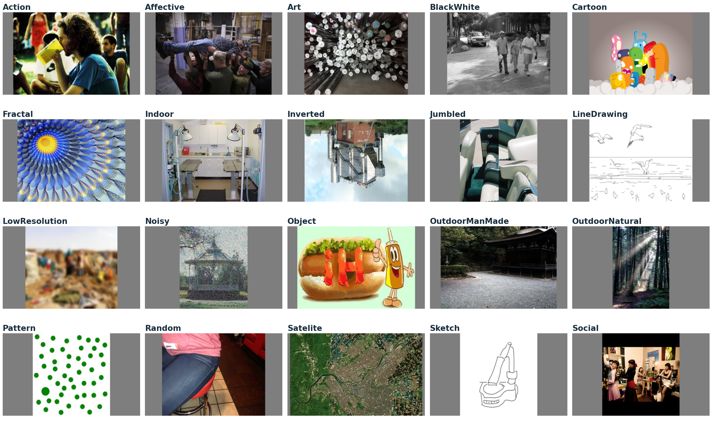

图 1 各类按文件名排序后的第一张测试图。原图自带的灰边保留在输入中。正文和数据表沿用课程目录里的类别拼写，包括 Satelite。

## 第一轮：将内容和位置分别建模

编码器采用冻结的 ImageNet ResNet-18。输入缩放到 320 × 192，三个阶段分别给出 128 × 24 × 40、256 × 12 × 20、512 × 6 × 10 的特征。每路经 1 × 1 卷积压到 16 通道，再双线性插值到 24 × 40。拼接后的 48 通道特征经 3 × 3 卷积、归一化、SiLU 和 1 × 1 卷积，变成每个位置的内容分数。用冻结的识别网络特征预测注视位置这一思路可见 DeepGaze II；本实验的骨干、融合头和训练目标均在课程数据上单独配置。[DeepGaze II](https://arxiv.org/abs/1610.01563)

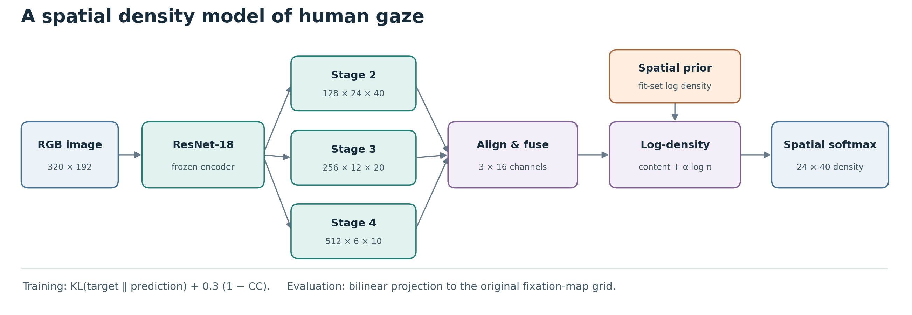

图 2 先验 π 是拟合集中 1,360 张标注各自归一化后求得的平均密度。对内容分数加上 α log π，再对全部 960 个位置做 softmax。α 从 1 开始学习，最终三个种子分别取 0.863、0.862、0.886。[可编辑 SVG](figures/architecture.svg)

损失为 KL(P‖Q) + 0.3 × (1 − CC)，其中 P 为标注，Q 为预测。KL 对漏掉真实注视质量的位置更敏感；CC 衡量扣除各自均值后，两张图的空间起伏是否一致。另报告 SIM，即两幅单位和密度图逐像素取小后的总和，1 表示两者完全重合。所有指标均先逐图计算，再对图像取平均。

四种学习配置共享 AdamW、批量 32、14 轮和种子 17、42、73。初始学习率 0.0015，余弦衰减至 0.00015，权重衰减 0.01。每轮在 160 × 90 网格上计算验证 CC，各种子保留最高点。最后按平均验证 CC 选择结构，平均三个模型的概率图。空间先验、网络训练均只使用拟合子集。

## 两个模块各贡献了多少

下表使用统一的 160 × 90 网格，方便比较所有单次训练。均值后的误差是三个训练种子间的样本标准差。

| 特征与先验 | 可训练参数 | 验证 CC | 测试 CC ↑ | 测试 KL ↓ | 测试 SIM ↑ |
|---|---:|---:|---:|---:|---:|
| 空间先验 | 0 | 0.7735 | 0.7834 | 0.5147 | 0.6414 |
| 末层特征 | 12,977 | 0.6390 | 0.6513 ± 0.0013 | 0.5733 ± 0.0053 | 0.5997 ± 0.0013 |
| 多尺度特征 | 28,433 | 0.7105 | 0.7198 ± 0.0027 | 0.4543 ± 0.0042 | 0.6463 ± 0.0029 |
| 末层特征 + 先验 | 12,978 | 0.8014 | 0.8074 ± 0.0009 | 0.4203 ± 0.0026 | 0.6766 ± 0.0009 |
| 多尺度特征 + 先验 | 28,434 | **0.8497** | **0.8579 ± 0.0006** | **0.3217 ± 0.0027** | **0.7214 ± 0.0017** |

单独靠内容预测时，多尺度读出比末层读出多 0.0685 CC，但仍低于先验。固定使用先验后，加入中浅层特征又带来 0.0505 CC。两个模块结合后，模型能在保留中央总体注视趋势的同时，随具体场景移动热点。[完整消融及各次指标](outputs/metrics.csv)

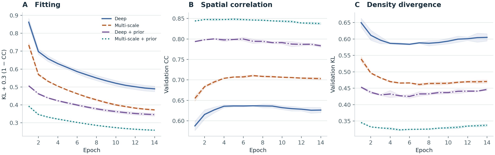

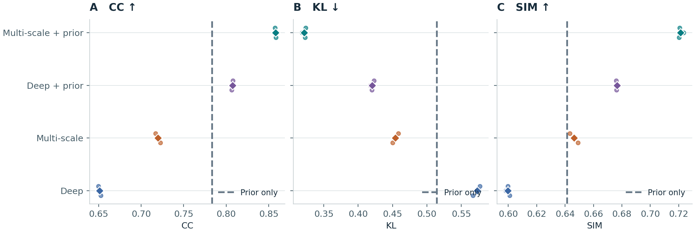

图 3–4 曲线阴影为种子间一个标准差，点图中小圆点对应单次训练、菱形为均值。最终三个读出头分别选中第 4、5、3 轮。随后数轮拟合损失仍在下降，验证 CC 已趋平。

## 回到原图分辨率

将 24 × 40 的预测密度双线性插值回原始标注尺寸，与原始 JPEG 灰度值对应的密度比较。下表给出集成预测在各拆分上的表现。对六张固定样本额外直接调用教师的 CC 和 KLD 函数，结果与批量实现逐项核对。[原尺寸逐图数据](outputs/native_per_image.csv) · [教师函数对照](outputs/teacher_metric_check.json)

| 数据 | 图像数 | CC ↑ | KL ↓ | SIM ↑ |
|---|---:|---:|---:|---:|
| 拟合 | 1,360 | 0.8746 | 0.2921 | 0.7366 |
| 验证 | 240 | 0.8527 | 0.3219 | 0.7202 |
| 完整训练集 | 1,600 | 0.8713 | 0.2965 | 0.7341 |
| 测试 | 400 | **0.8609** | **0.3173** | **0.7238** |
| 测试，空间先验 | 400 | 0.7834 | 0.5152 | 0.6413 |

在每类 20 张测试图内有放回抽样，共 2,000 次。集成预测 CC 的 95% 百分位区间为 0.8539～0.8678。按同一幅图配对，模型比先验平均增加 0.0775 CC，区间为 0.0700～0.0846；KL 平均减少 0.1979，区间为 0.1855～0.2112。[区间数据](outputs/bootstrap.json)

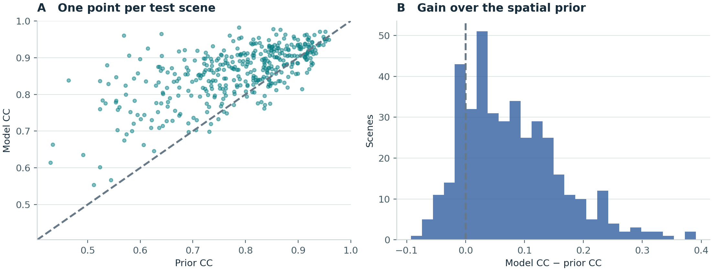

## 哪些类别更依赖图像内容

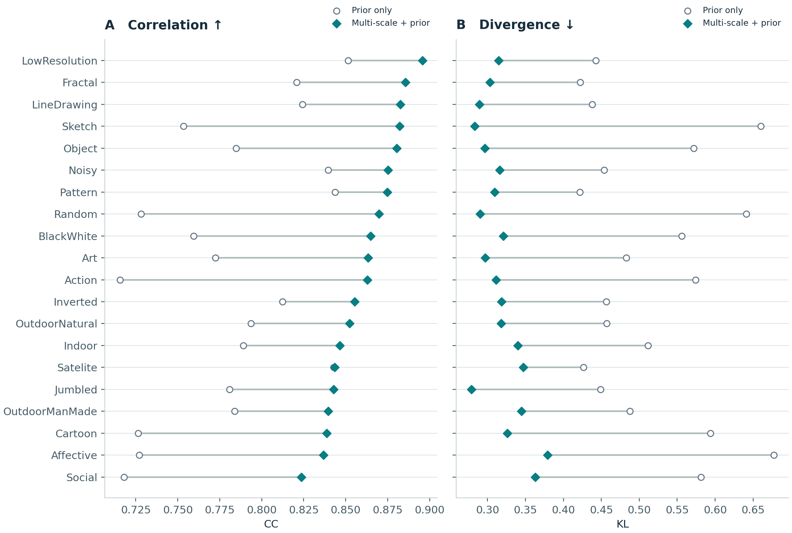

图 6 以类别平均值计，Action 的 CC 增益为 0.1473，Random 为 0.1417，Sketch 为 0.1289。Satelite 的增益为 0.0006，其平均热点已经很接近位置先验。Social 的模型 CC 为 0.8237，在 20 类中最低，却比本类先验高 0.1057。按最终得分和按“看图带来多少增益”排序，回答的是两个不同的问题。[20 类原尺寸明细](outputs/native_categories.csv)

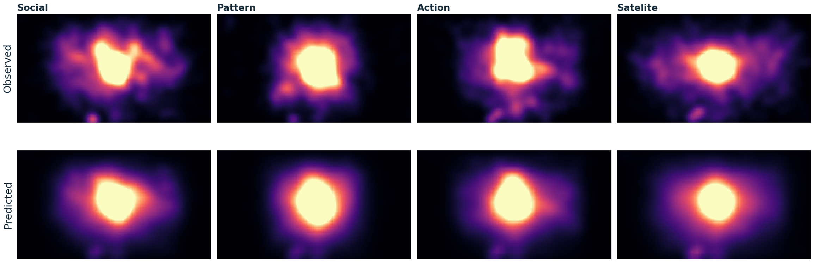

图 7 每幅图先除以自身平均密度，再按类平均。上下两行分别为标注、预测，统一色标从 0 到全图均值的 4 倍，更高处饱和。平均图显示的是群体位置偏好，个体热点要看逐图对照。

## 四张图里的得失

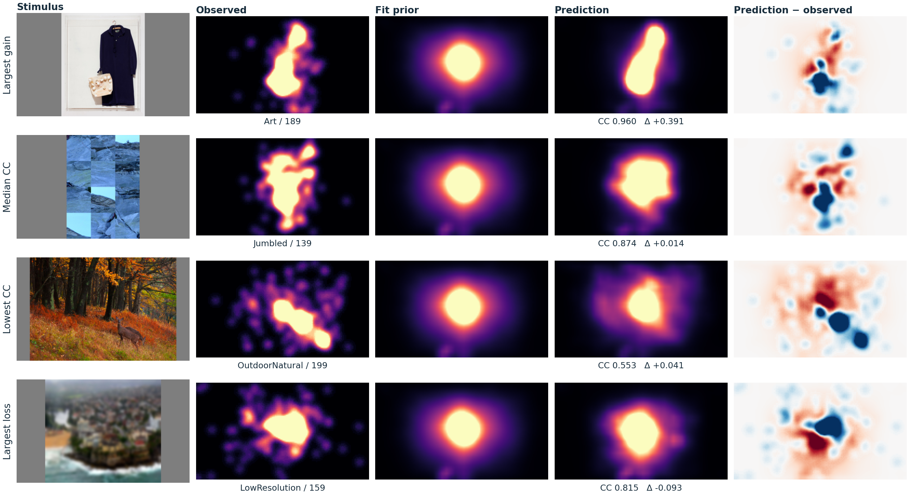

图 8 按四项预先定义的排序规则各取一张。密度图共用 0～4 倍图像均值的色标。残差图中红色表示预测偏高、蓝色表示预测偏低，显示范围为 −4～4。[样本编号及分数](outputs/case_gallery.csv)

- **Art/189** 的视线落在深色外套和浅色包附近。预测把先验的圆形热点拉成了沿物体分布的长条，CC 达到 0.960，比先验高 0.391。
- **Jumbled/139** 接近测试集 CC 中位数。预测覆盖了中央拼图，标注中偏右上、偏下的几个细峰被连成一片。
- **OutdoorNatural/199** 是最低分样本。林地里有一只位于右下方的动物，标注从中央延伸到右下，预测把大部分质量留在中央，CC 为 0.553。
- **LowResolution/159** 的 CC 为 0.815，比先验低 0.093。模糊海岸场景中，预测热点偏低，中心先验反而更贴合标注。这是绝对得分尚可、读取内容却带来负增益的例子。

## 第二轮：用自监督视觉表征寻找偏离中心的热点

图 8 的林地样本提出了一个具体问题。网络知道人们通常看哪里，但能否读出画面中值得偏离中央去看的东西？Gaze-LLE 在视线目标估计中冻结 DINOv2，用轻量读出头结合被观察者位置来估计其注视目标。这里关心自由观看时一群人的注视分布，输入只有场景 RGB。我们取 DINOv2 的空间特征，直接回归整幅密度图。骨干采用带 4 个 register token 的官方 ViT-S/14，参数始终冻结。[Gaze-LLE，CVPR 2025](https://openaccess.thecvf.com/content/CVPR2025/html/Ryan_Gaze-LLE_Gaze_Target_Estimation_via_Large-Scale_Learned_Encoders_CVPR_2025_paper.html) · [DINOv2](https://arxiv.org/abs/2304.07193) · [Vision Transformers Need Registers](https://arxiv.org/abs/2309.16588) · [固定版本与权重摘要](outputs/semantic/backbone.json)

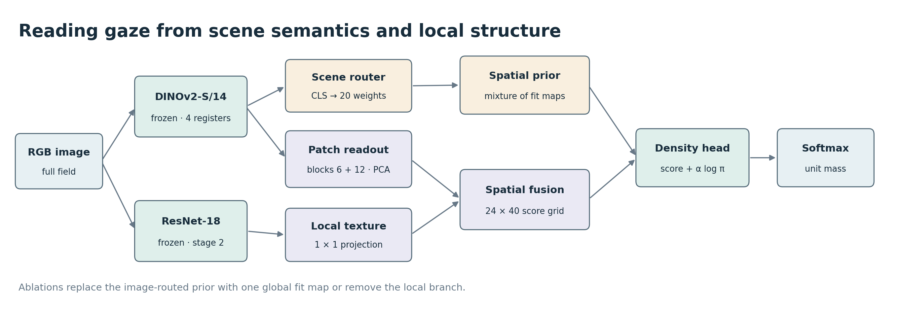

图 9 展示全部候选分支。最终模型使用中间的 patch 读出、下方的局部纹理分支和一张共享位置先验。上方按图像选择先验的分支用于消融。[可编辑 SVG](figures/semantic_architecture.svg)

原图按 16∶9 缩到 448 × 252。取第 6 和第 12 个 Transformer 块的 patch 输出，每层为 384 × 18 × 32。每张拟合图每层随机抽 24 个 patch，分别用 32,640 个向量拟合 PCA 并白化，取前 64 维。两层分别保留了拟合样本 97.9% 和 69.0% 的方差。拼接后用 1 × 1 卷积压到 48 通道，插值到 24 × 40。局部分支另外读取第一轮 ResNet-18 的第二阶段特征，投影成 16 通道。3 × 3 卷积综合两路特征，输出的空间分数加上 α log π，再作空间 softmax。每个选中读出头有 31,586 个可训练参数。[特征提取与 PCA](semantic_features.py) · [读出头及训练](semantic_train.py)

另一项尝试让空间先验随场景变化。近期一项 CAT2000 研究比较了按场景训练的显著性网络，并用分类器给新图像分配场景。这里共享同一个密度读出头，只让位置先验随图像变化。用拟合集标签训练线性分类器，从末块 CLS 向量预测 20 类的概率。每一类的先验由该类平均注视图与全局平均图按 0.85∶0.15 混合，再按预测概率加权。推理直接接收图像，无须输入类别名。[场景专属先验研究，2025](https://link.springer.com/article/10.1007/s12559-025-10506-1) · [分类权重和先验图](outputs/semantic/router.npz)

### 两条附加分支的消融

固定双层 DINO 表征，交叉比较“加入浅层卷积”和“使用分类器选择先验”两个因素。四种配置各训练三个种子，共十二次。共享 AdamW、批量 32、16 轮、权重衰减 0.01 和相同损失，学习率按余弦从 0.0012 降至 0.00008。以 0.5 概率同步水平翻转一个批次中的特征、目标和先验。每个种子按验证 CC 选轮次，再平均三个概率图。在验证集另比较第一轮和第二轮预测的五种混合比例。最优配置使用浅层卷积、全局先验及 100% 第二轮预测，三个种子选中第 13、14、14 轮。测试结果在选定结构及混合比例后计算。[验证搜索记录](outputs/semantic/validation_search.csv) · [锁定的选择](outputs/semantic/selection.json) · [每次训练指标](outputs/semantic/metrics_by_seed.csv)

| 内容表征 | 空间先验 | 读出头参数 | 验证 CC ↑，160 × 90 | 测试 CC ↑，原图 | 测试 KL ↓，原图 | 测试 SIM ↑，原图 |
|---|---|---:|---:|---:|---:|---:|
| 无 | 全局 | 0 | — | 0.7834 | 0.5152 | 0.6413 |
| 无 | 按图像加权 | 0 | — | 0.7886 | 0.4924 | 0.6496 |
| ResNet 多尺度，第一轮 | 全局 | 28,434 | 0.8528 | 0.8609 | 0.3173 | 0.7238 |
| DINO 双层 | 全局 | 23,730 | 0.8876 | 0.8906 | 0.2653 | 0.7504 |
| **DINO 双层 + 浅层卷积** | **全局** | **31,586** | **0.8881** | **0.8910** | **0.2641** | **0.7504** |
| DINO 双层 | 按图像加权 | 23,730 | 0.8864 | 0.8888 | 0.2696 | 0.7483 |
| DINO 双层 + 浅层卷积 | 按图像加权 | 31,586 | 0.8867 | 0.8897 | 0.2680 | 0.7491 |

读出头参数按单个种子计，不包含冻结编码器、PCA 和单独拟合的场景分类器。学习模型各行均为三种子平均概率图。全局先验下，浅层卷积使 CC 增加 0.0004，KL 减少 0.0012。较大的差距出现在更换整套图像表征之后；两轮还改变了输入分辨率、训练周期和翻转增强，跨轮差值不能分配给其中某一项。[原尺寸全表](outputs/semantic/native_metrics.csv)

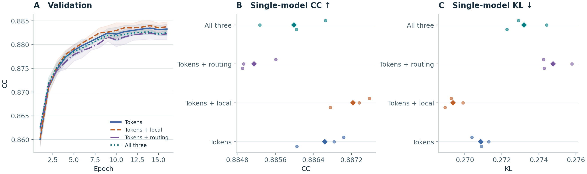

图 10 左图为 16 轮验证 CC，阴影表示三个种子间的一个样本标准差。右两图使用 160 × 90 评价单个种子，圆点是单次训练，菱形是三次的均值。[可编辑 SVG](figures/semantic_ablation.svg) · [选中读出头的逐轮损失和验证指标](outputs/semantic/tokens_local_42/history.csv)

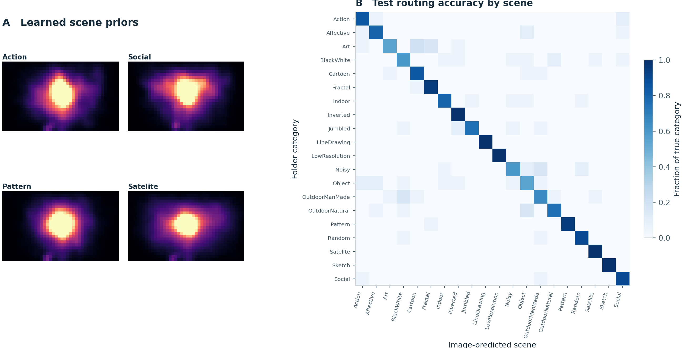

图 11 左图的四个先验使用同一色标，从 0 到全图均值的 4 倍。右图的每一行是一种真实场景，分类器判对了 329/400 张测试图（82.25%）。场景加权单独使用时优于全局平均图。加到已经读取画面内容的模型后，两组消融的验证 CC 却都略低。只选共享先验还有一个好处，遇到难分类的场景时，位置偏好不再依赖这个分类决定。[可编辑 SVG](figures/semantic_routing.svg) · [逐图场景概率](outputs/semantic/routes.csv)

### 回到同一张测试图，量出两轮的差值

| 原尺寸拆分 | 图像数 | 第二轮 CC ↑ | 第二轮 KL ↓ | 第二轮 SIM ↑ |
|---|---:|---:|---:|---:|
| 拟合 | 1,360 | 0.9096 | 0.2335 | 0.7707 |
| 验证 | 240 | 0.8881 | 0.2626 | 0.7494 |
| 完整训练集 | 1,600 | 0.9064 | 0.2379 | 0.7675 |
| 测试 | 400 | **0.8910** | **0.2641** | **0.7504** |

配对比较使用相同的 400 张原始 1920 × 1080 标注。在每个类别内抽取 20 张图并允许重复，拼成一次 400 图重采样，共重复 3,000 次。区间刻画给定两组已训练模型时，测试图样本的波动。第二轮有 303 张 CC 上升，322 张 KL 下降。六张图上直接运行教师的 CC 和 KLD 函数，与批量计算的最大差异为 1.17 × 10⁻⁷。第一轮所有原图分数也已复算。[成对的逐图数据](outputs/semantic/paired_images.csv) · [区间与估计量](outputs/semantic/paired_intervals.json) · [教师函数核对](outputs/semantic/native_checks.json)

| 测试指标 | 第一轮 | 第二轮 | 逐图差的平均值［95% 区间］ |
|---|---:|---:|---:|
| CC ↑ | 0.8609 | 0.8910 | +0.0301 ［+0.0256, +0.0348］ |
| KL ↓ | 0.3173 | 0.2641 | −0.0532 ［−0.0599, −0.0467］ |
| SIM ↑ | 0.7238 | 0.7504 | +0.0267 ［+0.0233, +0.0300］ |

按标注密度对像素加权，两个模型对数概率之差取期望，可写成 (KL₁ − KL₂) / ln 2。第二轮每单位标注质量多给出 0.0768 bit，95% 区间为 0.0674～0.0864。教师提供的是平滑后的灰度密度图，这个计算以像素密度为权重，无法还原单次眼动的观测。[原图评价实现](semantic_evaluate.py)

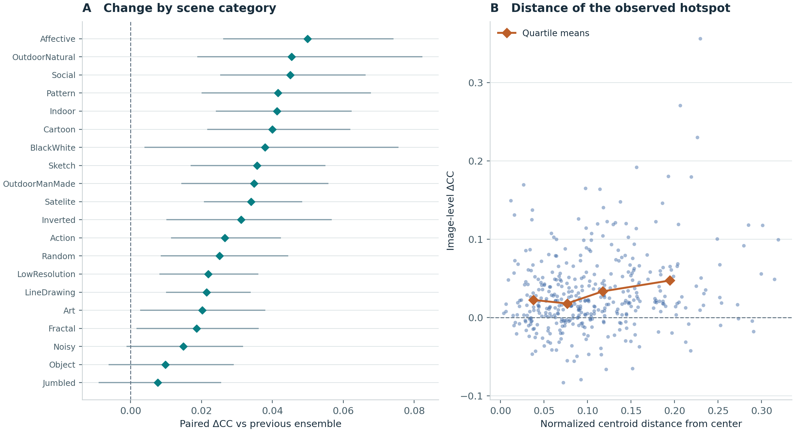

图 12 二十类的平均 CC 都提高了。Affective 增加 0.0499，OutdoorNatural 增加 0.0454，Social 增加 0.0450。Jumbled、Object、Noisy 的类内区间跨过零，每类仅有 20 张图，图中各类别区间分别计算。右图把横纵坐标归一到 [−1, 1]，按标注密度质心距中心的距离将 400 张图等分成四组。由近至远，平均增益为 0.0223、0.0178、0.0333、0.0471。质心最偏的一组收益最大，同一距离附近仍有得有失。[各类区间](outputs/semantic/category_intervals.csv) · [可编辑 SVG](figures/semantic_gains.svg)

### 同类图之间交换一个分支会发生什么

选用同时含三条分支的模型，固定全部权重。在一个测试类别内将 20 张图随机排成圆环，每张图各自向下一张借来一项输入，其余输入和待比较的标注均来自原图。三种替换共用同一组配对。这样可以问，给模型一张同类场景的表征，是否已经足以定位原图中的热点？类别标签只用来匹配供体，测试时向模型传递的先验仍由 RGB 预测。[互换协议与种子](outputs/semantic/counterfactual_protocol.json) · [400 对原图与供体](outputs/semantic/counterfactual_pairs.csv)

| 同一三分支模型，测试 400 张 | 原图 CC ↑ | 相对完整输入的 ΔCC［95% 区间］ | CC 下降图数 |
|---|---:|---:|---:|
| 完整输入 | 0.8897 | — | — |
| 换入同类另一图的两层 DINO patch | 0.7126 | −0.1771 ［−0.1878, −0.1664］ | 388 |
| 换入同类另一图的浅层卷积特征 | 0.8864 | −0.0033 ［−0.0044, −0.0022］ | 245 |
| 换入同类另一图的场景加权先验 | 0.8881 | −0.0016 ［−0.0025, −0.0007］ | 216 |

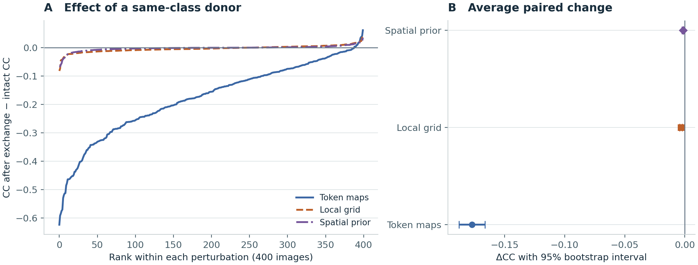

图 13 来自同类另一张图的 DINO 特征把平均 CC 拉低约 0.18。粗粒度场景身份相同，具体画面的空间排列仍很重要。交换局部卷积或路由先验的影响小得多。这个对照使用一组固定的同类配对，区间没有计入换一组供体的变动。[互换差值](outputs/semantic/counterfactual_effects.csv) · [全部分支的逐图数据](outputs/semantic/native_images.csv) · [可编辑 SVG](figures/semantic_exchange.svg)

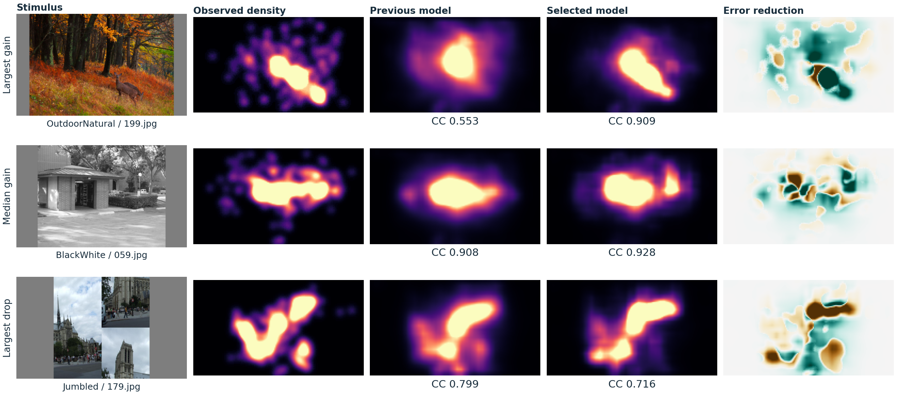

图 14 自上而下是 CC 增益最大、最接近增益中位数和退步最大的样本。两轮预测和标注共用 0～4 倍全图均值的色标，最右列用绿色表示绝对误差减少、棕色表示增加。第一行 **OutdoorNatural/199** 正是图 8 中的旧模型最低分样本，CC 从 0.553 升到 0.909。中间的 **BlackWhite/059** 多找回了右手边的次级热点。最后的 **Jumbled/179** 有多个彼此分离的注视区域，第二轮把质量偏向中间偏右的横带，CC 从 0.799 降到 0.716。对这种拼贴图，一张更集中的预测图反而会错过分散的局部峰值。[图像编号及分数](outputs/semantic/gallery.csv) · [可编辑 SVG](figures/semantic_cases.svg)

### 圈出一半预测概率，实际能捕获多少注视

在每幅图的 160 × 90 网格上，将像素按预测密度从高到低排列，直到累积预测概率达到指定比例，再记录所占面积和区域内的真实注视质量。边界上相同密度的像素均按同一比例计入。理想情况下，标称“50%”的区域平均应包含一半标注质量；在覆盖相近时，需要圈出的面积越小，热点定位就越集中。

| 标称 50% 的高密度区域，400 图平均 | 所占图像面积 | 捕获的真实注视质量 |
|---|---:|---:|
| 全局先验 | 8.54% | 50.71% |
| 第一轮 | 7.31% | 50.70% |
| 第二轮 | **7.02%** | **51.38%** |

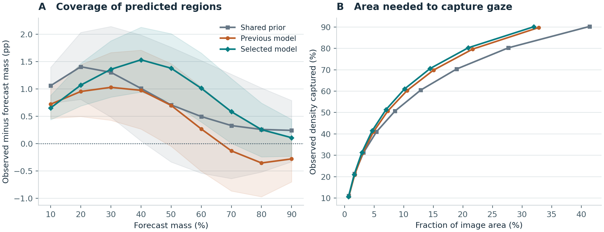

图 15 左图零线表示平均覆盖与标称值一致，阴影为按场景分层重采样的 95% 区间。右图中的每个点对应一个标称值。相对第一轮，第二轮在 50% 水平圈出的面积平均少 0.29 个百分点［0.15, 0.44］，捕获的真实质量平均多 0.68 个百分点［0.09, 1.26］。但它也将标称 50% 的区域估得略宽，实际平均覆盖比标称值高 1.38 个百分点。空间定位改善和概率数值的准确程度可以分别衡量。[逐图区域面积与覆盖](outputs/semantic/region_by_image.csv) · [九档覆盖汇总](outputs/semantic/region_summary.csv) · [配对区间](outputs/semantic/region_paired.csv) · [可编辑 SVG](figures/semantic_coverage.svg)

## 第二轮结论

共享位置先验能解释人们倾向看向画面中央的部分。面对真正偏离中央的热点，当前图像的空间特征起到了更大作用。换入同类场景的 DINO 特征，平均 CC 一次就损失 0.1771；只替换浅层纹理的损失约为它的五十分之一。分散的多热点画面仍难处理，例如 Jumbled/179 的几个峰被压到同一条横带。这样的错误在总体相关性、概率区域所占面积和单图误差图里各自留下了不同的线索。

## 前两轮的复现与单图预测

在项目根目录使用 `ml-course` 环境。以下命令沿用第一轮生成的样本清单、ResNet 特征和集成预测，顺序执行可重建第二轮结果。已有权重时可直接运行最后两条推理命令。输出为 NPY 时保存原图大小、总和为 1 的密度图，PNG 适合直接查看。

```bash
conda activate ml-course
cd /home/ubuntu/Documents/ml-course
python -m experiment3.semantic_features
python -m experiment3.semantic_train
python -m experiment3.semantic_swap
python -m experiment3.semantic_evaluate
python -m experiment3.semantic_figures
python -m experiment3.semantic_predict --verify
python -m experiment3.semantic_predict --image /path/to/scene.jpg --output /tmp/gaze.npy
```

原图推理在四张固定图上与缓存预测交叉核验，24 × 40 网格概率的总变差距离均低于 0.00020。保存的 2,000 张预测按样本清单的 index 排列。第一轮与第二轮共用课程划分，目前的增益衡量的是这份数据上的迁移效果。[第二轮预测](outputs/semantic/selected.npy) · [种子 17 权重](outputs/semantic/tokens_local_17/best.pt) · [种子 42 权重](outputs/semantic/tokens_local_42/best.pt) · [种子 73 权重](outputs/semantic/tokens_local_73/best.pt) · [四图推理核验](outputs/semantic/inference_check.json) · [训练日志](outputs/semantic/training.log) · [第一轮复现](../README.md)

<a id="third-round"></a>

## 第三轮：把同一场景交给不同尺度和不同编码器

第二轮将 448 × 252 的 RGB 场景变成一张 18 × 32 的 patch 网格。网格能指出林地里的动物，却容易把相邻的注视峰合并。这次保留原模型作对照，先问两个问题：看得更细、同时看得更远，哪一种设置有用？另一个预训练编码器能否补足 DINO 已经看过的内容？全部模型仍使用同一份 1,360 张拟合、240 张验证、400 张测试划分。

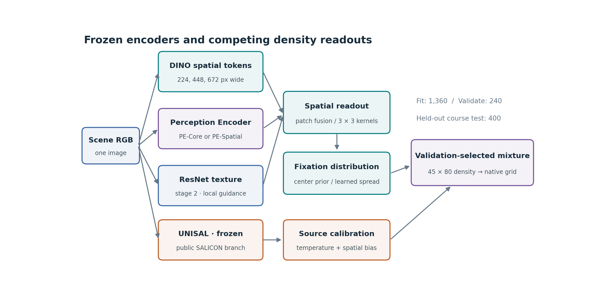

图 16 展示参加比较的路径。最终预测中，两组课程读出各占 45%，直接来自冻结 UNISAL 的预测占 10%。两组课程读出分别使用三个随机种子，在概率空间平均。六个读出头共享冻结编码器，只有其中一组读取 PE-Spatial。[可编辑 SVG](figures/multiscale_architecture.svg) · [课程分支选择](outputs/multiscale/backbone_selection.json) · [最终权重](outputs/multiscale/selection.json)

**三个观察尺度。** 同一个冻结 DINOv2-S/14-reg4 分别看 224 × 126、448 × 252、672 × 378 输入，得到 9 × 16、18 × 32、27 × 48 网格。三路共用第二轮在拟合集上建立的第 6/12 块 PCA 基底。卷积先压缩通道，再把网格对齐到 27 × 48，由一个 1 × 1 卷积学习如何混合三路。粗尺度给出更大范围的上下文，细尺度保留更细的位置区分。新旧单尺度对照也更新了读出结构、损失和输出网格，因此下面用本轮单尺度与三尺度之间的差值衡量这个改动。[特征与输入尺寸](multiscale_features.py) · [细尺度记录](outputs/multiscale/fine_features.json)

**两个真正载入的 PE 权重。** Bolya 等人在 *Perception Encoder* 中发现，视觉语言模型中间层蕴含有价值的空间信息。本实验使用 Meta 官方 PE-Core-T16-384 和 PE-Spatial-T16-512 权重，逐一校验文件摘要、严格加载整个视觉编码器。为保留课程图像比例，两者均输入 512 × 288 的场景，提取第 6/11 块的 18 × 32 patch 网格。对每层，从 1,360 张拟合图分别抽 24 个位置做 PCA 并白化，保留 64 维。PE 可单独替换 DINO；双编码器配置则用单独投影的 PE-Spatial 替换三尺度 DINO 中的粗尺度，同时保留 DINO 中、细两路。这样有一个等分辨率、等读出结构的 PE-Core/PE-Spatial 对照，也有一个允许它们与 DINO 互补的组合。[论文，首发 2025-04-17，NeurIPS 2025](https://arxiv.org/abs/2504.13181) · [Meta 核心权重](https://huggingface.co/facebook/PE-Core-T16-384) · [Meta 空间权重](https://huggingface.co/facebook/PE-Spatial-T16-512) · [本地编码与 PCA](perception_features.py)

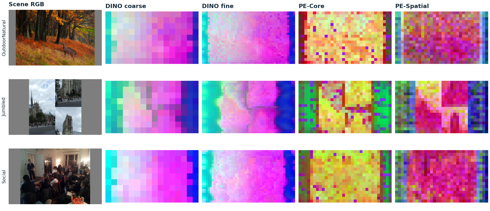

图 17 每组特征分别取较深块的前三个主成分，映射到 RGB。每个颜色通道固定使用拟合图子集的 1% 和 99% 分位数定标。颜色只在同一编码器的同一列有相同含义。粗尺度 DINO 将背景区域连成较宽的空间梯度，细尺度和 PE 特征能分出较小区域。某处颜色变化能说明特征发生变化，是否与真实注视一致仍取决于下游预测。[图像编号](outputs/multiscale/feature_gallery.csv) · [可编辑 SVG](figures/multiscale_features.svg)

**局部取样与注视扩散。** AnyUp 用高分辨率图像作查询，在局部窗口上重新组合低分辨率特征。本实验采用这个局部加权思路，在 27 × 48 网格上用 ResNet 浅层纹理产生 9 个查询分数，语义网格产生相邻 3 × 3 位置的键分数。两项之和经 softmax 后在邻域取加权和，再与原特征作残差混合。此处使用课程监督学习的小层，全部 AnyUp 权重均未参与计算。另一个分支借鉴 *Modeling Saliency Dataset Bias* 对多尺度、中心偏好和注视扩散的分析：用拟合集白化后的 48 维 DINO 场景特征，调节峰值温度、六个空间基函数和三个扩散尺度。在 45 × 80 的预测网格上，原预测和 σ = 1.5、3.25 格的高斯平滑结果分别归一化，再按三个概率权重求和。我们另测了以上一轮密度作为初始 logit 的残差配置。[AnyUp，首发 2025-10-14，ICLR 2026 Oral](https://arxiv.org/abs/2510.12764) · [MSDB，首发 2025-05-15，ICCV 2025](https://arxiv.org/abs/2505.10169) · [具体读出实现](multiscale_train.py)

### 三尺度与双编码器各自带来什么

九种结构各训练种子 17、42、73，共 27 个读出头。每组 AdamW 训练 18 轮，批量 20，学习率从 0.0011 余弦衰减至 0.00006，权重衰减 0.012。训练目标为 0.8 KL + 0.8(1 − CC) + 0.25(1 − SIM)，加上 SIM 使预测也考虑与标注实际重叠的概率质量。对 DINO、PE、局部纹理、先验与目标同步水平翻转。每个种子按验证 CC 选轮次，然后平均三个种子的概率图。

| 读出配置 | 单头参数 | 验证 CC ↑ | 原图测试 CC ↑ | 原图 KL ↓ | 原图 SIM ↑ |
|---|---:|---:|---:|---:|---:|
| 第二轮选中模型 | 31,586 | 0.8881 | 0.8910 | 0.2641 | 0.7504 |
| 本轮 DINO 中尺度 | 37,634 | 0.8923 | 0.8937 | 0.2596 | 0.7542 |
| DINO 三尺度 | 40,802 | **0.9002** | 0.8989 | 0.2511 | 0.7596 |
| 三尺度 + 局部取样 | 40,989 | 0.9001 | **0.9005** | 0.2474 | 0.7618 |
| 三尺度 + 注视扩散 | 42,700 | 0.8994 | 0.8985 | 0.2512 | 0.7598 |
| 三尺度 + 取样与扩散 | 42,887 | 0.8998 | 0.8999 | 0.2488 | 0.7614 |
| 上式加旧预测作为残差起点 | 42,887 | 0.8911 | 0.8937 | 0.2581 | 0.7557 |
| PE-Core，中尺度单路 | 37,634 | 0.8766 | 0.8804 | 0.2828 | 0.7409 |
| PE-Spatial，中尺度单路 | 37,634 | 0.8779 | 0.8786 | 0.2823 | 0.7413 |
| DINO 中、细尺度 + PE-Spatial，取样与扩散 | 47,079 | 0.8985 | 0.9002 | **0.2463** | **0.7624** |

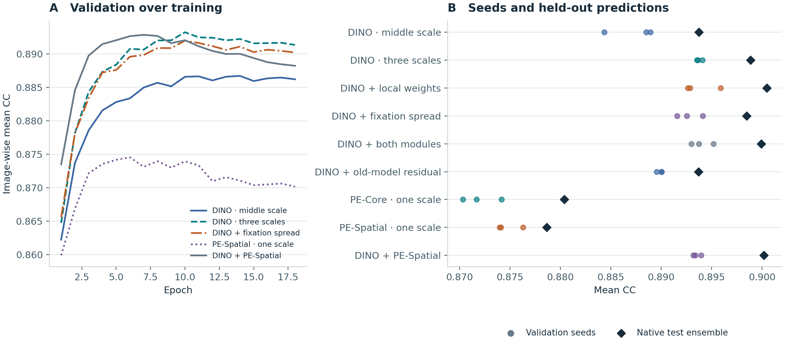

图 18 单尺度改用三尺度，测试 CC 从 0.8937 升至 0.8989。局部取样在三尺度之上又增加了 0.0016。单独引入扩散时，CC 略降；它与局部取样合用后也没有超过只加局部取样的分支。PE 两种权重单独使用都弱于 DINO。把两种表征放进同一组候选后，验证集选出普通 DINO 三尺度与 DINO/PE 双编码器各占一半的组合，验证 CC 为 0.90202。该组合按原图评测取得 CC **0.90206**、KL **0.24435**、SIM **0.76352**。训练只用 1,360 张，读出参数只计单个种子的可训练部分。[各轮日志示例](outputs/multiscale/dual_42/history.csv) · [验证搜索数据](outputs/multiscale/backbone_validation_search.csv) · [可编辑 SVG](figures/multiscale_training.svg)

### 一套独立发表的显著性模型在相同的 400 张图上表现如何

采用 Droste 等人的 UNISAL 官方 `weights_best.pth`。其训练配置列出 SALICON、DHF1K、Hollywood-2、UCF Sports 四个来源。我们加载未经 MIT1003 微调的版本，使用静态 SALICON 分支。在 1920 × 1080 课程图上，作者的文件夹推理尺寸规则给出 416 × 256。保留该尺寸的完整 logits，按双线性插值还原为原图大小后做空间 softmax。读出头和所有预训练参数均被冻结。这提供了一项能够逐图配对的外部对照。[UNISAL，首发 2020-03-11，ECCV 2020](https://arxiv.org/abs/2003.05477) · [发布权重随附训练配置](https://github.com/rdroste/unisal/blob/7f8ca1a7ecb3dbc1bf7fca837cb6186a85ac27d9/training_runs/pretrained_unisal/Trainer.json) · [本次权重与推理配置](outputs/multiscale/unisal.json)

只使用课程拟合集校准外部预测时，一个小头可以调节温度、共享位置先验和低频空间偏移。给该头再加入场景特征，可允许不同图像采用不同校准强度。最后在验证集上比较两路概率的混合，外部候选包括原预测与两种校准结果。权重候选固定为 0、0.1、0.2、0.3、0.4、0.5、0.65、0.8、1。

| 方法，教师原图测试集 | CC ↑ | KL ↓ | SIM ↑ |
|---|---:|---:|---:|
| 冻结 UNISAL，按作者流程恢复原图 | 0.61940 | 0.65788 | 0.59211 |
| 冻结 UNISAL，增加课程全局校准 | 0.83780 | 0.36918 | 0.70341 |
| 冻结 UNISAL，增加课程场景校准 | 0.85616 | 0.34472 | 0.71839 |
| 本轮两个课程分支，等权 | 0.90206 | **0.24435** | **0.76352** |
| 按验证 CC 选定，90% 课程双分支 + 10% 冻结 UNISAL | **0.90210** | 0.24551 | 0.76056 |

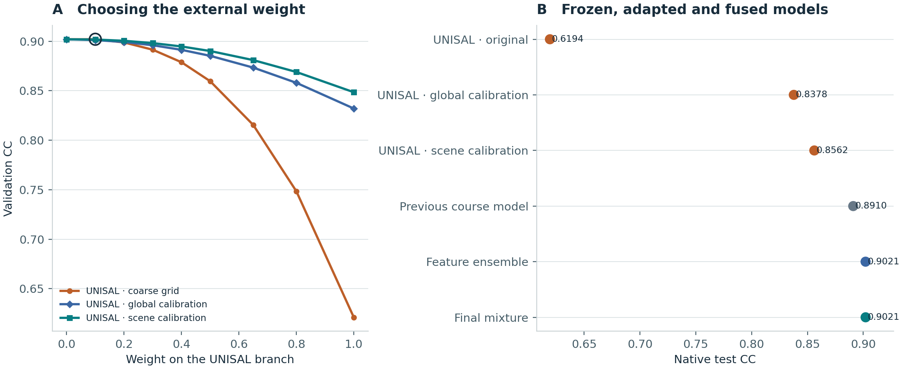

图 19 课程中心偏好能解释外部模型在这批图上的不少误差。强度随图像调整后，单独使用 UNISAL 的 CC 从 0.6194 提高到 0.8562。进入最终混合的却是少量原始 UNISAL 分布，在 45 × 80 公共网格上与两条课程分布相加。选它的直接理由是验证 CC 比只用课程模型高 0.00003。到了原图测试集，这 10% 的边际 ΔCC 只有 +0.00004，配对 95% 区间为 [−0.00050, +0.00060]。SIM 则下降 0.00296，区间 [−0.00377, −0.00213]。若更看重概率重叠和 KL，这组结果支持使用两条课程分支的等权预测。[混合权重选择记录](outputs/multiscale/fusion_validation.csv) · [同图增量与区间](outputs/multiscale/anchor_paired.csv) · [可编辑 SVG](figures/multiscale_anchor.svg)

### 哪些图更好，哪些图退步

相对第二轮，同一批原图的 CC 提高了 **0.01109**，配对 95% 区间 **[0.00895, 0.01325]**，280/400 张提高。KL 平均下降 **0.01858**，95% 区间 **[−0.02146, −0.01574]**，303 张下降。SIM 增加 **0.01014**，95% 区间 **[0.00834, 0.01190]**，291 张增加。以图像为单位、按 20 个类别分层重采样 4,000 次，每次比较都沿用两组固定权重。

| 第三轮验证选中模型，原尺寸 | 图数 | CC ↑ | KL ↓ | SIM ↑ |
|---|---:|---:|---:|---:|
| 拟合 | 1,360 | 0.9228 | 0.2162 | 0.7826 |
| 验证 | 240 | 0.9020 | 0.2412 | 0.7615 |
| 完整课程训练集 | 1,600 | 0.9197 | 0.2199 | 0.7794 |
| 课程测试集 | 400 | **0.9021** | **0.2455** | **0.7606** |

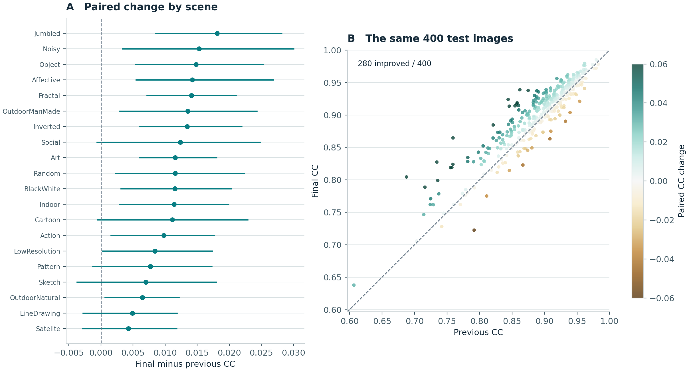

图 20 二十类的平均 CC 都有提高，Jumbled（+0.0181）、Noisy（+0.0153）和 Object（+0.0148）的增幅最大。每类 20 张图，各类区间分别估计，14 类的区间下界大于零。[逐类区间](outputs/multiscale/category_intervals.csv) · [逐图配对数据](outputs/multiscale/paired_images.csv) · [可编辑 SVG](figures/multiscale_gains.svg)

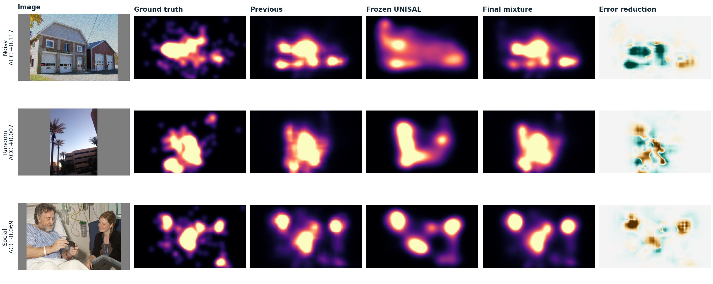

图 21 按 CC 改变量从 400 张图中取最大、中位和最小。**Noisy/159** 的房屋有多个次级注视点，第三轮 CC 从 0.688 提至 0.805。**Random/139** 的变化较小，0.870 升至 0.877。**Social/029** 则从 0.792 降到 0.723，两个人脸得到很强的预测峰值，标注在面孔之间和画面下方还有视线分布。四幅密度图共用 0～4 倍图均值的色标，末列以绿色表示绝对误差改善，棕色表示变差。[三幅图的编号与增益](outputs/multiscale/gallery.csv) · [可编辑 SVG](figures/multiscale_cases.svg)

从发布论文看，MSDB 在 MIT/Tübingen 的隐藏 CAT2000 评测上报告了 CC **0.9155**、KLDiv **0.2098**、SIM **0.7891**。那个基准由服务器用隐藏注视观测和指定指标流程评分；课程使用指定的 400 张 JPEG 密度标注及教师 CC/KLD。这里的 0.9021 是当前项目在固定课程划分下的最好 CC。可直接公平比较的外部数字是同批 400 张图上复跑所得的 UNISAL 结果。[官方 CAT2000 榜单及评分说明](https://saliency.tuebingen.ai/results_CAT2000.html) · [本次原图全表](outputs/multiscale/native_metrics.csv)

### 第三轮复现与单图推理

在项目根目录使用 `ml-course`。以下命令默认沿用前两轮的数据清单、PCA 和权重。两个 PE 权重来自 Meta 官方仓库，UNISAL 代码与权重来自已固定提交的作者仓库，首次运行会获取所需文件。下载完成的版本、权重摘要和源数据均已保存在本机。

```bash
python -m pip install einops==0.8.1
python -m experiment3.multiscale_features
python -m experiment3.perception_features extract --name core
python -m experiment3.perception_features extract --name spatial
python -m experiment3.external_saliency predict
python -m experiment3.multiscale_train train
python -m experiment3.multiscale_train select
python -m experiment3.multiscale_train export
python -m experiment3.anchor_calibration train
python -m experiment3.anchor_calibration select
python -m experiment3.multiscale_evaluate
python -m experiment3.multiscale_figures
python -m experiment3.multiscale_predict --verify
python -m experiment3.multiscale_predict --image /path/to/scene.jpg --output /tmp/gaze.npy
```

直接从四张固定 RGB 图片重载全部权重，得到的 45 × 80 概率图与批处理存档的最大总变差距离为 0.000163。对四幅原图分别用冻结 UNISAL 和最终模型复算教师指标，CC/KLD 最大绝对差为 0.000012。CSV 可从场景、文件名一直查到原图指标和逐图配对改变量。[四图原始推理](outputs/multiscale/inference_check.json) · [教师指标核验](outputs/multiscale/teacher_checks.json) · [逐图原尺寸数据](outputs/multiscale/native_images.csv) · [选中三尺度权重示例](outputs/multiscale/pyramid_42/best.pt) · [选中双编码器权重示例](outputs/multiscale/dual_42/best.pt)

[三个实验的论文出处、首稿日期与选择理由](../method-origins.md)
