# 四步条件流生成：训练目标中的类别信息、速度外推与频谱校正

**机器学习基础 · 实验四 | SY2631122 徐基恒**

**摘要** 在 CIFAR-10 上，小型条件生成器既要区分鸟、犬等外观相近的类别，也要在较少的网络求值下形成自然纹理。本文用指数移动平均教师的条件速度差修正训练目标，采样时复用历史速度，并按真实训练图的径向功率谱逐步校正振幅。在 RTX 3070 Ti 上从第 44 轮权重续训八轮，四步、八次网络分支求值得到 48.40 FID 和 7.19 IS。固定权重与噪声，仅切换频谱校正使 FID 从 50.55 降至 48.40。此前用另一批独立噪声复测，FID 从 50.21 降至 48.51。

**关键词** 条件图像生成、直线流、模型引导、历史速度外推、频谱校正

## 1 问题描述

从标准正态噪声 $z$ 和指定的 CIFAR-10 类别 $c$ 生成一张 32×32 彩色图像。目标同时涉及图像分布、类别可辨认度与计算成本。一张船的图像可能很容易被分类器识别，但如果给定“船”时总是产生相近的水线和船身，模型仍可能漏掉真实图像中的许多构图。

| 表 1 数据与评测样本 | 总数 | 每类 | 用途 |
|---|---:|---:|---|
| CIFAR-10 原始训练集 | 50,000 | 5,000 | 训练生成器；估计频谱、选择超参数 |
| CIFAR-10 官方测试集 | 10,000 | 1,000 | 主 FID 和 KID 的真实参照 |
| 每个主采样设置 | 10,000 | 1,000 | 两设置复用相同起点与条件，种子 109 |
| CIFAR-10.1 v6 | 2,000 | 200 | 此前锁定的外部真实参照，按等规模 KID 比较 |

训练将 RGB 像素线性缩放至 [−1,1]，以 0.5 概率水平翻转。推理不读取真实图。FID 选用完整测试参照，训练侧校准另用真实训练图，两者的特征距离分别记录。[数据下载与校验](data/download_manifest.json) · [采样与真实参照协议](outputs/guidance/selection/protocol.json)

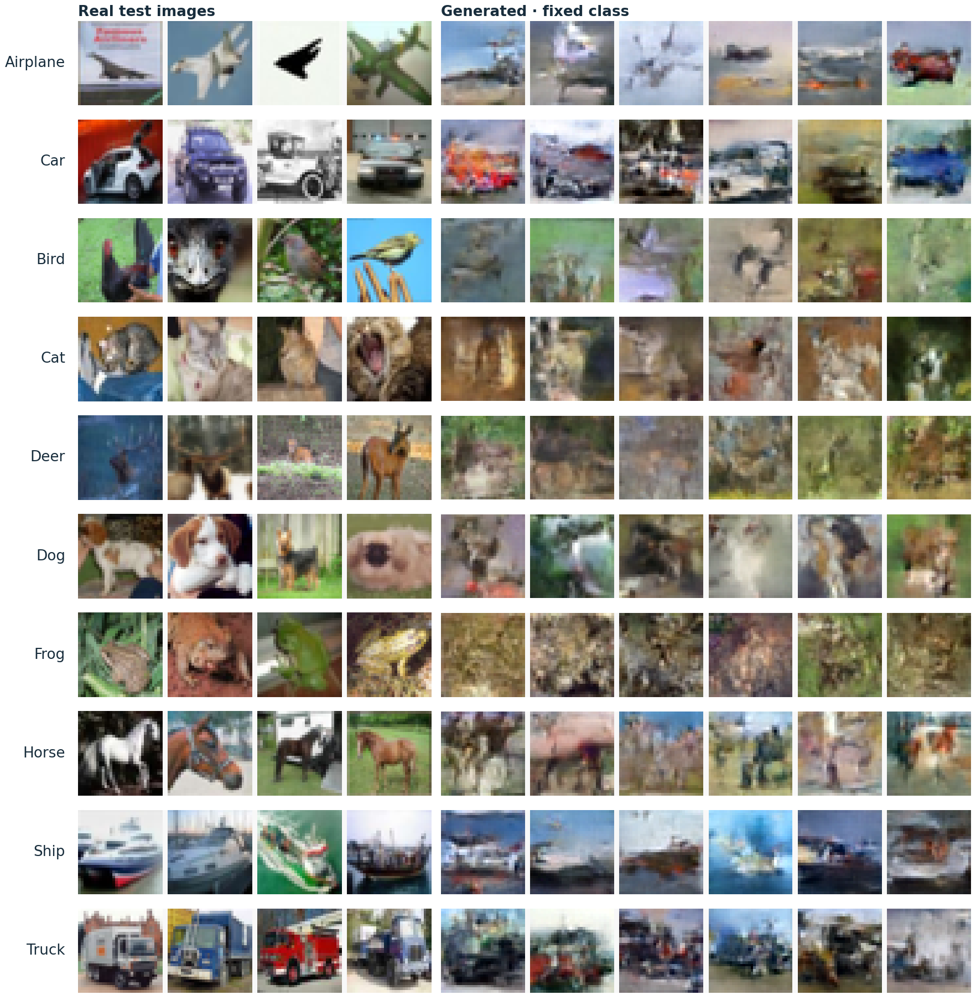

图 1 真实图与生成图按 CIFAR 标签顺序排列。低分辨率下船与飞机可能只剩几条水平边缘，鸟类常被大块背景包围，因此在全局分布指标之外，还需要逐类和逐样本分析。

## 2 模型原理与创新设计

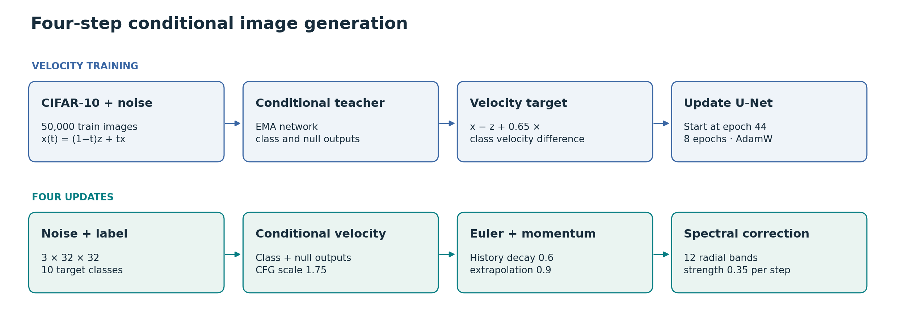

图 2 上排为从第 44 轮开始的训练路径，下排从一个噪声起点出发。除输入初始噪声外，下排的条件速度、欧拉外推、频谱校正依次执行四次。[可编辑 SVG](figures/report_pipeline.svg)

**直线流与条件引导。** 对训练样本 $x$、独立噪声 $z$ 和时间 $t$，构造 $x_t=(1-t)z+tx$，基础速度目标为 $x-z$。网络以 $x_t,t,c$ 为输入回归速度。训练时随机移除 12% 的类别标签，推理可同时获得条件速度 $v_c$ 和空条件速度 $v_u$，以 $v_u+w(v_c-v_u)$ 调节类别强度。[Rectified Flow](https://arxiv.org/abs/2209.03003) · [Classifier-Free Guidance](https://arxiv.org/abs/2207.12598)

**创新一：训练速度本身携带更强的类别信息。** 借鉴 Tang 等的模型引导目标，用不回传梯度的 EMA 教师输出同一中间图的条件与空条件速度，将二者的差以 0.65 的系数加入 $x-z$，学生仍以均方误差训练。空标签样本的两项预测相同，修正为零。这样可以在同一网络、同一更新数下检验改变目标是否提高可辨认度。[方法来源](https://arxiv.org/abs/2502.12154) · [本地训练实现](guidance_train.py)

**创新二：复用速度历史，补偿粗时间网格。** Liao 等的 Momentum Guidance 将当前速度与历史趋势比较。本实验在欧拉更新中使用 $v_k+α(v_k-m_k)$，然后计算 $m_{k+1}=0.6m_k+0.4v_k$，以首步速度初始化。四步主配置取 $w=1.75$、$α=0.9$；外推只保存一个与图像同形的张量，不增加 U-Net 求值次数。[ECCV 2026 原文](https://link.springer.com/chapter/10.1007/978-3-032-37517-9_8)

**创新三：用 CIFAR 图像的实际频谱约束每一步。** 受 Kim 与 Kim 的频谱对齐方法启发，把 2D 傅里叶系数分到 12 个非直流径向频带，用全部训练图估计各带平均功率 $P_b$。在线性噪声路径上，用 $t^2P_b+(1-t)^2$ 作该时刻的参考。每步欧拉更新后按参考与实测功率的比值缩放频带振幅，三个颜色通道共享增益，保留原相位和直流分量。用独立训练参照选定强度 0.35。这个实现直接使用课程图像统计，适合宽高只有 32 像素的小图。[预印本，2026-10-02](https://arxiv.org/abs/2610.02753) · [频谱实现](spectral_guidance.py)

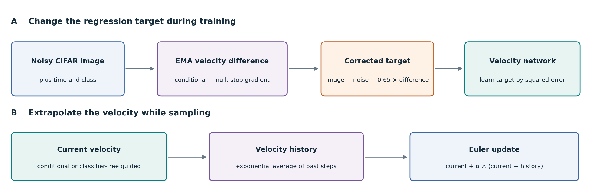

图 3 左侧比较教师在同一图像上的两种条件，右侧比较同一生成轨迹在不同时刻的速度。这两种差值分别作用于训练目标和推理方向。

## 3 模型结构、参数与复现条件

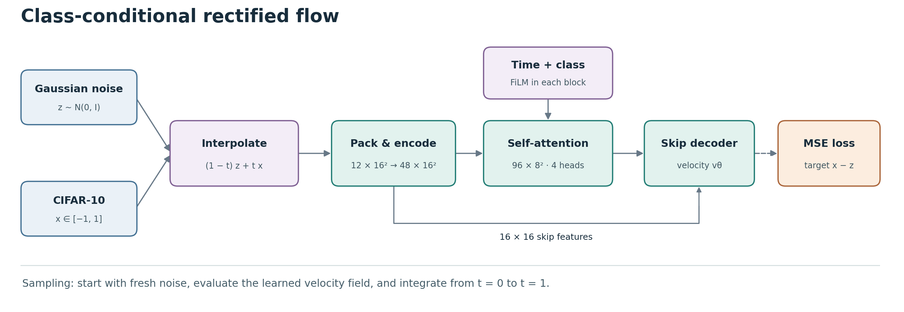

图 4 先通过像素重排把原图转到 16×16 网格，在 8×8 瓶颈做四头自注意力，再通过跳连与上采样恢复 RGB。像素重排本身保留全部输入值。[网络实现](model.py) · [可编辑结构图](figures/architecture.svg)

| 表 2 生成器模块 | 输出或配置 | 参数量 |
|---|---|---:|
| 时间 MLP + 类别嵌入 | 64 维正弦编码 → 128；10 类及空标签 | 26,240 |
| Stem + 编码残差块 | 12×16×16 → 48×16×16 | 59,376 |
| 下采样 + 第一瓶颈残差块 | 96×8×8 | 232,800 |
| 归一化、QKV、投影 | 4 头，每头 24 维 | 37,440 |
| 第二瓶颈残差块 | 96×8×8 | 191,232 |
| 上采样、解码残差块、输出头 | 拼接浅层后恢复 3×32×32 | 126,444 |
| **总计** | **单条件分支前向约 0.135 GFLOPs** | **673,532** |

表 2 一次乘加计两次；计数仅含框架识别的算子。每张图四步八次条件／空条件分支求值，骨干约 1.08 GFLOPs；频域变换和调度开销未计入骨干数字。[实测参数与算子计数](outputs/report_replay/complexity.csv)

| 表 3 阶段 | 固定设置 | 选择或对照 |
|---|---|---|
| 第 1–20 轮 | 类别 U-Net，直接回归速度 | 与解析跳连参数化等预算比较 |
| 第 20–32 轮 | 分支共享起点、噪声、图像与更新数 | 均匀／logit-normal 时间 × 开／关掩码表征对齐 |
| 第 44–52 轮 | 批量 128，391 批／轮，AdamW，权重衰减 0.01；学习率 0.00014→0.00006，EMA 0.995 | 教师速度差修正与普通续训，同步数比较；另用普通 13 轮近似匹配训练算量 |
| 采样筛选 | 训练参照投影距离，1,200 个校准噪声；限制 8 或 24 次分支求值 | 54 组设置分别选择分布质量或类别优先解 |
| 频谱筛选 | 另取 1,600 个噪声，种子 91724 | 共享／分类别功率，含零强度共九项，训练参照选 0.35 |

本次在 **RTX 3070 Ti Laptop GPU（8 GB）** 上加载已保存的第 44 轮父权重，真实续训 3,128 次更新，八轮训练循环累计 102.1 秒。表 4 前两行的生成图均由这次训练的 EMA 权重产生。每行各生成 10,000 张，并用同机重新编码的 10,000 张真实测试图评测。驱动 566.14，PyTorch 2.6.0+cu124，训练种子 1843。第 1–44 轮、对照分支、第二个噪声种子和外部队列取自此前完成的实验；训练损失按实际轮次保存。[本次训练设备](outputs/report_replay/training_device.json) · [八轮训练日志](outputs/report_replay/model_guidance/history.csv) · [父权重与本次检查点摘要](outputs/report_replay/run.json)

## 4 实验结果分析

### 4.1 测试参照上的质量与推理成本

FID 在兼容 Inception-v3 的 2,048 维特征上比较高斯均值与协方差，$FID=\lVert\mu_r-\mu_g\rVert_2^2+\mathrm{tr}(\Sigma_r+\Sigma_g-2(\Sigma_r^{1/2}\Sigma_g\Sigma_r^{1/2})^{1/2})$，越低越好。IS 为 $\exp(E_x D_{KL}(p(y\mid x)\,\Vert\,p(y)))$，按十个分块汇报均值和标准差。KID 为三次多项式核的无偏 MMD²，取 50 个大小为 1,000 的子集。类别一致率另用在真实训练特征上拟合的固定探针计算，它在真实测试图上的准确率为 88.75%。

| 表 4 同一万张真实测试图 | 每图分支求值 | FID ↓ | IS ↑ | KID × 1,000 ↓ | 条件一致率 ↑ |
|---|---:|---:|---:|---:|---:|
| 本次四步，无频谱校正 | 8 | 50.55 | 7.154 ± 0.165 | 19.02 ± 0.94 | 80.32% |
| **本次四步，频谱强度 0.35** | **8** | **48.40** | **7.193 ± 0.108** | **18.17 ± 0.82** | **80.46%** |
| 归档 44 轮双模块，原引导 | 24 | 62.06 | 5.43 | 45.21 | 49.00% |
| 归档 32 轮时间采样，强引导 | 24 | 62.95 | 6.06 | 33.01 | 67.28% |

从旧主模型到新主模型，FID 降低 13.66，同时推理分支数由 24 减至 8；期间既延长了训练，也改变了训练目标和采样器。要单独衡量频谱，用表 4 前两行：同一权重、相同噪声下，FID 下降 2.15。一致率仅提高 0.14 个百分点。另将本次两组图像数组分别与相同种子、相同设置的归档数组做逐像素比较，两组各 10,000 张图均完全吻合。[本次分布指标](outputs/report_replay/metrics.csv) · [每个噪声对应的类别判决](outputs/report_replay/predictions.csv)

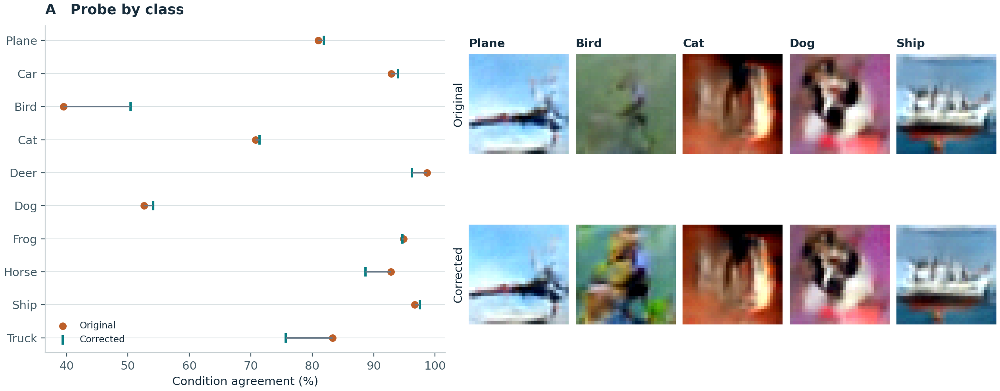

图 5 左侧十个类别各有一千张生成图；右侧每列取该类第一个噪声。两幅船图都保留了水线，鸟的颜色与背景分界变化更明显。图版展示的差异可从逐样本记录和两份图像数组定位。

### 4.2 从训练过程拆解模块作用

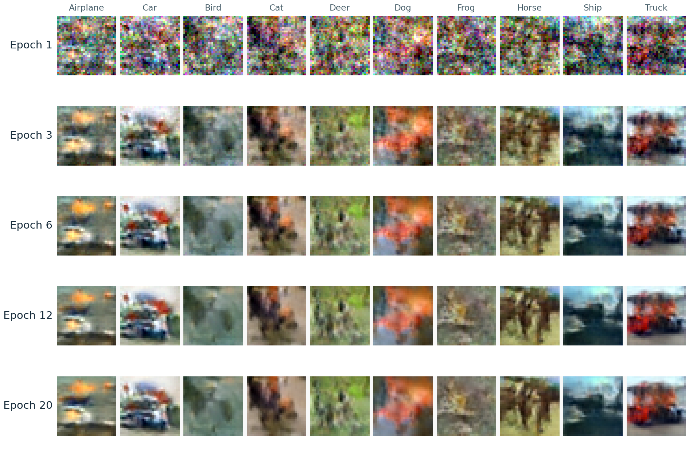

图 6 各列使用同一起点与条件，按第 1、3、6、12、20 轮排列。早期色块缺乏稳定的主体边界；随着训练进行，某些车辆逐渐出现水平构图，细小动物更难辨认。

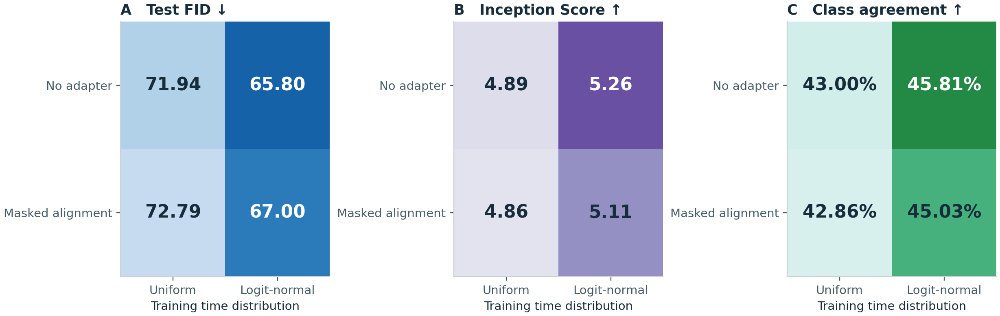

图 7 归档四路各从相同的第 20 轮权重再训练 12 轮。普通续训 FID 为 71.94，只改时间为 65.80，只加语义监督为 72.79，两者合用为 67.00。logit-normal 时间采样增加中间噪声阶段的训练概率，收益在两种监督设置下都出现。借鉴 REPA 和 PixelREPA 的局部掩码目标使用冻结 ResNet 教师和 4×4 中间特征，本模型上没有获得独立的 FID 改善。[四路原始指标](outputs/research/evaluation/metrics.csv)

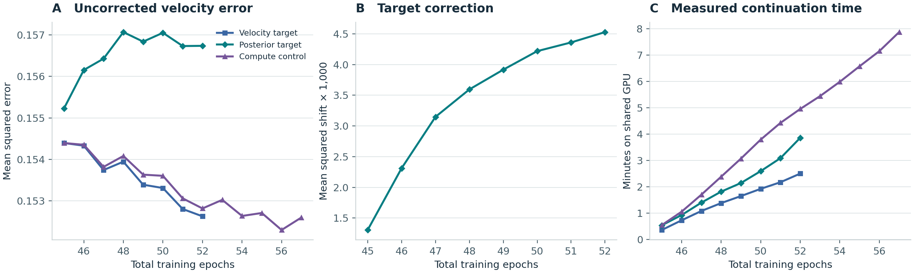

图 8 归档对照中后验修正的幅度随训练增长。本次独立续训的八轮速度目标损失从 0.15463 降至 0.15282，平均修正项平方从 0.00130 增至 0.00453。损失的改变是否有助于生成，仍要在固定采样器上比较。

| 表 5 归档的控制变量实验 | 固定项 | 结果 |
|---|---|---|
| 普通目标 → 教师条件差修正 | 52 轮、单条件分支八步、外推 0.4 | FID 61.71→49.81，一致率 34.94%→69.28% |
| 关闭 → 开启历史速度外推 | 相同 52 轮权重、四步、CFG 1.75 | FID 78.25→50.55，一致率 78.67%→80.32% |
| 普通续训 8 轮 → 13 轮 | 单分支 24 步，关闭外推 | FID 68.57→68.10，一致率 32.47%→32.66% |
| 同一 24 步改用后验监督 8 轮 | 单分支，近似匹配普通 13 轮的训练成本 | FID 56.60，一致率 65.60% |

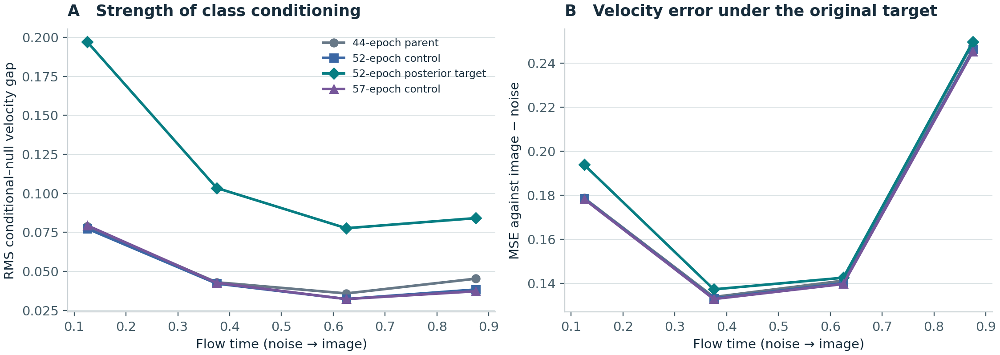

图 9 在相同 1,500 张训练图、同一噪声上计算两种类别输入的速度均方根差。噪声较强的 $t=0.125$，普通模型为 0.0774，后验模型为 0.1972；这从速度场本身补充解释了表 5 的类别结果。[逐图速度诊断](outputs/guidance/probe_images.csv)

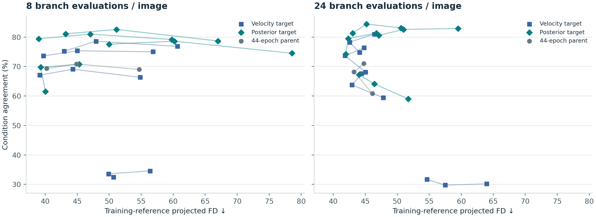

图 10 同一个分支预算可以选更多单条件步数，也可以选较少的条件／空条件双分支步数。质量优先与类别优先的选择不同：四步时把 CFG 从 1.75 增至 2.5，一致率升到 81.75%，FID 却升至 56.94。表 5 中的单分支八步是另一可行取舍。[训练侧锁定设置](outputs/guidance/selection/locked.json) · [14 项正式测试](outputs/guidance/test/metrics.csv)

### 4.3 频谱、第二组噪声与外部队列

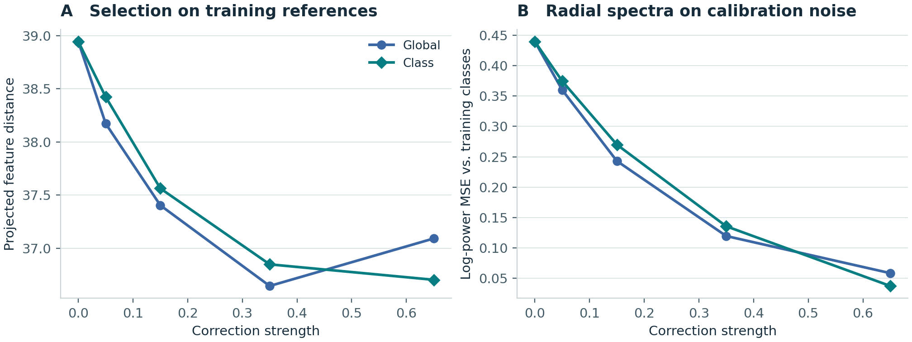

图 11 在训练参照上，零校正与强度 0.35 的投影特征距离分别为 38.94、36.65。继续加强校正会进一步压低频谱误差，却会使全类共享设置的特征距离回升。最终以训练图的特征距离选参数。[九项校准记录](outputs/spectral_guidance/sweep.csv)

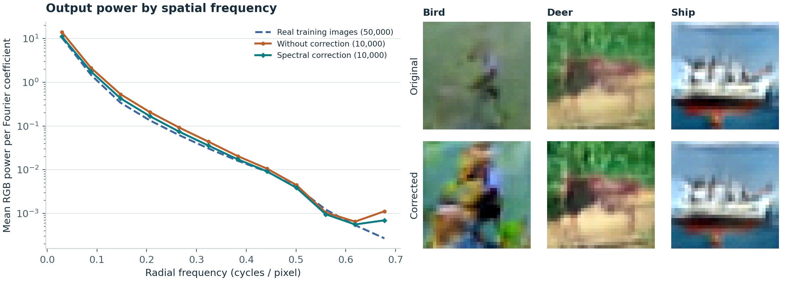

图 12 在归档的一万张样本上，最低频带平均功率从 14.15 降至 11.19，更接近真实训练图的 10.58。最高频带从 0.00112 降到 0.00069，真实参照为 0.00027。相位保留使大体构图延续，但各频带并非都恰好回到训练均值。[各频带均值](outputs/spectral_guidance/profiles.csv)

| 表 6 复验设置 | 无频谱校正 | 加校正 | 比较口径 |
|---|---:|---:|---|
| 原噪声 109，本次 FID | 50.55 | 48.40 | 原测试集全量、10k 对 10k |
| 独立噪声 27619，归档 FID | 50.21 | 48.51 | 同权重换另一万组生成起点 |
| CIFAR-10 原测试匹配子集，归档 KID × 1,000 | 18.66 | 17.95 | 按类抽 2,000 张真实图 |
| CIFAR-10.1 v6，归档 KID × 1,000 | 19.09 | 17.35 | 外部 2,000 张真实图，每类 200 |

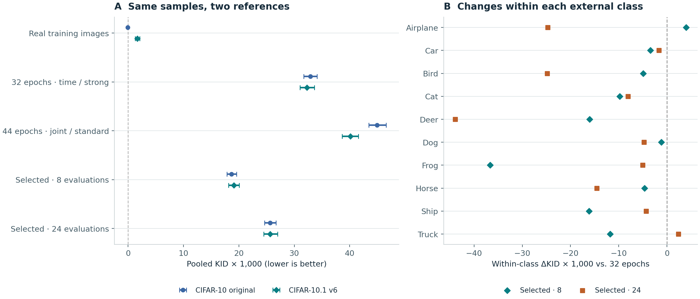

图 13 外部 KID 的配对改善为 1.74，95% 区间为 1.43～2.05（KID × 1,000）。每个生成器的一万张图分成五个互不重叠的平衡块，模型间共享重抽索引。这些区间衡量给定生成器的图像抽样波动；种子 27619 检验的是同一权重对另一组起点是否稳定。[独立噪声](outputs/spectral_guidance/repeat/metrics.csv) · [外部队列差值](outputs/external_cohort/supplement_contrasts.csv)

### 4.4 逐类错误、多样性与另一种少步方案

| 表 7 本次每类各 1,000 张 | 校正前一致率 | 校正后一致率 | 错→对（张） | 对→错（张） |
| --- | --- | --- | --- | --- |
| 飞机 | 81.0% | 81.9% | 84 | 75 |
| 汽车 | 92.9% | 94.0% | 36 | 25 |
| 鸟 | 39.5% | 50.4% | 200 | 91 |
| 猫 | 70.8% | 71.4% | 71 | 65 |
| 鹿 | 98.7% | 96.2% | 7 | 32 |
| 犬 | 52.6% | 54.1% | 108 | 93 |
| 蛙 | 94.9% | 94.7% | 18 | 20 |
| 马 | 92.8% | 88.7% | 16 | 57 |
| 船 | 96.7% | 97.5% | 20 | 12 |
| 卡车 | 83.3% | 75.7% | 47 | 123 |

表 7 的一致率都以同一训练集探针判断。图片仍可能有类别语义但被探针误判，尤其是 32×32 的细小动物。判断整体多样性时，另用冻结 DINO 与真实同类近邻计算覆盖率。

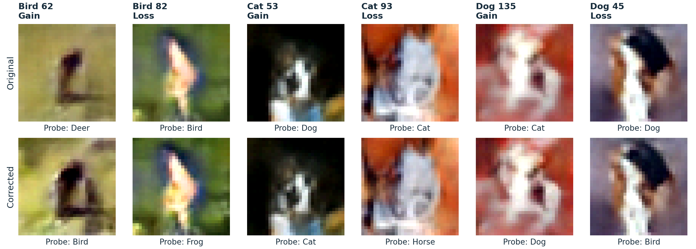

图 13b 在鸟、猫、犬三个条件内各取首个由错转对及由对转错的起点。鸟 #62 从鹿改判为鸟，鸟 #82 从鸟改判为蛙；犬 #135 从猫改判为犬，犬 #45 却从犬改判为鸟。图 13b 只改变频谱校正，下一图比较的则是前期强引导模型和四步模型。[本次固定选例](outputs/report_replay/cases.csv)

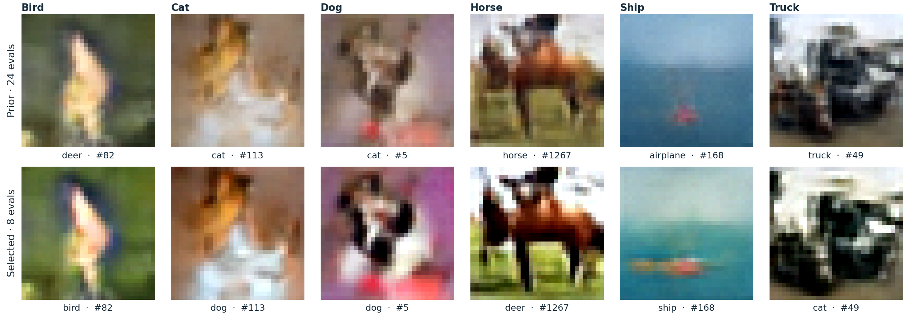

图 14 在归档的前期强引导与未加频谱的四步模型之间，鸟 #82 由鹿改判为鸟、狗 #5 由猫改判为狗、船 #168 由飞机改判为船；猫 #113 变成狗、马 #1267 变成鹿、卡车 #49 变成猫。固定噪声并沿两个方向选例，能同时看见结构变清楚与类别线索被改变的样本。[六例索引](outputs/guidance/paired_gallery.csv)

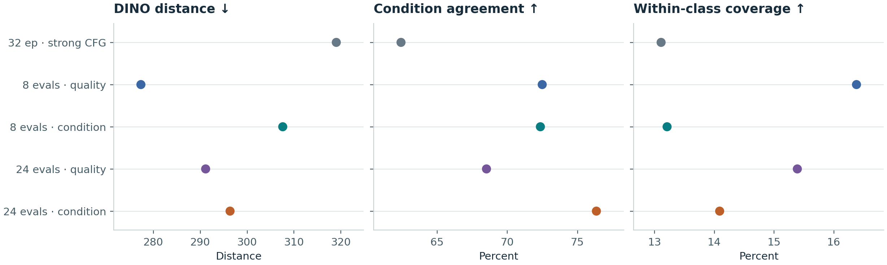

图 15 在 DINO 空间，以每张真实图到第五个真实同类近邻的距离定义邻域。四步、未加频谱模型覆盖 1,638 张真实图的同类邻域；旧 32 轮时间采样强引导模型覆盖 1,311 张。此处的 16.38% 对应未做频谱校正的模型。[独立编码器指标](outputs/guidance/semantic_metrics.csv)

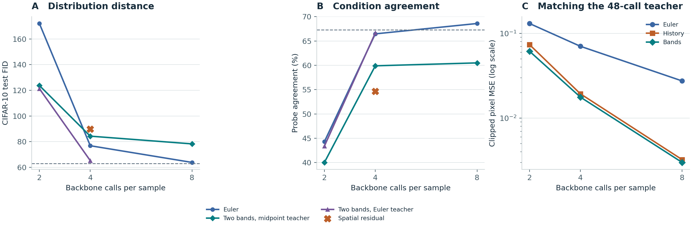

图 16 少步求解器是与主模型独立的实验。在同一冻结第 32 轮模型上，借鉴 S4S 和 GAS 为历史速度学习阶段系数，再试用 SpanLift 启发的局部空间残差。以实际部署的 12 步欧拉作教师，普通四步的 FID 从 76.79 改善到学生的 65.17；反过来，给模仿 48 次中点教师的学生加空间残差，端点 MSE 从 0.01773 降到 0.01393，FID 却从 84.25 升至 89.82。能逼近某一教师，与能逼近真实图像的分布，是两个需独立测量的目标。[12 项求解器结果](outputs/learned_solver/evaluation/metrics.csv)

## 5 总结

同权重的四步比较中，速度历史外推显著改变图像分布质量；进一步修正频带功率，在两组独立噪声与另一真实图像参照上都观察到改善。条件目标的收益则在单条件分支时尤为清楚。本次复跑固定了训练起点和种子，能核对模型实现与主结果。估计训练随机性的下一步是从相同父权重换多个续训种子，并优先检查鸟、猫、犬之间的混淆及同类邻域覆盖。

## 参考文献

1. Liu 等，Flow Straight and Fast，首稿 2022-09-07；Ho、Salimans，Classifier-Free Diffusion Guidance，arXiv 版本 2022-07-26。基础速度回归、训练时丢弃类别及推理引导。[Rectified Flow](https://arxiv.org/abs/2209.03003) · [CFG](https://arxiv.org/abs/2207.12598)
2. Esser 等，Scaling Rectified Flow Transformers，首稿 2024-03-05，ICML 2024。中间时间采样。[论文](https://arxiv.org/abs/2403.03206)
3. Yu 等，REPA，首稿 2024-10-09，ICLR 2025；PixelREPA，首稿 2026-03-15，ECCV 2026。干净特征监督和掩码对齐消融。[REPA](https://arxiv.org/abs/2410.06940) · [PixelREPA](https://arxiv.org/abs/2603.14366)
4. Tang 等，Diffusion Models without Classifier-free Guidance，首稿 2025-02-17，微软研究院列为 NeurIPS 2026。模型引导目标。[作者条目](https://www.microsoft.com/en-us/research/publication/diffusion-models-without-classifier-free-guidance/)
5. Liao 等，Momentum Guidance，首稿 2026-02-23，ECCV 2026。无需额外网络求值的速度历史外推。[论文](https://arxiv.org/abs/2602.20360)
6. Kim、Kim，Correcting Guided Diffusion Trajectories with Spectral Alignment，首稿 2026-10-02，预印本。径向功率校正。[论文](https://arxiv.org/abs/2610.02753)
7. Frankel 等，S4S，首稿 2025-02-24，ICML 2025；GAS，首稿 2025-10-20，ICLR 2026；SpanLift，首稿 2026-06-07。短轨迹和局部残差实验的来源。[S4S](https://arxiv.org/abs/2502.17423) · [GAS](https://arxiv.org/abs/2510.17699) · [SpanLift](https://arxiv.org/abs/2606.08672)
8. Bińkowski 等，Demystifying MMD GANs，ICLR 2018。KID 估计量。Recht 等，ICML 2019。独立真实图像队列。[KID](https://arxiv.org/abs/1801.01401) · [CIFAR-10.1](https://proceedings.mlr.press/v97/recht19a.html)

## 附录 复现与图像数组

在项目根目录激活 ml-course。使用全新输出目录可从已保存的 44 轮父权重重做八轮续训；同一路径再次运行会从该目录的检查点恢复。第二条命令从同一批新生成图重画图 5。

~~~bash
python -m course.report_replay 4 --output experiment4/outputs/fresh_flow_run
python -m course.report_figures 4 --input-dir experiment4/outputs/fresh_flow_run
python -m experiment4.spectral_guidance sample --class-id 8 --seed 123 --output /tmp/ship.png
~~~

[本次校正前 10,000 张图](outputs/report_replay/uncorrected_images.npy) · [本次校正后 10,000 张图](outputs/report_replay/selected_images.npy) · [八轮检查点](outputs/report_replay/model_guidance/flow.pt) · [历轮消融、训练曲线与完整命令](report.md)
