# 实验四 CIFAR-10 条件生成：从速度回归到四步采样

[按课程大纲编排的正式报告（含 RTX 3070 Ti 复跑）](SY2631122徐基恒.md)

**徐基恒 · SY2631122**

用 673,532 个参数的条件 U-Net，将高斯噪声变成 32 × 32 的 CIFAR-10 图像。原模型训练 20 轮，12 步欧拉的测试 FID 为 **78.76**。在后续模型中，训练时间偏向路径中段，再将类别速度差写入训练目标，采样时利用速度历史，四步就达到 **50.55**。在每步追加频谱校正后，两批独立噪声得到 **48.3983 和 48.5088**，类别条件一致率分别为 **80.46% 和 80.93%**。每批生成 10,000 张、每类 1,000 张，FID 均以原 CIFAR-10 的完整 10,000 张测试图为参照。四步需要八次有类或空类分支求值。

同一结论还可以从另一批真实图像检验。在独立收集的 CIFAR-10.1 v6 上，沿用原模型和配对噪声，频谱校正将 KID × 1000 从 19.09 降至 17.35。另一路实验冻结第 32 轮的旧权重，仅拟合采样轨迹，四步 FID 可由 76.79 降至 65.17。对照实验分别回答三个问题：训练目标能否学到类别信号，频谱校正是否改善分布，旧模型的高质量轨迹能压缩到几步。[两批生成噪声](outputs/spectral_guidance/repeat/protocol.json) · [独立真实参照](outputs/external_cohort/supplement_summary.csv) · [冻结模型的求解器对照](outputs/learned_solver/evaluation/metrics.csv)

## 第 1–20 轮的图像与训练目标

训练使用 CIFAR-10 全部 50,000 张图，每类 5,000 张。测试集每类 1,000 张，仅用作分布评测与可视化。图像有三个颜色通道，像素线性映射到 [−1, 1]。训练时以 50% 概率水平翻转。数据包 MD5 为 c58f30108f718f92721af3b95e74349a。[数据集说明](https://www.cs.toronto.edu/~kriz/cifar.html) · [本次下载记录](data/download_manifest.json)

对真实图像 x，独立采样标准正态噪声 z 和均匀时间 t。沿直线路径构造中间图像 xₜ = (1 − t)z + tx，网络学习在该处预测速度 x − z，以逐元素均方误差训练。生成时只提供新噪声和目标类别，反复按 x ← x + v / 步数更新。这样可以保持生成器权重不变，直接研究积分精度与生成质量的关系。[Rectified Flow 首稿，2022-09-07](https://arxiv.org/abs/2209.03003)

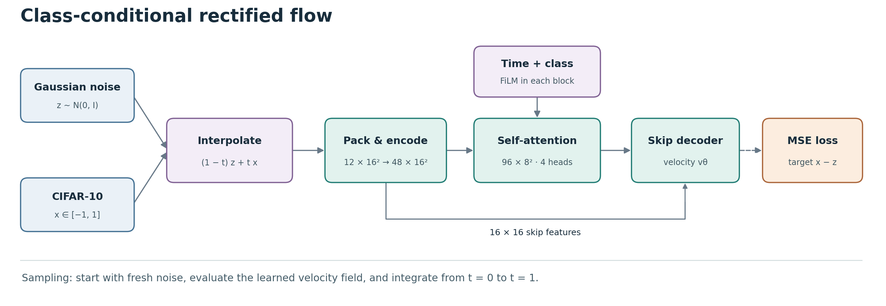

图 1 把每个 2 × 2 像素块的颜色通道重排，得到 12 × 16 × 16 的张量，这一步保留全部像素。编码器在 16 × 16 网格使用 48 通道，在 8 × 8 使用 96 通道和 4 头自注意力。解码器上采样后与浅层特征拼接，输出端恢复 RGB 网格。时间经正弦编码和 MLP，类别经嵌入，两者相加后对各残差块施加逐通道缩放和平移。[可编辑 SVG](figures/architecture.svg) · [模型源码](model.py)

| 训练项 | 设置 |
|---|---|
| U-Net 可训练参数 | 673,532，随机初始化 |
| 优化 | AdamW，初始学习率 0.0007，权重衰减 0.01，梯度范数上限 1 |
| 预算 | 20 轮，批量 128，7,820 次更新，种子 42 |
| 数值精度 | GPU 卷积使用 BF16 混合精度，速度损失与积分状态使用 FP32 |
| 类别条件 | 10 类加 1 个空标签，训练时以 12% 概率丢弃类别 |
| 主采样器 | 第 20 轮 EMA 权重，衰减 0.995，欧拉 12 步，引导系数 1.6 |

类别引导使用 v空 + w(v类别 − v空)。w = 1 时仍提供类别，仅去掉额外放大。中段引导在 0.25 ≤ t < 0.75 时用 w = 1.6，其余位置用 w = 1。它借鉴了限制引导区间的思路，区间按本实验的线性流时间定义。[CFG，NeurIPS 2021 Workshop 短文扩展版，arXiv 首稿 2022-07-26](https://arxiv.org/abs/2207.12598) · [有限区间引导首稿，2024-04-11](https://arxiv.org/abs/2404.07724) · [NeurIPS 2024 论文](https://proceedings.neurips.cc/paper_files/paper/2024/hash/dd540e1c8d26687d56d296e64d35949f-Abstract-Conference.html)

## 图像怎样成形

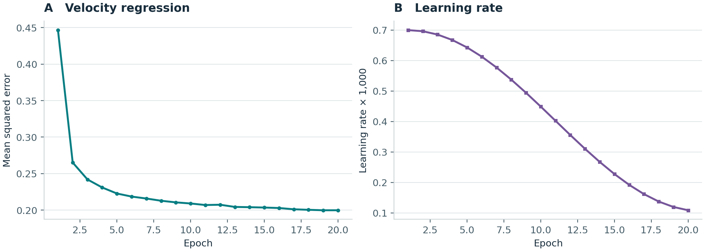

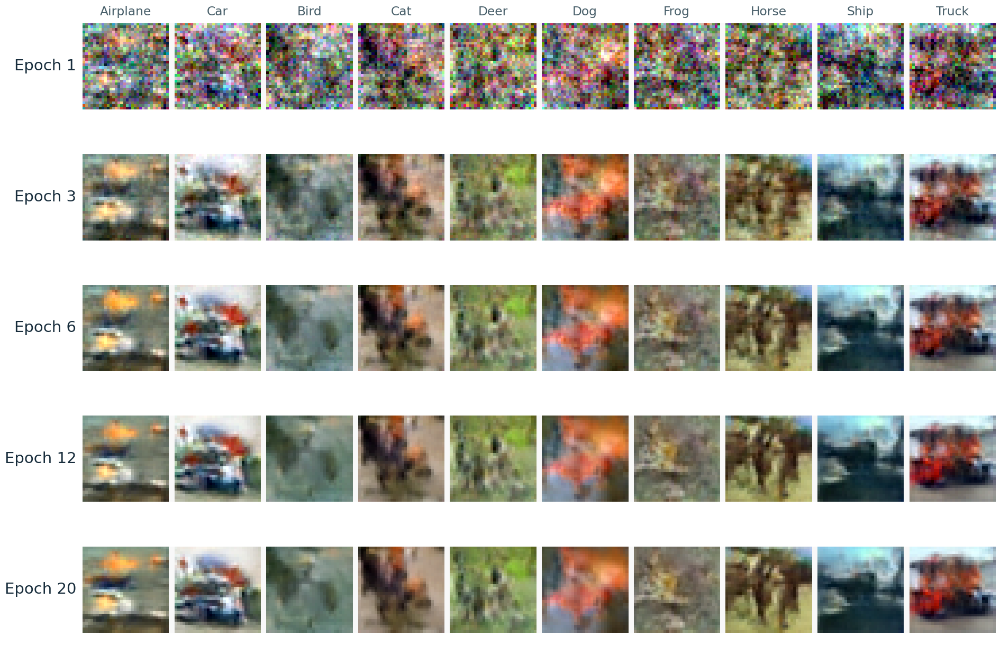

图 2–3 速度回归 MSE 从 0.4466 降至 0.1998。每列始终使用同一噪声、同一类别和相同采样器。第 1 轮几乎被彩色颗粒覆盖，第 3 轮已有成片背景色，之后轮廓逐渐集中。到第 20 轮，汽车与船的背景层次更清楚，部分动物依然难凭轮廓辨认。[逐轮损失与耗时](outputs/history.csv)

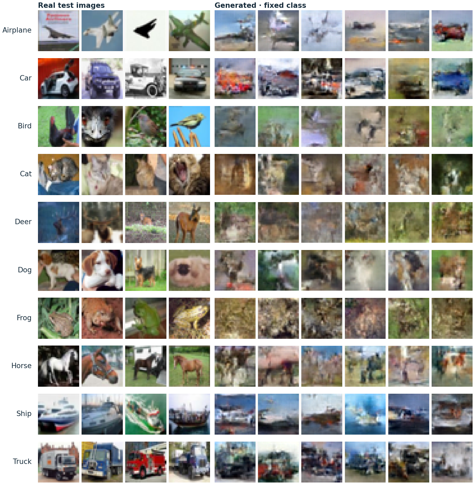

图 4 每行左侧为该类排在前面的 4 张真实测试图，右侧为该条件下前 6 张生成图，按既定顺序取样。车辆、天空和水面的色块较容易成形，动物四肢、面部轮廓和细边缘更容易粘在一起。

## 分布评测与采样消融

使用 torch-fidelity 0.3.0 的兼容 Inception 权重和指标函数，从 uint8 RGB 图提取特征。每种方案生成 10,000 张图，每类正好 1,000 张。测试参照是完整测试集，训练参照从 50,000 张中按类固定抽取 10,000 张。流模型变体共享噪声种子 109 和类别顺序，两个参照集在各行保持一致。FID 取 2,048 维特征；IS 随机拆成 10 份；KID 使用 50 个大小为 1,000 的子集。IS 的 ± 为分块标准差，KID 的 ± 为子集标准差。[torch-fidelity 文档](https://torch-fidelity.readthedocs.io/en/latest/) · [参考图索引](outputs/evaluation/reference_indices.npz)

| 方案 | 每图分支求值次数 | 训练参照 FID ↓ | 测试 FID ↓ | IS ↑ | 测试 KID × 1000 ↓ |
|---|---:|---:|---:|---:|---:|
| 按类高斯基线 | — | 243.70 | 243.37 | 1.84 ± 0.02 | 332.78 ± 4.28 |
| 12 步、EMA、全程引导 | 24 | **78.27** | **78.76** | **4.58 ± 0.10** | **63.28 ± 1.89** |
| 仅改为 4 步 | 8 | 91.73 | 92.33 | 4.34 ± 0.09 | 71.22 ± 1.48 |
| 仅去掉额外引导 | 12 | 83.18 | 83.80 | 4.06 ± 0.03 | 75.91 ± 2.12 |
| 仅在中段引导 | 18 | 80.48 | 81.08 | 4.29 ± 0.03 | 70.38 ± 2.00 |
| 仅换成末轮即时权重 | 24 | 81.19 | 81.60 | 4.42 ± 0.07 | 66.65 ± 1.91 |

高斯基线先把各类真实训练图平均池化成 8 × 8 RGB，拟合 192 维均值与完整协方差，再采样并上采样到 32 × 32。作为真实数据之间的参照，等量真实训练图对真实测试图的 FID 为 **5.18**，真实测试图自身的 IS 为 **10.96 ± 0.23**。上述 FID 均基于一万张对一万张的设置。[各方案原始结果与耗时](outputs/evaluation/metrics.csv) · [真实数据参照](outputs/evaluation/reference.json)

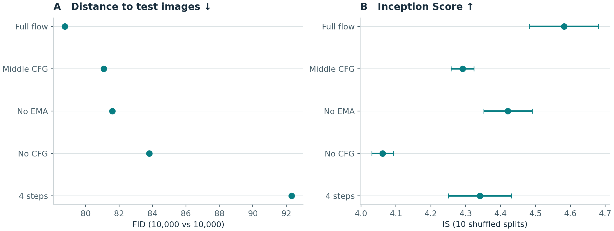

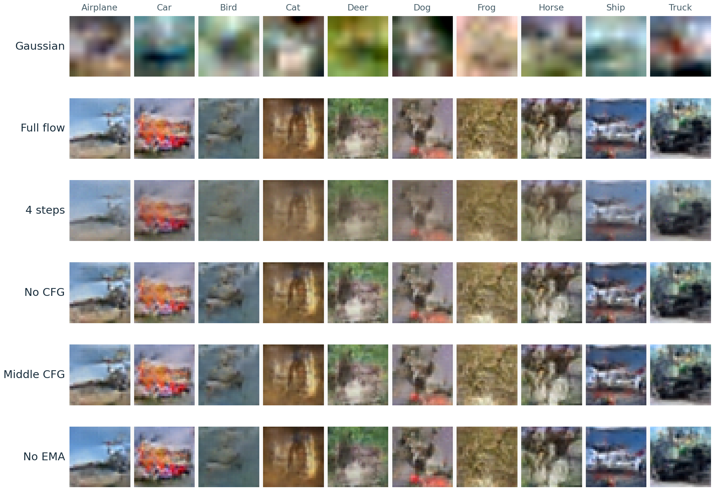

图 5–6 减少积分步数带来的 FID 差距为 13.57，大于去掉额外引导的 5.04，也大于换用即时权重的 2.83。中段引导每图少算 6 个分支，FID 差距为 2.31。实现把一对条件与空条件合并为一个批次，因此表中的分支求值次数按每个样本计算，实际耗时不与其严格成正比。高斯基线单独从低维高斯分布采样，图中与其他行仅按类别对齐。

## 等预算重训：给速度场加上解析跳连

完成上述采样比较后，又从相同初始化训练了一个参数量相同的模型。令数据尺度 σ = 0.5，D = t²σ² + (1 − t)²。把速度写成两部分：

```text
v(xₜ,t,c) = [(tσ² − (1 − t)) / D] xₜ + [σ / √D] fθ(xₜ / √D, t, c)
```

第一项是独立、零均值、各向同性噪声与数据近似下的线性最小二乘速度估计，第二项学习剩余结构。这样，网络不必从第一步起独自学习恒等缩放。两次训练使用同一数据顺序、种子、骨干、速度 MSE、更新次数和采样器。该构造借鉴网络预条件化的思路，系数按本实验的线性插值路径计算。[EDM 首稿，2022-06-01](https://arxiv.org/abs/2206.00364) · [《Elucidating the Design Space of Diffusion-Based Generative Models》，NeurIPS 2022](https://proceedings.neurips.cc/paper_files/paper/2022/hash/a98846e9d9cc01cfb87eb694d946ce6b-Abstract.html)

| 速度参数化 | 首轮 MSE | 末轮 MSE | 训练参照 FID | 测试 FID | IS | 测试 KID × 1000 |
|---|---:|---:|---:|---:|---:|---:|
| 直接回归 | 0.4466 | 0.1998 | 78.27 | 78.76 | 4.58 | 63.28 |
| 解析跳连 + 残差 | 0.3850 | 0.2004 | 80.95 | 81.58 | 4.41 | 64.92 |

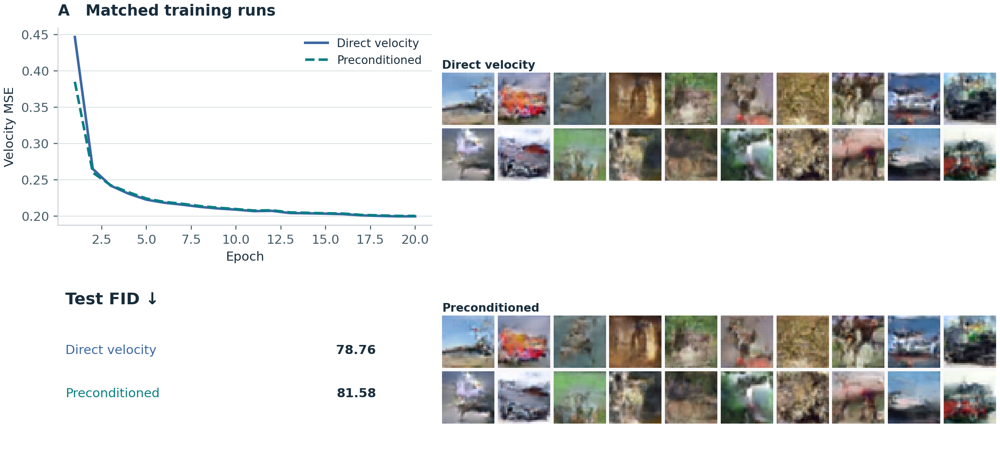

图 7 解析跳连降低了首轮误差，两条损失曲线最终收敛到接近的位置。固定 20 轮预算和 12 步采样后，直接回归的测试 FID 低 2.82。这个比较各训练一次，跨随机种子的波动尚未测量。[配对数据](outputs/parameterization.csv)

## 哪些类别画得像，哪些容易混

用固定的真实训练参照图拟合岭回归分类头，输入为 2,048 维 Inception 特征，正则系数为 100。它在真实测试图上的十分类准确率为 **88.75%**。在直接速度模型的 10,000 张生成图上，分类头预测与指定条件的一致率为 **38.69%**。这是独立分类头对条件一致性的测量，和基于 ImageNet 输出分布的 IS 回答不同问题。[各类数据](outputs/evaluation/class_agreement.csv)

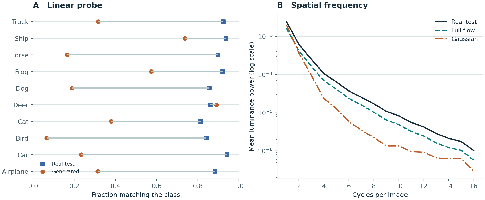

图 8 鹿和船的一致率分别为 89.1%、73.8%，鸟为 6.6%，马为 16.6%。右图对每张图减去平均亮度，计算二维傅里叶功率，在相同空间频率上取均值。每幅图 8 个周期处，流模型的平均功率约为真实测试图的 60%，按类高斯约为 13%。模型学到了比高斯基线更丰富的细节，生成图的高频成分仍偏少。[频谱数据](outputs/evaluation/spectra.csv)

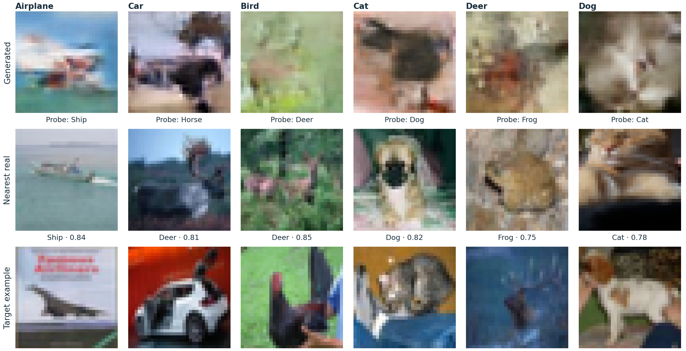

图 9 在 CIFAR 标签顺序的前六类中，各选一张“目标类得分减去最高其他类得分”最小的误判图。第二行是从一万张真实训练参照中按特征余弦相似度找到的最近邻，第三行给出目标类真实图。飞机条件的样本 4260 有水面般的蓝绿背景和水平轮廓，分类头和最近邻都指向船；猫条件的样本 683 更接近犬脸。鸟条件的样本 6112 则保留了草绿色纹理，鸟的轮廓难以辨认。近邻界定了外观相似性，不能据此判定训练记忆。[样本身份、近邻索引与相似度](outputs/evaluation/case_gallery.csv)

在这套小网络和 20 轮训练预算下，增加积分步数比改用解析跳连带来更清楚的质量变化。若目标进一步转向类别可辨认度，鸟、马、狗等低一致率类别比总体 FID 更能指出该检查的样本。

复现与随机采样命令见[项目首页](../README.md)。[训练脚本](train.py) · [评测脚本](evaluate.py) · [生成与诊断图源码](visualize.py) · [参数化对照源码](compare_training.py)

## 固定步数，改善类别可辨认度

旧模型生成的鸟、马、狗比船更难辨认。把积分次数、权重平均和分类引导都固定下来，还能通过训练改变这种差距吗？这里从同一份第 20 轮权重出发，分别改变训练时间的分布，以及中间特征收到的监督。沿用上一节的一万组噪声、类别顺序、参照图和分类探针，可以逐张追踪哪些原本画错的样本变得容易识别。

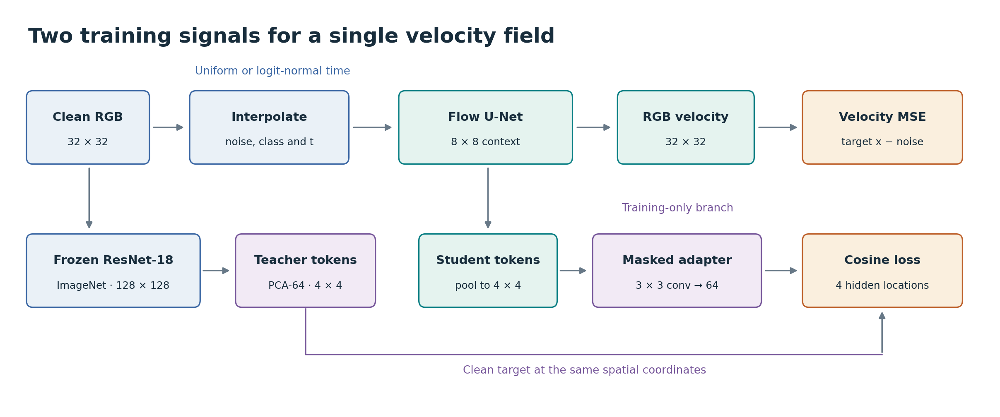

**时间分布。** 在原来的均匀采样以外，加入 logit-normal 时间采样。取同一个均匀分位数 u，一组令 t = u，另一组令 t = sigmoid(Φ⁻¹(u))。后者把更多更新留给既有图像结构又有较多噪声的中间时刻。未加重要性权重，训练目标随采样密度一同改变。推理仍然从零到一均匀积分。这一设置来自 Esser 等人的 rectified-flow 时间采样实验。[《Scaling Rectified Flow Transformers for High-Resolution Image Synthesis》首稿，2024-03-05](https://arxiv.org/abs/2403.03206) · [ICML 2024 原文](https://proceedings.mlr.press/v235/esser24a.html)

**空间表征监督。** 让速度网络的含噪特征预测干净图像的局部语义。教师采用冻结的 ImageNet ResNet-18。其输入为放大到 128 × 128 的 CIFAR 训练图，第 4 阶段的 4 × 4 特征与学生瓶颈的池化网格对齐。以 2,048 张训练图拟合 PCA，把 512 通道压缩为 64 通道，保留 65.33% 方差，再逐位置归一化。5 万张训练图和各自的水平翻转分别提取目标。生成器和最终的评价使用独立网络。[教师与 PCA 记录](outputs/research/teacher.json)

学生将 8 × 8 上下文特征平均池化到 4 × 4，每张图随机遮住 4 格，以可学习向量填充。两层卷积适配头看周围可见特征，只在这 4 格计算与教师目标的余弦距离。总目标为速度 MSE 加 0.12 倍掩码损失。适配头的 89,344 个参数仅参与训练，生成时仍使用原来的 673,532 个参数。干净表征监督取自 REPA；对学生输入遮罩、让它利用邻近位置的设计受 PixelREPA 启发。本实验将这两个想法用于低分辨率卷积 U-Net，并采用 3 × 3 卷积适配头。[REPA 首稿，2024-10-09](https://arxiv.org/abs/2410.06940) · [ICLR 2025 REPA](https://proceedings.iclr.cc/paper_files/paper/2025/hash/d9e42b4d7163931f3689d6d6fbaa11d0-Abstract-Conference.html) · [REPA 官方实现](https://github.com/sihyun-yu/REPA) · [PixelREPA 首稿，2026-03-15](https://arxiv.org/abs/2603.14366) · [ECCV 2026 官方实现](https://github.com/kaist-cvml/PixelREPA)

**配对训练。** 四路分别训练 12 轮，每路 4,692 次更新，读取完全相同的图像、翻转标志、高斯噪声、丢弃类别标志和时间分位数。续训种子 812，重新初始化 AdamW，学习率从 0.00022 余弦衰减到 0.00008。每组取最后一轮 EMA；额外把双模块分支再延长 12 轮，学习率从 0.00014 衰减至 0.00008。这个延长分支单列为总 44 轮，归因两个模块时只比较总 32 轮的四组。[训练实现](research_train.py) · [参考权重与配置](outputs/research/combined/config.json)

### 两项改动，各贡献了多少？

四个总 32 轮的模型都用欧拉 12 步、引导系数 1.6 生成。实验开始前选定的主设置是两项改动合用。在这四行中，只改时间的 FID 最低，IS 和条件一致率也最高。表里的 IS 写作十个随机分块的均值 ± 标准差，KID 的误差为 50 个子集的标准差。[逐项配置、原始结果与用时](outputs/research/evaluation/metrics.csv)

| 设置 | 训练参照 FID ↓ | 测试 FID ↓ | IS ↑ | 测试 KID × 1000 ↓ | 条件一致率 ↑ |
|---|---:|---:|---:|---:|---:|
| 原模型，20 轮 | 78.27 | 78.76 | 4.58 ± 0.10 | 63.28 ± 1.89 | 38.69% |
| 普通续训，32 轮 | 71.53 | 71.94 | 4.89 ± 0.09 | 57.08 ± 1.91 | 43.00% |
| 只改时间，32 轮 | 65.32 | 65.80 | 5.26 ± 0.11 | 48.29 ± 1.65 | 45.81% |
| 只加语义监督，32 轮 | 72.36 | 72.79 | 4.86 ± 0.08 | 57.72 ± 1.90 | 42.86% |
| 两者合用，32 轮 | 66.49 | 67.00 | 5.11 ± 0.10 | 49.78 ± 1.64 | 45.03% |
| 两者合用，44 轮 | 61.59 | 62.06 | 5.43 ± 0.13 | 45.21 ± 1.62 | 49.00% |

固定 32 轮训练，时间采样在无适配头和有适配头时分别降低 FID **6.14** 和 **5.79**。反过来，在这两种时间分布下添加掩码监督，FID 分别增加 **0.85** 和 **1.20**。从第 20 轮直接比较到双模块第 32 轮会得到 11.77 的 FID 改善，其中有 6.82 仅靠普通续训就能取得。主设置再延长 12 轮后，FID 从 67.00 变为 62.06，条件一致率从 45.03% 变为 49.00%。这段变化同时包含更多更新和第二段学习率安排。

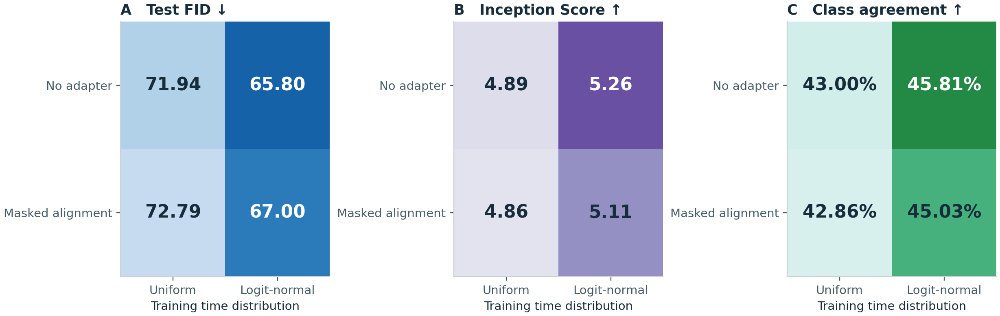

均匀时间上的速度回归误差解释了为什么不能简单按训练损失给四组排序。末轮同一组 258 张训练图和固定扰动下，普通续训在 [0.75, 1] 的速度 MSE 为 0.3066，只改时间后为 0.3208，而中段 [0.25, 0.5] 从 0.1333 降至 0.1321。后者把训练重心移向中部，覆盖完整路径的均匀 MSE 略高，最终生成的 FID 却更低。双模块的掩码余弦损失从 0.564 降至 0.440，能够预测教师目标这一点，在这次小模型续训中没有转化成额外的生成收益。[普通续训日志](outputs/research/control/history.csv) · [时间采样日志](outputs/research/time/history.csv) · [双模块日志](outputs/research/combined/history.csv)

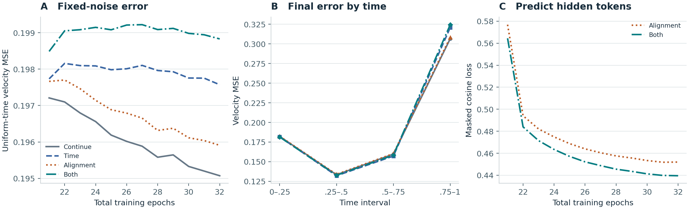

### 固定一万个起点，谁改变了判别结果？

对普通续训和双模块的 10,000 对同噪声图，分类头把 **823** 个原本判错的条件判对，也把 **620** 个原本判对的条件判错，净增 203 个。以类别为层、在每类的 1,000 个噪声索引中配对重抽 2,000 次，一致率净增 **2.03 个百分点**，95% 区间为 **+1.30 至 +2.77 个百分点**。相对只改时间的分支，加入语义监督的净变化为 −0.78 个百分点，区间为 −1.43 至 −0.14 个百分点。这些区间刻画一万个生成起点的抽样波动。四路只共享一份初始模型和一个续训种子，尚未测量训练种子之间的变异。[全部配对比较](outputs/research/evaluation/paired_agreement.csv)

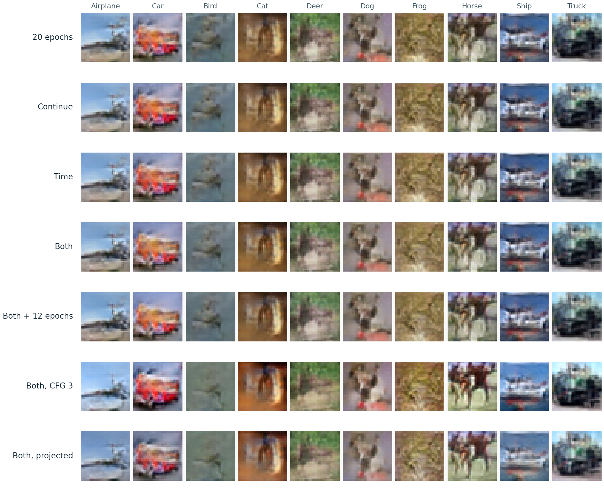

每列固定一个噪声与类别，首行是第 20 轮；其后分别为普通续训、只改时间、两者合用和延长训练。最后两行回到双模块 32 轮权重，比较常规强引导与投影强引导。车辆列的橙红色轮廓在强引导下变得鲜明，投影后有所减弱；鸟列在多行中都只剩模糊的小轮廓。图中为种子 109 的前十张，完整图像按零起始索引保存，类别顺序循环十类。[主设置图像数组](outputs/research/evaluation/combined_12/images.npy) · [逐图类别、预测与分数间隔](outputs/research/evaluation/combined_12/per_sample.csv)

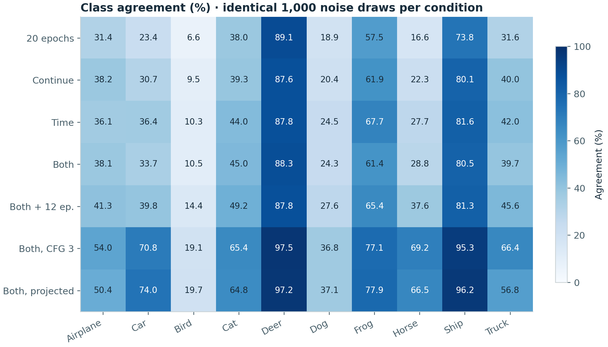

普通续训到双模块，马的条件一致率从 22.3% 升到 28.8%，猫从 39.3% 升到 45.0%，鸟仅从 9.5% 到 10.5%。双模块用常规强引导后，马达 69.2%，鹿达 97.5%，鸟仍只有 19.1%。真实图上的同一探针十类总体准确率为 88.75%。[各组逐类结果](outputs/research/evaluation/class_agreement.csv)

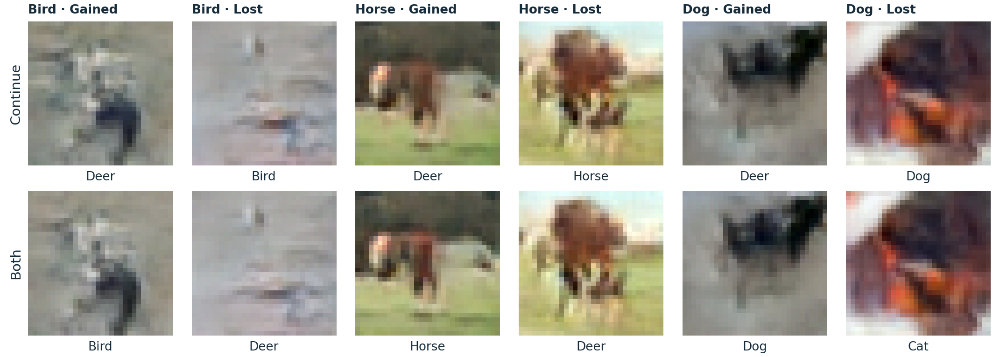

六列从旧模型较难画的鸟、马、狗中抽取。对每类分别收集“普通续训判错、双模块判对”和相反的样本，按目标类分数间隔的变化排序，各展示中位位置。鸟条件下，样本 6532 的预测从鹿转为鸟，9582 则从鸟转为鹿。马条件下也可看到方向相反的一对，狗条件的 8275 则从狗变为猫。面对这个分辨率下模糊的轮廓，两行的预测变化只说明固定分类头如何响应。[六张样本的索引、预测和分数变化](outputs/research/evaluation/case_gallery.csv)

### 相同网络求值次数下，引导和积分器怎样选？

固定双模块 32 轮权重，逐一替换求解器和类别引导。每个设置均有 12 次批量网络前向，一次同时处理一个条件分支和一个空条件分支，每图合计 24 次分支求值。显式中点在每一步多算一次速度，所以用 6 个大步。投影引导保留条件速度，再把额外引导量分解到估计干净图像的平行、正交两个方向，仅放大正交分量。具体地，令 d = v条件 − v空，x̂ = xₜ + (1 − t)v条件，使用 v条件 + (w − 1)[d − 〈d,x̂〉x̂ / ‖x̂‖²]；内积涵盖三个颜色通道和全部位置。此处采用 APG 的投影分解，以线性流的干净端点作参考，未引入动量或范数限制。[APG 首稿，2024-10-03](https://arxiv.org/abs/2410.02416) · [ICLR 2025 APG](https://studios.disneyresearch.com/2025/04/23/eliminating-oversaturation-and-artifacts-of-high-guidance-scales-in-diffusion-models/) · [三个求解器实现](research_evaluate.py)

| 设置 | 训练参照 FID ↓ | 测试 FID ↓ | IS ↑ | 测试 KID × 1000 ↓ | 条件一致率 ↑ |
|---|---:|---:|---:|---:|---:|
| 欧拉 12 步，w = 1.6 | 66.49 | 67.00 | 5.11 ± 0.10 | 49.78 ± 1.64 | 45.03% |
| 显式中点 6 步，w = 1.6 | 73.14 | 73.82 | 4.95 ± 0.10 | 55.44 ± 1.50 | 41.13% |
| 欧拉 12 步，w = 3.0 | 62.11 | 62.33 | 5.94 ± 0.13 | 34.91 ± 1.43 | 65.16% |
| 欧拉 12 步，正交投影，w = 3.0 | 63.45 | 63.76 | 5.83 ± 0.08 | 35.75 ± 1.43 | 64.06% |

相同预算下，6 步中点的 FID 比 12 步欧拉高 6.82。把常规引导从 1.6 加到 3.0，FID 降低 4.67，条件一致率提高 20.13 个百分点。保持 w = 3.0 改用投影后，FID 回升 1.43，一致率下降 1.10 个百分点（配对 95% 区间 -1.78 至 -0.42）。[同权重逐图数据](outputs/research/evaluation/combined_projected/per_sample.csv)

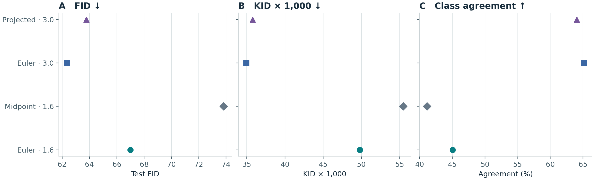

投影确实改变了色彩。把 RGB 单点的最大、最小通道差除以 255 再取图均值，常规强引导的平均色度为 **0.167**，投影后为 **0.150**，更接近真实图的 **0.134**。落在 [0,1] 或 [254,255] 的通道值占比由 **2.03% 减到 0.45%**，真实图为 **1.90%**。映射到 [−1,1] 后的图像均方根也从 0.467 降到 0.376，真实图为 0.489。投影在抑制过强色彩的同时，把暗部与亮部也向中间压得更紧。[四万张图的像素统计](outputs/research/evaluation/sample_color.csv) · [组别均值](outputs/research/evaluation/color_summary.csv)

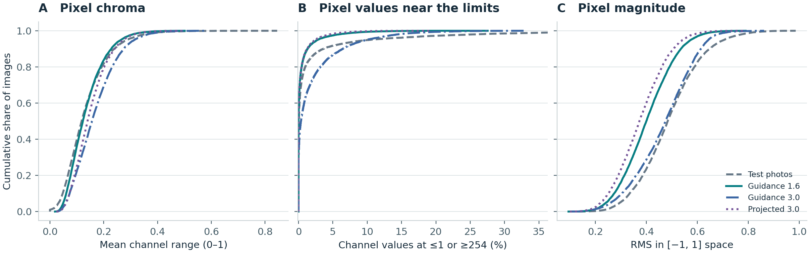

为拆开强引导与训练改动的影响，观察到上述单模块差异后，对其余三个同预算权重也补测 w = 3.0。各行给出同一权重从 1.6 到 3.0 的实测变化；这批结果属于补充分析。所有行的图像数、欧拉步数和分支求值次数相同。

| 总 32 轮权重 | 测试 FID，1.6 → 3.0 | 条件一致率，1.6 → 3.0 | IS，3.0 | KID × 1000，3.0 |
|---|---:|---:|---:|---:|
| 普通续训 | 71.94 → 69.55 | 43.00% → 63.87% | 5.64 | 39.87 |
| 只改时间 | 65.80 → 62.95 | 45.81% → 67.28% | 6.06 | 33.01 |
| 只加语义监督 | 72.79 → 68.99 | 42.86% → 62.03% | 5.56 | 41.69 |
| 两者合用 | 67.00 → 62.33 | 45.03% → 65.16% | 5.94 | 34.91 |

同为强引导，时间分支的条件一致率最高（67.28%），双模块 FID 最低（62.33），两组的排名取决于关注的指标。这一轮的预设引导强度为 1.6，44 轮结果单列计算预算。上述比较使用同一 CIFAR-10 测试参照，补测结果仍需在独立噪声与训练种子上确认。

## 模型能覆盖多少真实图像？

两种 32 轮权重在强引导下只有 0.62 的 Inception FID 差距。换一套视觉表征，这个排序还成立吗？我们将相同的生成图和全部 10,000 张真实测试图送入冻结的 DINOv2-S/14-reg。图像双三次放大至 224 × 224，取末层 384 维 CLS 向量。一项读数直接在原特征上计算 Fréchet 距离（下表记为 DINO FD）。另一项在 10,000 张分层抽取的真实训练图上拟合岭回归分类头，再比较它对生成图的预测与给定条件，分类头在真实测试集上的准确率为 96.82%。这一做法借鉴了 Stein 等人对生成评测编码器的比较，他们使用了更大的 DINOv2-L/14。[NeurIPS 2023 编码器研究](https://arxiv.org/abs/2306.04675) · [本次编码与权重记录](outputs/research/semantic_evaluation/test.json) · [分类头核验](outputs/research/semantic_evaluation/probe.json)

为测量覆盖率，先将特征归一到单位长度，对每张真实测试图，找出它到第 5 个真实近邻的距离作为半径。至少一张生成图落入半径内，这张真实图就算被覆盖。全局覆盖在所有类别中搜索。类内覆盖则在每类的 1,000 张真实图中重算半径，只搜索以该类为条件生成的 1,000 张图，再对十类取平均。改变邻居数会改变覆盖水平，数据表同时给出 3、5、10 三档。[ICML 2020 覆盖率定义](https://proceedings.mlr.press/v119/naeem20a.html) · [全局指标及邻居数敏感性](outputs/research/semantic_evaluation/metrics.csv) · [逐类结果](outputs/research/semantic_evaluation/by_class.csv)

| 模型与采样 | DINO FD ↓ | DINO 条件一致率 ↑ | 全局覆盖 ↑ | 类内覆盖 ↑ |
|---|---:|---:|---:|---:|
| 真实训练参照对真实测试图 | 6.24 | — | 96.83% | 96.80% |
| 20 轮原模型 | 391.64 | 37.56% | 9.91% | 8.69% |
| 32 轮普通续训 | 364.51 | 40.68% | 11.29% | 9.82% |
| 32 轮只改时间 | 355.47 | 43.78% | 11.93% | 10.55% |
| 32 轮只加掩码监督 | 369.33 | 40.99% | 11.24% | 9.69% |
| 32 轮双模块 | 362.42 | 43.08% | 11.73% | 10.04% |
| 32 轮只改时间，引导 3.0 | **319.02** | **62.43%** | **14.69%** | **13.11%** |
| 32 轮双模块，引导 3.0 | 327.52 | 61.40% | 14.08% | 12.74% |
| 44 轮双模块，引导 1.6 | 346.18 | 45.70% | 12.49% | 11.04% |
| 32 轮双模块，打乱条件标签 | 362.42 | 10.10% | 11.73% | 6.73% |

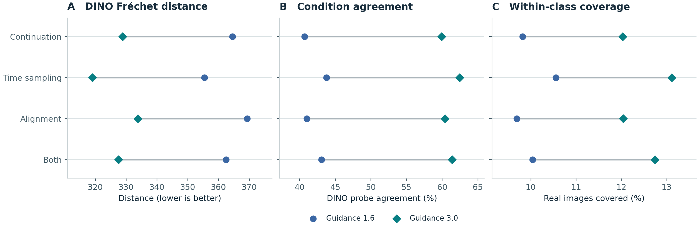

提高引导强度，四条分支的条件一致率和类内覆盖率都上升了。在引导 3.0 时，Inception FID 略偏向双模块（62.33 对 62.95），DINO FD 则偏向只改时间（319.02 对 327.52）。两个特征空间在这对接近的模型上给出的排序不同。即使采用类内覆盖最高的设置，10,000 张真实测试图也只有 1,311 张在同类生成样本中找到足够近的邻居。真实训练参照以相同数量和半径覆盖了 9,680 张。[可编辑 SVG](figures/research_guidance_coverage.svg)

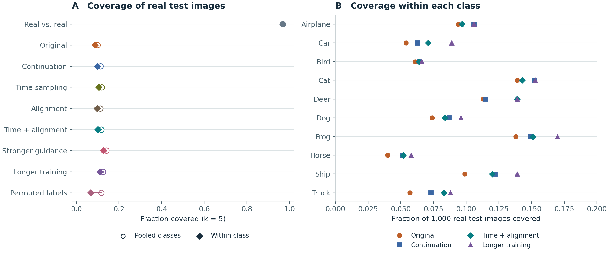

再将双模块在引导 1.6 时的 10,000 个条件标签随机打乱，像素、全局 DINO FD 和全局覆盖率保持相同，分类头的一致率从 43.08% 掉到 10.10%，类内覆盖从 10.04% 降到 6.73%。这个对照把“样本整体像什么”与“生成器是否听从指定类别”分开检验。[可编辑 SVG](figures/research_semantic_coverage.svg) · [生成评测的对照实验设计，ICML 2025](https://proceedings.mlr.press/v267/raisa25a.html)

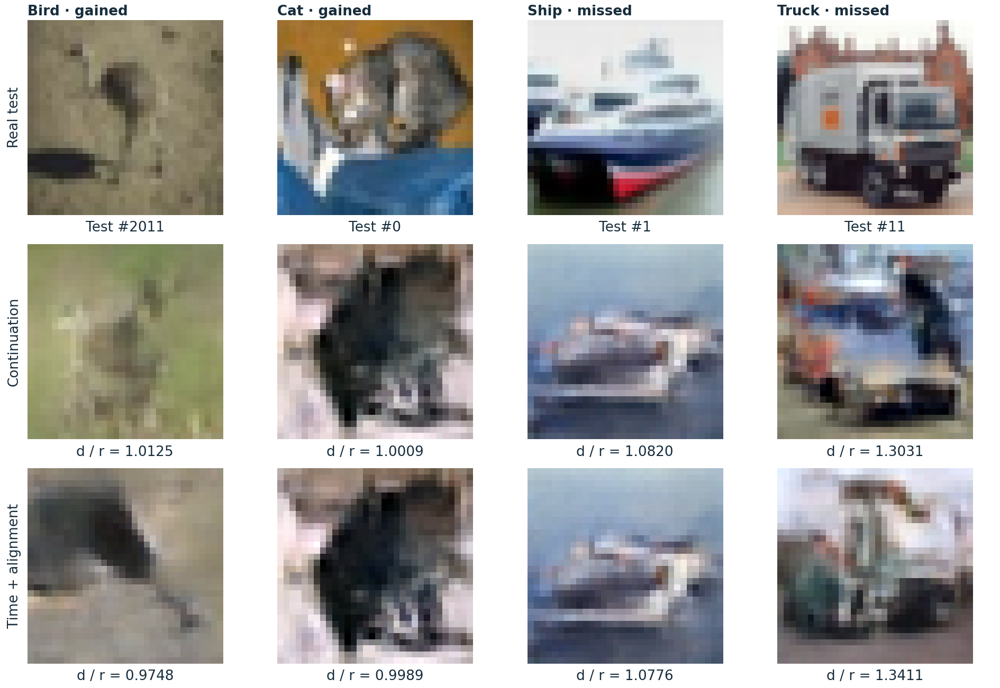

从普通续训换成同预算双模块，155 张测试图新进入类内覆盖，133 张掉出，净增 22 张。图中每列固定一张真实图，两行生成图是各模型独立检索得到的同类最近邻。鸟和猫取“原来未覆盖、后来覆盖”的首个测试编号，船和卡车取“两次都未覆盖”的首个编号。猫的距离与半径之比从 1.0009 变成 0.9989，刚刚越过阈值；卡车则在两个模型中都比半径远约三成。逐图记录能区分这种临界变化和持续漏掉的样本。[四例编号与距离](outputs/research/semantic_evaluation/gallery.csv) · [逐图近邻与覆盖判断](outputs/research/semantic_evaluation/nearest.csv) · [可编辑 SVG](figures/research_coverage_neighbours.svg)

## 让训练目标学会类别引导

上一轮模型用两个速度预测之差加强类别信号，每走一步都需求一次有类别和一次无类别输出。对于难画的鸟、马和狗，能否把一部分差异直接学进网络，把省下的求值次数换成更短的采样路径？

**训练时改速度目标。** 从已有的第 44 轮 EMA 与即时权重出发，普通续训依旧回归图像与噪声之差。另一个分支以当前模型的 EMA 计算同一噪声图、同一时刻的条件与空条件速度，把两者的差乘 0.65，加到原目标上。教师不接收梯度。12% 的空条件样本上，两个输出相同，修正项为零。这是 Tang 等人在《Diffusion Models without Classifier-free Guidance》中给出的模型引导损失在线性流上的固定系数形式，沿用上轮 U-Net、logit-normal 时间分布与 CIFAR-10 训练集。[Tang 等，arXiv 首版 2025-02-17，式 19–20](https://arxiv.org/html/2502.12154v1) · [微软研究院列为 NeurIPS 2026](https://www.microsoft.com/en-us/research/publication/diffusion-models-without-classifier-free-guidance/) · [配对训练代码](guidance_train.py)

两个分支各用相同图像、翻转、噪声和空标签做 3,128 次更新，对应 8 轮 × 391 批。后验目标每批多算两次无需反向传播的教师前向。为比较训练计算量，另从第 44 轮训练 13 轮普通速度模型。把一次常规前向加反向近似看成三次前向，普通 13 轮与后验 8 轮分别约为 39 和 40 个整轮前向等价。三条学习率曲线均从 0.00014 余弦衰减到 0.00006。[普通 8 轮](outputs/guidance/control/history.csv) · [后验 8 轮](outputs/guidance/model_guidance/history.csv) · [普通 13 轮](outputs/guidance/compute_control/history.csv)

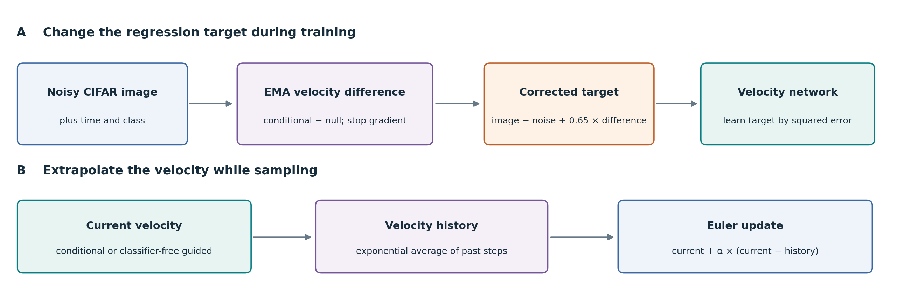

**采样时利用上一段速度。** 走到第 k 步，将当前速度与过去速度的指数平均相比，沿两者的差异再前进一段。更新方向为 vₖ + α(vₖ − mₖ)，随后更新 mₖ₊₁ = 0.6mₖ + 0.4vₖ，以首步速度初始化。类别指导强度 w 决定当前速度有多偏向给定类别，α 决定当前速度偏离近期轨迹的程度。Liao 等人的《Momentum Guidance: Plug-and-Play Guidance for Flow Models》给出了这种速度历史外推。每张图只多保存一份与图像形状相同的张量，网络求值次数与欧拉相同。[Liao 等，arXiv 首版 2026-02-23，算法 1](https://arxiv.org/abs/2602.20360) · [ECCV 2026 正式论文](https://link.springer.com/chapter/10.1007/978-3-032-37517-9_8) · [本实验采样实现](guidance_eval.py)

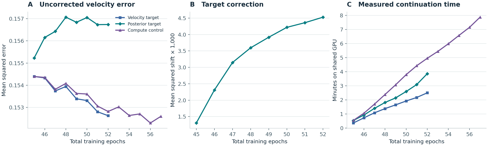

在 1,500 张分层抽取的训练图上，用同一噪声分别构造四个时间点，直接测条件与无条件速度的像素均方根差。噪声占主导的 t = 0.125 上，第 52 轮普通模型是 0.0774，后验模型是 0.1972。到 t = 0.875，两者仍相差一倍以上，分别为 0.0383 和 0.0841。与此同时，后验模型对原始速度的早期时刻均方误差由 0.1785 升到 0.1939。改目标确实把条件信号写进了预测值，也改变了它与原回归目标的距离。[逐图速度诊断](outputs/guidance/probe_images.csv)

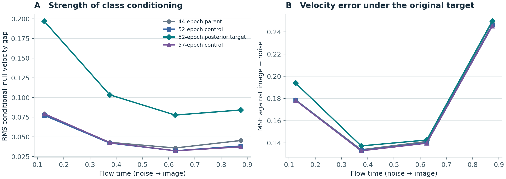

**按可用计算量选择采样。** 分别限制每张图最多 8 次和 24 次分支求值。有额外 CFG 时，每步计两次。只算条件预测时，可以用双倍步数。候选包括 44 轮父代及两条 52 轮分支，共 54 种训练、步数、CFG 与速度外推组合。每种用相同的 1,200 个独立噪声（种子 1309），与 10,000 张真实训练参照比较。在参照特征上拟合 192 维 PCA 后按投影 Fréchet 距离选最低者；另在最低距离的 1.12 倍内选择条件一致率最高者。最终评测使用另一组固定噪声（种子 109），在与旧实验相同的完整测试集和 2,048 维 Inception 特征上计算 FID。[搜索范围](outputs/guidance/selection/protocol.json) · [54 项训练参照评分](outputs/guidance/selection/calibration.csv) · [测试前锁定的设置](outputs/guidance/selection/locked.json)

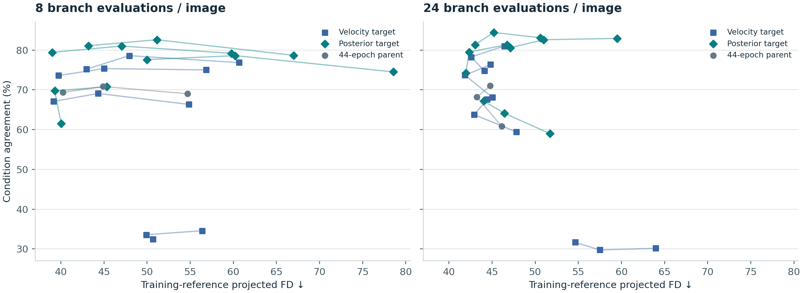

### 四步生成能同时改善分布和类别吗？

| 设置 | 每图分支求值 | 测试 FID ↓ | IS ↑ | KID × 1000 ↓ | 条件一致率 ↑ |
|---|---:|---:|---:|---:|---:|
| 上轮 44 轮双模块，原引导 | 24 | 62.06 | 5.43 | 45.21 | 49.00% |
| 上轮 32 轮仅改时间，强引导 | 24 | 62.95 | 6.06 | 33.01 | 67.28% |
| 8 次，训练侧按距离选，后验目标、4 步、w＝1.75、α＝0.9 | 8 | **50.55** | 7.15 | **19.02** | 80.32% |
| 8 次，兼顾类别，后验目标、4 步、w＝2.5、α＝0.9 | 8 | 56.94 | **7.22** | 19.28 | 81.75% |
| 24 次，训练侧按距离选，普通速度、12 步、w＝3.5、α＝0.4 | 24 | 54.41 | 6.75 | 25.91 | 74.11% |
| 24 次，兼顾类别，后验目标、12 步、w＝2.5、α＝0.4 | 24 | 60.30 | 7.06 | 19.82 | **82.73%** |

每行各生成 10,000 张图。8 次求值的质量设置比上轮 44 轮模型少用三分之二的推理分支，FID 降低 11.51。相同 8 次预算下，把引导从 1.75 提到 2.5，条件一致率再提高 1.43 个百分点，FID 却升到 56.94。画面是否更接近真实图像的分布，和探针是否更容易认出指定类别，可以分别从两个数读出。[所有锁定设置和对照的完整指标](outputs/guidance/test/metrics.csv)

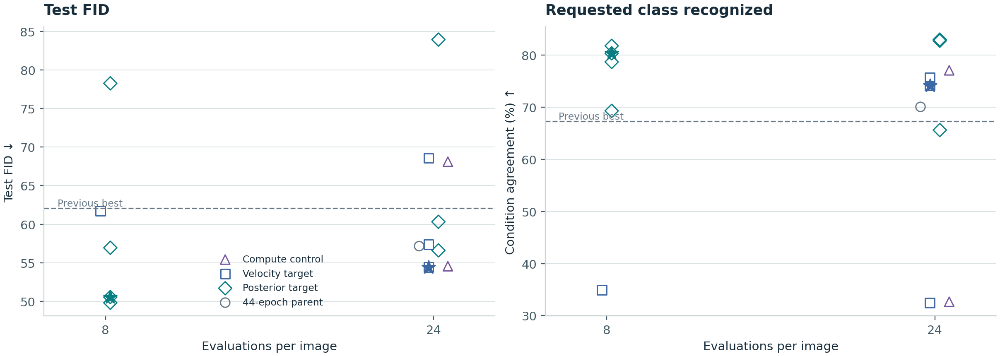

**把训练和采样的作用拆开。** 两个第 52 轮模型只算条件分支，走 8 步，都使用 α＝0.4。普通速度模型的 FID 为 61.71，一致率为 34.94%；换成后验目标后变为 **49.81、69.28%**。这条单分支结果的测试 FID 比按训练参照选出的主设置还低 0.74，但条件一致率低 11.04 个百分点。再固定主设置的权重、四个时间点与 w＝1.75，只关闭速度外推，FID 从 50.55 升至 78.25，一致率从 80.32% 变为 78.67%。在四步这个粗网格上，历史速度给分布质量带来的变化尤其明显。[等权重、等步数的配对数据](outputs/guidance/paired_contrasts.csv)

把采样固定为单分支 24 步、w＝1、α＝0，普通训练 8 轮的 FID 为 68.57、条件一致率为 32.47%，普通训练 13 轮为 68.10、32.66%。8 轮后验监督得到 **56.60、65.60%**。在近似匹配额外训练计算量时，单纯多更新 5 轮也没有补上识别差距。另一方面，已经学入类别信号的网络若继续使用 3.5 倍 CFG，在同样的 12 步下，一致率升到 82.95%，FID 却到 83.92。强引导可以放大识别线索，画面分布也会随之偏移。[额外计算对照的固定设置](outputs/guidance/compute_control_protocol.json)

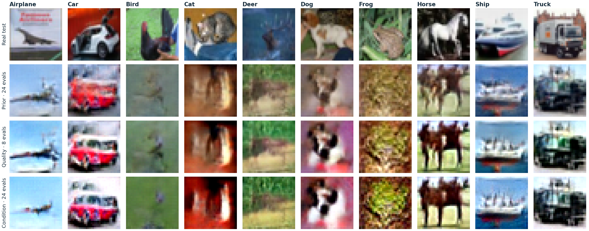

在固定的前十个噪声上，汽车的红色车身和船的水线贯穿了三种设置。旧模型犬类样本的脸只有一小片暗色，新模型里眼部和鼻口的明暗分区更清楚。鸟仍容易只剩背景里的一小块纹理。上面的真实图每类取第一个测试编号，与同列生成图按类别对应。[真实与生成样本编号](outputs/guidance/reference_gallery.csv)

**哪一类受益最多？** 与上一轮类别一致率最高的时间采样分支比较，4 步主设置在完全相同的一万组噪声和类别上，将 1,796 张原来判错的图判对，另有 492 张从对变错。净增 **13.04 个百分点**，按类对噪声编号作 2,000 次配对重采样，95% 区间为 **12.12 至 13.93**。马从 66.5% 升到 92.8%，鸟从 15.6% 升到 39.5%；鹿和船本来已超过 96%，两者的区间均跨零。这些区间反映生成起点的波动，训练重复使用一个续训种子。[逐类配对区间](outputs/guidance/paired_by_class.csv) · [总体配对数据](outputs/guidance/paired_overall.csv)

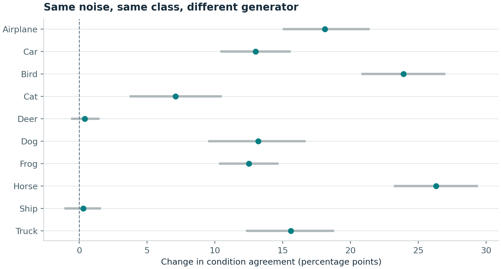

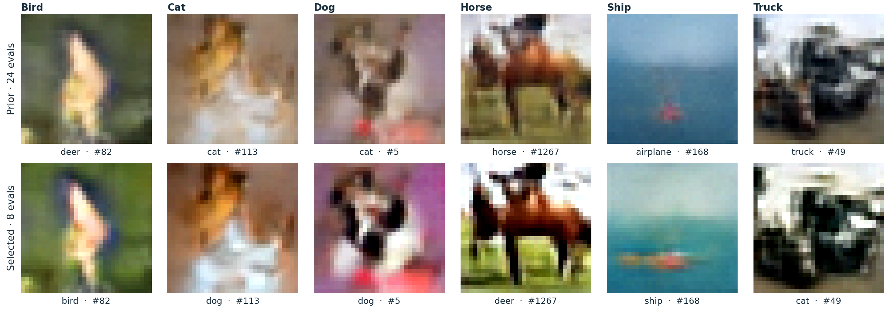

每列取指定类别、指定变化方向的第一个噪声编号。鸟样本 82 从鹿改判为鸟，卡车样本 49 却从卡车变成了猫。两者都保留了同一起点产生的大致色块，背景与轮廓间的局部对比足以使固定分类头改判。[六个案例的选择与预测](outputs/guidance/paired_gallery.csv)

### 用第二个编码器复核

| 设置 | DINO FD ↓ | DINO 条件一致率 ↑ | 全局覆盖 ↑ | 类内覆盖 ↑ |
|---|---:|---:|---:|---:|
| 上轮 32 轮时间采样＋强引导 | 319.02 | 62.43% | 14.69% | 13.11% |
| 8 次，按距离选 | **277.33** | 72.49% | **17.76%** | **16.38%** |
| 8 次，兼顾类别 | 307.59 | 72.36% | 14.32% | 13.21% |
| 24 次，按距离选 | 291.14 | 68.52% | 16.56% | 15.39% |
| 24 次，兼顾类别 | 296.35 | **76.35%** | 15.43% | 14.09% |

沿用前文冻结的 DINOv2-S/14-reg、同一训练集分类头与 k＝5 的邻域。4 步主设置共覆盖 1,638 张真实图的同类邻域，上轮时间采样强引导为 1,311 张。相同计算量下再加大引导，Inception 探针的正确数增加了 143，DINO 的同类覆盖数却少了 317。更强的类别信号把样本推向探针容易辨认的区域，也可能离一些真实场景更远。[四组总体结果](outputs/guidance/semantic_metrics.csv) · [分组覆盖与一致率](outputs/guidance/semantic_by_class.csv)

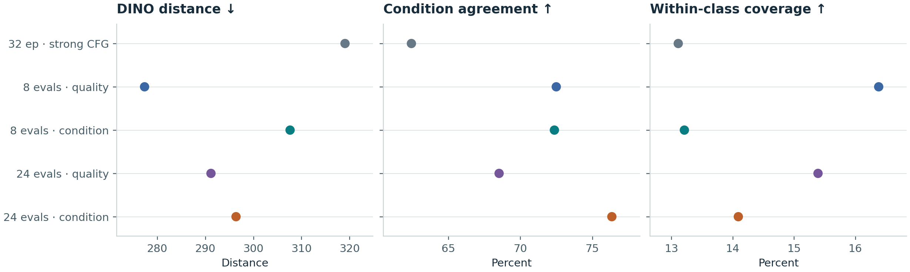

## 四步采样中的频谱校正

小船的轮廓与水面纹理都写在同一张 32 × 32 图里，但对应的空间尺度不同。只用四步生成，能否在每次更新后检查不同尺度的能量，让它们沿着真实训练图的加噪过程变化？Gihoon Kim 和 Taesup Kim 在《Correcting Guided Diffusion Trajectories with Spectral Alignment》中提出 Spectral Correction Guidance，以前向过程的参考频谱校正引导采样。我们取这项工作的径向功率校正思路，把参考曲线换成 CIFAR-10 直线流的解析表达。每步只增加一对正、逆傅里叶变换。[论文首稿，2026-10-02](https://arxiv.org/abs/2610.02753) · [本地实现](spectral_guidance.py)

先用 50,000 张真实训练图估计 12 个径向频带的平均功率。用正交归一化的傅里叶变换，单位白噪声在每个频带的期望功率是 1。对独立抽取的噪声与图像，时刻 t 的参考功率因而为 (1−t)² + t²P，其中 P 是干净训练图在该频带的平均功率。每次欧拉更新后，把同一频带的傅里叶系数乘以「参考功率 / 当前功率」的 s/2 次方，三个通道共用这一增益，并保留直流分量和各位置的相位。[训练集十类功率](outputs/spectral_guidance/class_power.npy) · [选型协议](outputs/spectral_guidance/protocol.json)

在已经锁定的 52 轮后验目标、四步、w＝1.75、α＝0.9 的模型上，另抽 1,600 个噪声，只与训练参照比较。在强度 0、0.05、0.15、0.35、0.65 中，同时考察按类别和全体训练图统计的两种参考，共 9 个设置。按 192 维投影特征的分布距离选出全局参考、s＝0.35，距离从 38.94 降到 36.65。将强度推到 0.65 后，全局频谱误差继续从 0.120 降到 0.059，而特征距离回升到 37.09。校准中对频谱的约束继续加强，图像的语义特征却开始偏离训练分布。[九组校准数据](outputs/spectral_guidance/sweep.csv) · [锁定设置](outputs/spectral_guidance/selection.json)

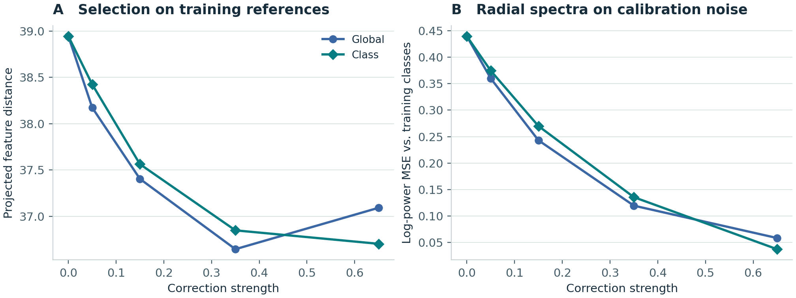

| 生成噪声种子 | 四步采样 | 测试 FID ↓ | 测试 KID × 1000 ↓ | IS ↑ | 条件一致率 ↑ |
|---|---|---:|---:|---:|---:|
| 109 | 原始 | 50.5515 | 19.02 | 7.15 | 80.32% |
| 109 | 频谱校正 | **48.3983** | **18.17** | **7.19** | **80.46%** |
| 27619 | 原始 | 50.2139 | 18.97 | **7.37** | 80.56% |
| 27619 | 频谱校正 | **48.5088** | **18.15** | 7.36 | **80.93%** |

每个种子内使用相同的 10,000 张初始噪声、相同类别和相同网络权重，与完整 10,000 张 CIFAR-10 测试图比较。两批噪声的 FID 分别下降 2.1532 和 1.7050，分类头分别多判对 14 和 37 张。第二批噪声下 IS 与第一批的变化方向不同，分布距离的改善则在两批中都出现了。该重复测量改变的是生成噪声，权重来自同一次训练。[第一批配对结果](outputs/spectral_guidance/paired_metrics.csv) · [第二批配对结果](outputs/spectral_guidance/repeat/metrics.csv) · [新噪声锁定记录](outputs/spectral_guidance/repeat/protocol.json) · [可编辑 SVG](figures/spectral_guidance.svg)

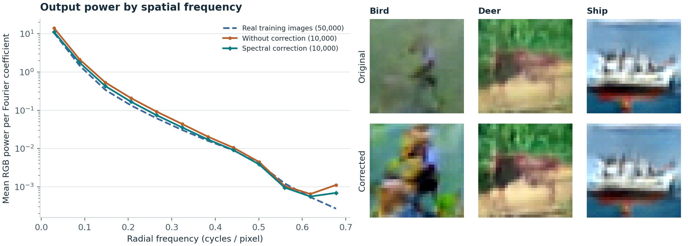

从全部 10,000 张生成图取均值，最低频带的功率从 14.15 降至 11.19，接近真实训练图的 10.58。最高频带从 0.00112 降至 0.00069，仍高于真实的 0.00027。第十频带原本就比训练图弱，校正后又降了一点。图中鸟、鹿和船分别取编号 2、4、8，前后两行共享起始噪声。[频带统计](outputs/spectral_guidance/profiles.csv) · [配对样本索引](outputs/spectral_guidance/profiles_gallery.csv) · [可编辑 SVG](figures/spectral_profiles.svg)

### 更换真实图像参照后，采样器的排序是否稳定？

CIFAR-10.1 v6 按原 CIFAR-10 的收集思路重新取样，含 2,000 张图，每类 200 张。逐张比较 RGB 像素，v6 与本次使用的原始 50,000 张训练图和 10,000 张测试图均无完全重复。我们保留四种已锁定模型的生成图，并从原测试集固定抽取每类 200 张，比较同一批生成图到新旧两个参照集的距离。[数据集原始研究，2018-06-01](https://arxiv.org/abs/1806.00451) · [扩展论文，ICML 2019](https://proceedings.mlr.press/v97/recht19a.html) · [作者发布的 v6 数据](https://github.com/modestyachts/CIFAR-10.1/tree/d9982abb0bfc4846b8d13a11e66b887d946205d0/datasets) · [像素核查](outputs/external_cohort/encoder.json)

每种生成器使用相同的 10,000 个带标签噪声起点，按类别均分成五组，每组 2,000 张。每组分别与两个完整参照计算 2,048 维 Inception 特征的三次多项式 KID，取五组均值。表中为 **KID × 1,000**，数值越低越好，括号给出 95% 区间。区间来自 1,000 次类内重抽样，模型之间共享生成索引，五组共享同一次真实参照重抽样。区间刻画给定权重下的图像抽样波动。KID 沿用 Bińkowski 等人 2018-01-04 公开、发表于 ICLR 2018 的估计量，有限样本的估计值可略低于零。[KID 论文](https://arxiv.org/abs/1801.01401) · [划分与重抽样方案](outputs/external_cohort/protocol.json)

| 样本来源 | CIFAR-10 原测试集，匹配 2,000 张 | CIFAR-10.1 v6，全部 2,000 张 |
|---|---:|---:|
| 真实训练图对照 | −0.06 [−0.13, 0.03] | 1.69 [1.28, 2.11] |
| 历史 32 轮，仅改时间采样，强引导 | 32.89 [31.68, 34.12] | 32.28 [31.03, 33.61] |
| 历史 44 轮，联合训练，常规引导 | 44.96 [43.43, 46.56] | 40.13 [38.64, 41.58] |
| 4 个欧拉更新，8 次分支求值 | **18.66 [17.84, 19.59]** | **19.09 [18.14, 20.05]** |
| 12 个欧拉更新，24 次分支求值 | 25.63 [24.61, 26.68] | 25.65 [24.47, 26.97] |

真实训练图对两个参照的 KID 相差 1.74 [1.33, 2.17]。尽管如此，四种生成器的排序在两个参照上一致。在 v6 上，8 次和 24 次分支求值的方案相对历史 32 轮分别降低 **13.20 [12.56, 13.84]** 和 **6.64 [6.09, 7.16]**。拆到类别，8 次求值方案的青蛙下降 36.68，飞机上升 3.99。每个类别仅有 200 张真实图，这些类内差值作为描述性结果。[完整配对差](outputs/external_cohort/contrasts.csv) · [逐类及分组结果](outputs/external_cohort/by_class.csv)

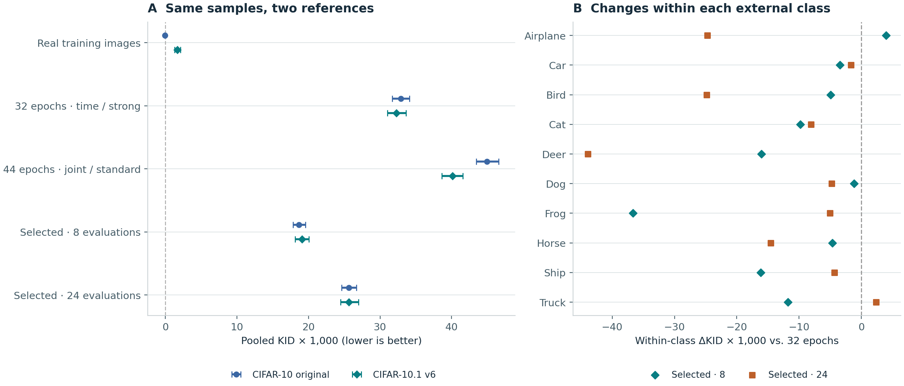

**后追加的频谱校正对照。** 在训练参照和另取的 1,600 个噪声起点上确定全局频谱校正强度 0.35，随后把校正前后两套 8 次求值结果按上述索引直接配对。校正后，原测试参照 KID 为 **17.95 [17.17, 18.72]**，比校正前降低 **0.71 [0.39, 1.02]**。v6 上为 **17.35 [16.54, 18.21]**，降低 **1.74 [1.43, 2.05]**。这项对照固定权重、积分预算、生成噪声和真实参照，仅切换频谱校正。[训练参照选定参数](outputs/spectral_guidance/selection.json) · [追加对照锁定记录](outputs/external_cohort/supplement_lock.json) · [配对结果](outputs/external_cohort/supplement_contrasts.csv) · [可编辑 SVG](figures/cohort_reference_kid.svg)

## 冻结 32 轮模型后，能把采样缩短到几步？

保留只改时间采样的第 32 轮权重和 w＝3.0，把计算仅花在学习如何组合已有速度上。Frankel 等人的 S4S 通过匹配高预算教师的结果来学习少步求解器；Oganov 等人的 GAS 进一步研究了如何组合初始噪声和历史预测，并使用对抗目标改善细节。这里借用教师匹配与历史组合，在固定均匀时间点上逐步做带欧拉先验的岭回归；训练数据由旧模型自己生成，损失只有像素匹配项。再将速度场拆为 4 × 4 像素块的均值和块内细节，分别学系数，检验一组标量是否足以兼顾轮廓与纹理。[S4S 首稿，2025-02-24](https://arxiv.org/abs/2502.17423) · [ICML 2025 版《S4S: Solving for a Fast Diffusion Model Solver》](https://proceedings.mlr.press/v267/frankel25a.html) · [《GAS: Improving Discretization of Diffusion ODEs via Generalized Adversarial Solver》，首稿 2025-10-20，ICLR 2026](https://arxiv.org/abs/2510.17699) · [训练与系数组合实现](learned_solver.py)

第一位教师用显式中点法走 24 步，每张图顺序调用引导速度 48 次。用 1,200 组带标签噪声拟合，另用 400 组验证，考察 2、4、8 次速度调用。下表每次调用同时运行有类别和空类别两条分支，4 次调用就是前文的 8 次分支求值。每档先按验证集的教师端点像素均方误差选出方案，再在同一万组新噪声上报告 FID 与条件一致率。三个预算均选中两频带模型。[实验协议](outputs/learned_solver/protocol.json) · [验证集九组结果](outputs/learned_solver/validation.csv) · [锁定记录](outputs/learned_solver/selection.json)

| 引导速度调用（分支求值） | 配置 | 验证集端点 MSE ↓，对 48 次教师 | 测试 FID ↓ | 条件一致率 ↑ |
|---|---|---:|---:|---:|
| 2（4） | 标准欧拉 | 0.13070 | 172.07 | 44.31% |
| 2（4） | 两频带、48 次教师 | 0.06155 | 123.72 | 40.03% |
| 4（8） | 标准欧拉 | 0.07040 | 76.79 | 66.47% |
| 4（8） | 单组历史系数、48 次教师 | 0.01937 | 81.23 | 62.23% |
| 4（8） | 两频带、48 次教师 | 0.01772 | 84.25 | 59.90% |
| 8（16） | 标准欧拉 | 0.02747 | 63.77 | 68.60% |
| 8（16） | 两频带、48 次教师 | 0.00300 | 78.23 | 60.50% |
| 48（96） | 中点教师本身 | — | 75.55 | 60.00% |

两步欧拉的残余噪声很多，分频带拟合有 48.35 FID 的收益。四步和八步时，标准欧拉本身已更强，学生在验证集越来越接近教师，测试 FID 却分别高出同预算欧拉 7.46 和 14.46。教师自己的 FID 为 75.55，八步欧拉已做到 63.77。把教师的离散轨迹拟合得更准，并不保证追上更好的真实图像分布。[逐设置的一万张图及完整指标](outputs/learned_solver/evaluation/metrics.csv) · [逐图端点误差](outputs/learned_solver/validation_images.csv)

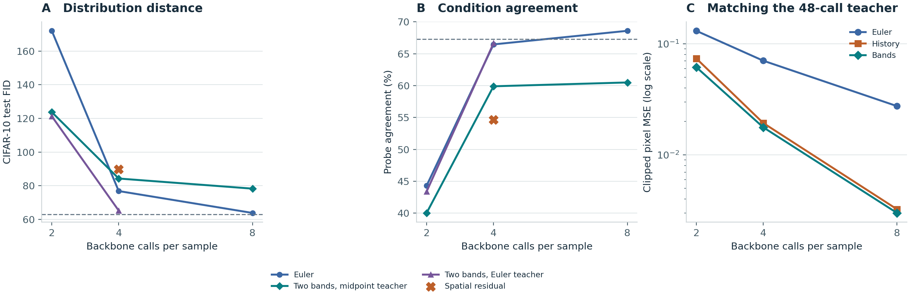

### 增加空间残差，还是更换教师轨迹？

Kim 等人在《Learning to Solve Generative ODEs Beyond the Linear Span》中指出，标量重组只能到达历史速度张成的线性空间，并在 SpanLift 中用神经算子预测空间残差。四步模型也许缺少恢复边缘所需的空间自由度，可以直接在它的端点上验证这个猜想。以两频带四步结果为底，拼接它的端点、起始噪声和四次速度，在最后一步额外加一个轻量残差网络。逐像素与 3 × 3 深度卷积两种方案各以 17、73 两个种子训练 24 轮，取两套预测的均值。这项计算保留四次骨干网络调用，另有两个小残差头的前向。[SpanLift 首稿，2026-06-07](https://arxiv.org/abs/2606.08672) · [残差网络](solver_residual.py) · [训练协议](outputs/learned_solver/residual/protocol.json)

使用缓存输入时，基础模型、逐像素头、空间头的验证 MSE 依次为 0.01778、0.01530、0.01386。每个空间头有 4,371 个可训练参数，验证协议选中了空间头。另在同一 400 个噪声上按推理路径重新运行骨干，逐图误差也已保存。与真实图像比较，基础模型的 FID 是 84.25，逐像素头和空间头分别为 91.15 和 89.82。增加空间自由度的确改善了模仿，但它也忠实保留了这位教师的偏差。[缓存验证结果](outputs/learned_solver/residual/validation.csv) · [实际推理逐图复验](outputs/learned_solver/residual/deployment_validation.csv) · [残差头选择](outputs/learned_solver/residual/selection.json)

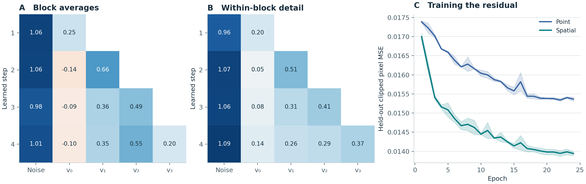

随后固定两频带、均匀时间点与 1,200 / 400 组拟合及验证噪声，改为模仿原本部署的 **12 次欧拉**。它的测试 FID 为 62.95，比 48 次中点教师的 75.55 更好。学生的两步与四步预算在这次追加实验计分前确定。相对新教师，四步标准欧拉、蒸馏旧教师、蒸馏新教师的验证 MSE 依次为 0.02442、0.01148、0.00478。[追加实验约定](outputs/learned_solver/short_teacher/protocol.json) · [三种方法对同一新教师的误差](outputs/learned_solver/short_teacher/validation.csv) · [短教师实验](solver_target.py)

| 首先固定的学生预算 | 标准欧拉 FID | 模仿 48 次中点 FID | 模仿 12 次欧拉 FID | 模仿 12 次欧拉的条件一致率 |
|---|---:|---:|---:|---:|
| 2 次调用（4 次分支） | 172.07 | 123.72 | **121.27** | 43.39% |
| 4 次调用（8 次分支） | 76.79 | 84.25 | **65.17** | 66.65% |

同模型、同四次调用下，仅更换目标轨迹，FID 就从 84.25 降到 65.17，也比四步标准欧拉低 11.63。两类教师的选择来自先前实验，追加对照检验这条更好的采样路径能否压缩。它与后验训练主模型使用不同权重。下图按噪声编号 0–9 依次展示十类图像，所有行共享同一批起点。十二组求解器均已从各自系数或权重复现首 50 张图，并从一万张特征重算 FID。[两频带四步系数](outputs/learned_solver/short_teacher/short_4.json) · [图中样本索引](outputs/learned_solver/gallery.csv) · [核验记录](outputs/learned_solver/verification.json)

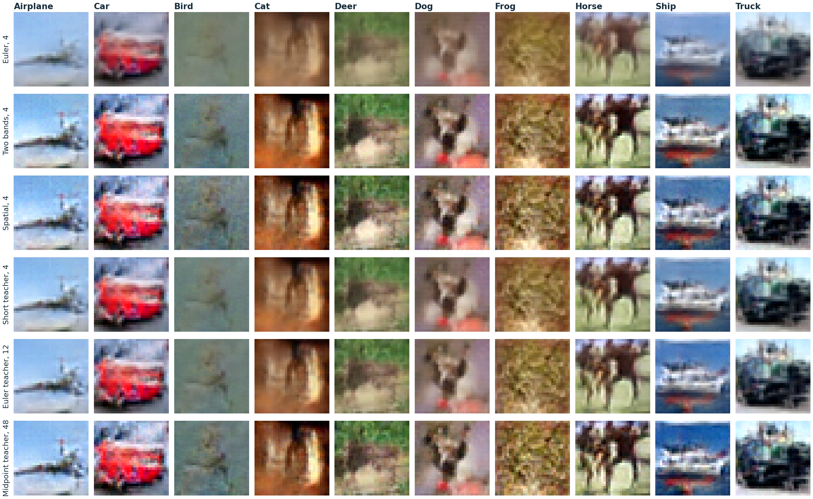

[质量与成本 SVG](figures/solver_quality_cost.svg) · [训练与系数 SVG](figures/solver_coefficients.svg) · [配对样本 SVG](figures/solver_matched_gallery.svg)

## 结论

时间采样、训练目标和推理校正解决的是三个相互关联的问题。32 轮等预算比较中，多给路径中段分配训练样本便能把 FID 从 71.94 降到 65.80。52 轮时，给速度目标加上 EMA 估计的类别差，同为单分支八步的条件一致率从 34.94% 升至 69.28%。到了四步部署，速度历史外推配合适度引导，分布和可辨认度还可进一步改善。追加频谱校正后，两批独立噪声的 FID 都低于 49；换成 CIFAR-10.1 的 2,000 张真实图作参照，KID 仍然下降。

类别识别和场景覆盖之间仍有取舍。未加频谱校正时，8 次分支求值的质量设置在 DINO 上覆盖了 16.38% 的真实图像同类邻域，比前一轮多覆盖 327 张；同计算量加强类别引导，又少覆盖 317 张。少步蒸馏也有相似的目标选择问题：相同的四步学生，模仿 48 次中点教师得到 FID 84.25，模仿 12 次欧拉教师却能做到 65.17。选教师时，它自身生成的样本质量，比它解了多少步更能解释这组差距。

## 复现实验与读取产物

在项目根目录激活 `ml-course` 环境。以下命令按阶段排列，已有相应权重和特征时可直接运行该阶段的核验与单图生成。

### 基线、32 轮消融与 44 轮续训

从空目录复跑时，先用 `experiment4.download`、`experiment4.train`、`experiment4.evaluate`、`experiment4.visualize` 准备基础权重、真实特征和基线图表。

```bash
python -m experiment4.teacher_features
python -m experiment4.research_train --arms control time align combined extended
OPENBLAS_NUM_THREADS=4 python -m experiment4.research_evaluate
python -m experiment4.research_visualize
OPENBLAS_NUM_THREADS=4 python -m experiment4.research_verify
python -m experiment4.research_verify --scenario time_12 --class-id 8 --seed 810 --generate /tmp/cifar_ship.png
```

在上述采样结果齐备后，运行以下命令可用实验三共享的 DINOv2 编码器重建独立特征库、近邻结果和三幅图。编码结果按原始像素的 SHA256 缓存。[评测源码](semantic_evaluation.py)

```bash
python -m experiment4.semantic_evaluation extract
python -m experiment4.semantic_evaluation measure
python -m experiment4.semantic_evaluation figure
```

[主设置 EMA 与优化器](outputs/research/combined/flow.pt) · [引导 1.6 时等预算最低 FID 的权重](outputs/research/time/flow.pt) · [44 轮权重](outputs/research/extended/flow.pt) · [完整训练日志](outputs/research/training.log) · [核验记录](outputs/research/verification.json) · [绘图与配对分析源码](research_visualize.py)。每个评测目录保存 10,000 × 3 × 32 × 32 的 uint8 图像、2,048 维 Inception 特征、logits 和逐图条件预测。核验脚本为每个设置从权重与固定噪声重新生成首 100 张图，并从完整特征重新计算测试 FID、KID、IS 和探针一致率。同名 SVG 保留各图的可编辑文字和矢量坐标轴。[新图目录](figures)

### 后验目标、速度历史与频谱校正

依次重建普通与后验两条等轮数训练、额外计算量对照、训练参照选型及最终评测。频谱选型固定第一阶段已选中的四步设置。

```bash
python -m experiment4.guidance_train control
python -m experiment4.guidance_train model_guidance
python -m experiment4.guidance_train compute_control
python -m experiment4.guidance_eval calibrate
python -m experiment4.guidance_eval test
python -m experiment4.guidance_eval compute-test
python -m experiment4.guidance_probe
python -m experiment4.guidance_semantics
python -m experiment4.guidance_figures
python -m experiment4.guidance_verify
python -m experiment4.guidance_verify --method nfe8_quality --generate /tmp/cifar_ship.png --class-id 8 --seed 123
```

[后验模型权重、优化器与 EMA](outputs/guidance/model_guidance/flow.pt) · [主设置的一万张生成图](outputs/guidance/test/model_guidance_n4_w1.75_a0.9/images.npy) · [原始特征与重生成核验](outputs/guidance/verification.json)


```bash
python -m experiment4.spectral_guidance select
python -m experiment4.spectral_guidance test
python -m experiment4.spectral_guidance repeat
python -m experiment4.spectral_guidance figure
python -m experiment4.spectral_guidance sample --class-id 8 --seed 123 --output /tmp/cifar_spectral_ship.png
```

[第一批一万张校正图像](outputs/spectral_guidance/test/images.npy) · [独立噪声逐样本预测](outputs/spectral_guidance/repeat/per_sample.csv)

### 旧模型的少步求解器

```bash
python -m experiment4.learned_solver teacher
python -m experiment4.learned_solver train
python -m experiment4.solver_residual cache
python -m experiment4.solver_residual train
python -m experiment4.solver_target
python -m experiment4.learned_solver_evaluate evaluate
python -m experiment4.learned_solver_evaluate verify
python -m experiment4.solver_figures
python -m experiment4.learned_solver_evaluate sample --method short_4 --class-id 8 --seed 123 --output /tmp/cifar_solver_ship.png
```

### CIFAR-10.1 v6 外部参照

外部队列复用已锁定模型的 CIFAR-10 生成图。补充对照读取频谱校正结果，共用相同的真实参照与抽样索引。

```bash
python -m experiment4.external_cohort download
python -m experiment4.external_cohort extract
python -m experiment4.external_cohort score
python -m experiment4.external_cohort verify
python -m experiment4.external_cohort freeze-supplement
python -m experiment4.external_cohort supplement
python -m experiment4.external_cohort verify-supplement
python -m experiment4.external_cohort figure
```

[三个实验的论文出处、首稿日期与选择理由](../method-origins.md)
